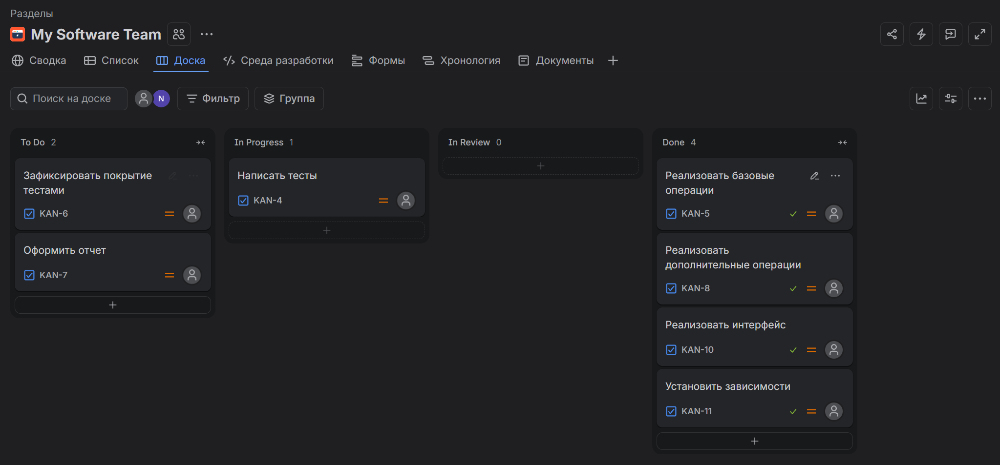
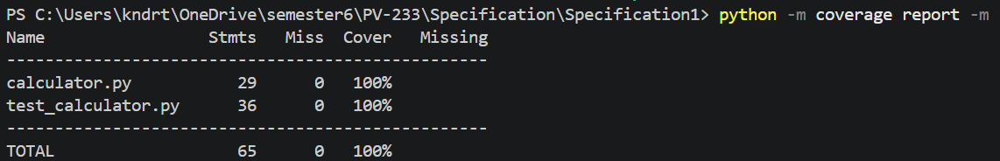
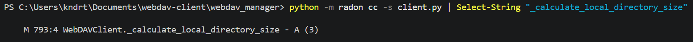

# Лабораторная работа №1 <br> Критерии качества ПО: сложность, корректность, надёжность, трудоёмкость. Оценка качества ПО.
## Цель работы

Освоить практические методы оценки качества и метрик программного обеспечения.

## Задание:

### Часть 1. Теоретическая

1. Опишите 3 наиболее значимые проблемы, возникающие при разработке сложных программных систем.
2. Составьте таблицу: «Проблема → Возможное решение → Инструменты/методы».

### Часть 2. Практическая

1. Создайте тестовый проект на Python (например, калькулятор).
2. Создайте задачи для проекта в Аспро (или другой системе трекинга).
3. Покройте код тестами (Unit tests).
4. Зафиксируйте покрытие тестами кода (например, с помощью coverage.py).
5. Возьмите небольшой программный проект (учебное консольное приложение или открытый код с GitHub).
6. Определите размер ПО (LOC).
7. Рассчитайте цикломатическую сложность одной из функций (можно использовать `radon cc -s calculator`).
8. Оцените дефектность (если есть баг-репорты или замечания).
9. Составьте итоговую таблицу метрик проекта, включающую:
   - размер (LOC),
   - сложность (цикломатическая),
   - качество (дефекты),
   - время реакции (если есть возможность),
   - процент покрытия тестами.

## Выполнение

### Часть 1. Теоретическая

1. Опишите 3 наиболее значимые проблемы, возникающие при разработке сложных программных систем.

    1\) Рост сложности и связности системы. 

    Сложная система состоит из большого числа модулей, между которыми существует множество прямых и обратных зависимостей. Из-за этого разработчику трудно удерживать в голове всю картину: чтобы внести изменение в одном месте, приходится проверять, как оно отразится на остальных частях. Постепенно растёт время на анализ кода, увеличивается число регрессионных ошибок, а новые возможности добавляются всё медленнее.

    2\) Неопределённость и изменчивость требований.

    На начальном этапе проекта требования, как правило, известны не полностью: заказчик может неточно представлять конечный результат, а часть деталей выясняется уже в процессе разработки. При этом стоимость исправления ошибки на этапе эксплуатации значительно выше, чем на этапе проектирования.

    3\) Оценка сроков и планирование.

    Оценка трудоёмкости сложной системы всегда содержит неопределённость: заранее неизвестен полный объём работ, возможны технические сложности и изменения требований. Кроме того, исполнители склонны недооценивать сроки, ориентируясь на наиболее благоприятный сценарий. В результате сроки срываются, а качество снижается из-за сокращения времени на тестирование и рефакторинг.

2. Составьте таблицу: «Проблема → Возможное решение → Инструменты/методы».

| Проблема | Возможное решение | Инструменты/методы |
|---|---|---|
| Рост сложности и связности системы | Разделение системы на слабо связанные модули по бизнес-границам, фиксация архитектурных решений и контроль зависимостей | Domain-Driven Design, C4-модель, ADR |
| Неопределённость и изменчивость требований | Итеративная разработка: уточнение требований по мере выполнения и регулярная проверка результата с заказчиком | Agile/Scrum, User Story Mapping, MVP и прототипирование |
| Оценка сроков и планирование | Вероятностные диапазоны вместо точных дат, резерв времени на риски | Story Points и Planning Poker, метрики velocity/throughput, Monte Carlo-симуляция |

### Часть 2. Практическая

1. Создайте тестовый проект на Python (например, калькулятор).

``` python
import math


def add(a: float, b: float) -> float:
    return a + b


def subtract(a: float, b: float) -> float:
    return a - b


def multiply(a: float, b: float) -> float:
    return a * b


def divide(a: float, b: float) -> float:
    return a / b


def power(a: float, b: float) -> float:
    return a ** b


def square_root(a: float) -> float:
    return math.sqrt(a)


def percent(value: float, percent_value: float) -> float:
    return value * percent_value / 100


def calculate(a: float, b: float, operation: str) -> float:
    if operation == "add":
        return add(a, b)
    if operation == "subtract":
        return subtract(a, b)
    if operation == "multiply":
        return multiply(a, b)
    if operation == "divide":
        return divide(a, b)
    if operation == "power":
        return power(a, b)
    if operation == "percent":
        return percent(a, b)
    raise ValueError(f"Unknown operation: {operation}")
```

2. Создайте задачи для проекта в Аспро (или другой системе трекинга).



3. Покройте код тестами (Unit tests).

``` python
import math

import pytest

from calculator import (
    add,
    calculate,
    divide,
    multiply,
    percent,
    power,
    square_root,
    subtract,
)


@pytest.mark.parametrize(
    "a, b, expected",
    [
        (2, 3, 5),
        (-2, -3, -5),
        (0, 0, 0),
        (1.5, 2.5, 4.0),
    ],
    ids=["positive", "negative", "zeros", "floats"],
)
def test_add(a, b, expected):
    assert add(a, b) == pytest.approx(expected)


@pytest.mark.parametrize(
    "a, b, expected",
    [
        (5, 3, 2),
        (3, 5, -2),
        (0, 0, 0),
        (1.5, 0.5, 1.0),
    ],
    ids=["positive_result", "negative_result", "zeros", "floats"],
)
def test_subtract(a, b, expected):
    assert subtract(a, b) == pytest.approx(expected)


@pytest.mark.parametrize(
    "a, b, expected",
    [
        (2, 3, 6),
        (-2, 3, -6),
        (0, 100, 0),
        (1.5, 2, 3.0),
    ],
    ids=["positive", "negative", "zero", "floats"],
)
def test_multiply(a, b, expected):
    assert multiply(a, b) == pytest.approx(expected)


@pytest.mark.parametrize(
    "a, b, expected",
    [
        (6, 2, 3.0),
        (-6, 2, -3.0),
        (0, 5, 0.0),
        (1, 4, 0.25),
    ],
    ids=["positive", "negative", "zero_dividend", "fraction"],
)
def test_divide(a, b, expected):
    assert divide(a, b) == pytest.approx(expected)


def test_divide_by_zero():
    with pytest.raises(ZeroDivisionError):
        divide(1, 0)


@pytest.mark.parametrize(
    "a, b, expected",
    [
        (2, 3, 8),
        (2, 0, 1),
        (9, 0.5, 3.0),
        (-2, 3, -8),
    ],
    ids=["positive", "zero_exponent", "fractional", "negative_base"],
)
def test_power(a, b, expected):
    assert power(a, b) == pytest.approx(expected)


@pytest.mark.parametrize(
    "a, expected",
    [
        (9, 3.0),
        (0, 0.0),
        (2, math.sqrt(2)),
    ],
    ids=["perfect_square", "zero", "irrational"],
)
def test_square_root(a, expected):
    assert square_root(a) == pytest.approx(expected)


def test_square_root_negative():
    with pytest.raises(ValueError):
        square_root(-1)


@pytest.mark.parametrize(
    "value, percent_value, expected",
    [
        (200, 10, 20.0),
        (100, 0, 0.0),
        (50, 50, 25.0),
    ],
    ids=["ten_percent", "zero_percent", "half"],
)
def test_percent(value, percent_value, expected):
    assert percent(value, percent_value) == pytest.approx(expected)


@pytest.mark.parametrize(
    "a, b, operation, expected",
    [
        (2, 3, "add", 5),
        (5, 3, "subtract", 2),
        (2, 3, "multiply", 6),
        (6, 2, "divide", 3.0),
        (2, 3, "power", 8),
        (200, 10, "percent", 20.0),
    ],
    ids=["add", "subtract", "multiply", "divide", "power", "percent"],
)
def test_calculate_dispatch(a, b, operation, expected):
    assert calculate(a, b, operation) == pytest.approx(expected)


def test_calculate_unknown_operation():
    with pytest.raises(ValueError):
        calculate(1, 2, "mod")
```

4. Зафиксируйте покрытие тестами кода (например, с помощью coverage.py).



5. Возьмите небольшой программный проект (учебное консольное приложение или открытый код с GitHub).

    Выбран курсовой проект: клиент для управления файловыми хранилищами по протоколу WebDAV.

6. Определите размер ПО (LOC).

    Размер проекта составляет 2203 строки.

7. Рассчитайте цикломатическую сложность одной из функций (можно использовать `radon cc -s calculator`).

    Выбрана функция def _calculate_local_directory_size(self, local_directory: str) -> int выполняющая подсчет размера локальной директории.

    ``` python
    def _calculate_local_directory_size(self, local_directory: str) -> int:
        total_size = 0
        for current_root, _, files in os.walk(local_directory):
            for file_name in files:
                total_size += os.path.getsize(os.path.join(current_root, file_name))
        return total_size
    ```

    

    Категория A говорит о простой логике с малым числом ветвлений.

8. Оцените дефектность (если есть баг-репорты или замечания).

    В ходе ручного тестирования основных пользовательских сценариев явных дефектов не выявлено.

9. Составьте итоговую таблицу метрик проекта, включающую:
   - размер (LOC),
   - сложность (цикломатическая),
   - качество (дефекты),
   - время реакции (если есть возможность),
   - процент покрытия тестами.

    Клиент для управления файловыми хранилищами по протоколу WebDAV

    | Метрика | Значение | Описание |
    |---|---|---|
    | Размер (LOC) | 2203 | |
    | Сложность (цикломатическая) | 3 | Для функции _calculate_local_directory_size |
    | Качество (дефекты) | 0 | |
    | Время реакции | - | |
    | Процент покрытия тестами | - | |

    calculator.py

    | Метрика | Значение | Описание |
    |---|---|---|
    | Размер (LOC) | 45 | |
    | Сложность (цикломатическая) | 7 | Максимальное значение |
    | Качество (дефекты) | 0 | |
    | Время реакции | - | |
    | Процент покрытия тестами | 100% | |

## Вывод

В ходе лабораторной работы были освоены практические методы оценки качества и метрик программного обеспечения.