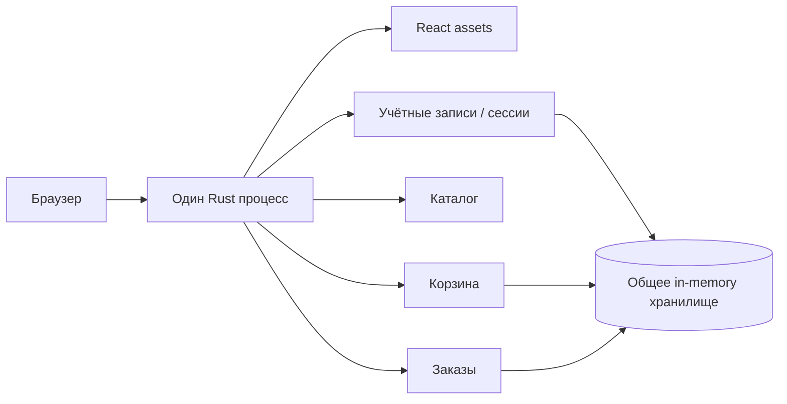
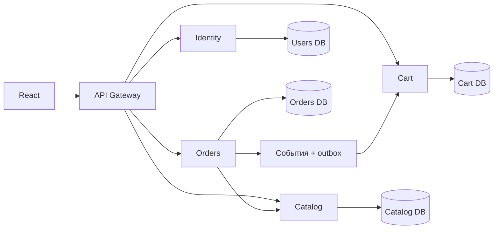
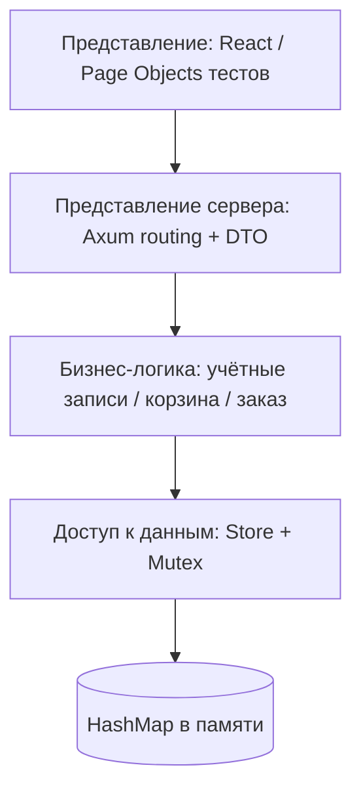

# Анализ требований и организация разработки Moroz Store

**Дисциплина:** Архитектура, проектирование и ППС.
**Основание:** `Specification/Total.md`. **Выполнил:** Мороз Роман, ПВ-233.
**Дата:** 26.11.2026. **Проект:** учебный интернет-магазин Moroz Store.

## Цель и описание

Спроектировать пользовательскую информационную систему, сравнить три
архитектурных модели, сформировать требования, роли и управляемый план работ.

Система позволяет покупателю найти товар, зарегистрироваться, войти,
сформировать корзину и оформить заказ с оплатой при получении.
Аудитория — покупатели учебного магазина и преподаватель, проверяющий
воспроизводимость сценариев. Решаемые проблемы: разрозненный каталог,
ручной расчёт стоимости, потеря состава корзины в ходе сессии, отсутствие
проверяемого процесса выпуска. Реальной оплаты и обработки персональных
данных покупателей в лабораторном контуре нет: используются синтетические данные.

Эксплуатация: один процесс на Linux, современный Chromium, HTTP на loopback,
одна локальная машина или изолированный CI runner, без внешней БД.
Данные намеренно хранятся в памяти и сбрасываются при перезапуске. Режим
подходит для обучения и тестов; постоянный коммерческий магазин — другой контур.

## Функциональные требования

| ID | Название | Действие / описание | Пользователь | Ожидаемый результат / проверка |
|---|---|---|---|---|
| FR-01 | Регистрация | Ввести имя, email и пароль 8–128 байт | Гость | HTTP 201; пароль хранится как Argon2 hash; UI-01, registration_rejects_invalid_input |
| FR-02 | Уникальность email | Повторить email с другим регистром | Гость | HTTP 409, вторая учётная запись не создаётся; UI-05 |
| FR-03 | Вход | Передать правильные email и пароль | Покупатель | Случайный bearer token на 1 час; неверные данные → 401; UI-01/02 |
| FR-04 | Каталог | Открыть список или карточку товара | Гость / покупатель | Три предопределённых товара; неизвестный ID → 404; health_and_catalog |
| FR-05 | Поиск | Ввести часть названия без учёта регистра | Гость / покупатель | Только совпавшие товары; пустой результат явно показан; UI-01/03 |
| FR-06 | Корзина | Выбрать размер и добавить 1–99 единиц | Покупатель | Товар в собственной корзине; цена и владелец определяются сервером; UI-01, quantity_size_and_missing_product |
| FR-07 | Удаление | Удалить собственную позицию | Покупатель | Позиция исчезает; чужая недоступна; UI-06, cart_and_orders_are_isolated_by_session |
| FR-08 | Заказ | Указать адрес и подтвердить непустую корзину | Покупатель | HTTP 201; сумма пересчитана сервером, заказ сохранён, корзина очищена; UI-01 |
| FR-09 | История | Открыть собственные заказы | Покупатель | Только свои заказы и серверные статусы Pending; checkout_uses_server_prices_and_clears_cart |
| FR-10 | Выход | Завершить сессию | Покупатель | Token отозван сервером, клиент очищен, повторный запрос → 401; UI-01, logout_revokes_token |

## Нефункциональные требования

| ID | Область | Измеримый критерий | Способ проверки / состояние |
|---|---|---|---|
| NFR-01 | Корректность | Все локальные unit/integration/E2E зелёные; нет непроверенного выпуска | CI, локальные протоколы; hosted CI ещё не запускался |
| NFR-02 | Надёжность | Заказ и очистка корзины атомарны в пределах процесса; ошибочный запрос не создаёт частичный заказ | Mutex охватывает обе операции; checkout и повтор пустой корзины |
| NFR-03 | Производительность | На лабораторном runner браузерный сценарий укладывается в 30 с | Timeout Playwright; это бюджет smoke-теста, не нагрузочный SLA |
| NFR-04 | Безопасность | Argon2; server-side auth и расчёт цены; срок token 1 ч; тело ≤16 КиБ | Rust integration, проверка expiration и body limit; npm critical/Bandit high/cargo audit/pip audit |
| NFR-05 | Сопровождаемость | Python coverage ≥80% (фактически gate 100%), Rust ≥80%; lint без ошибок | pytest-cov, cargo-llvm-cov, Ruff, Clippy, ESLint |
| NFR-06 | Масштабирование | Один instance; предельное количество позиции 99; при росте выделить repository и общую БД | Архитектурное ограничение явно зафиксировано; горизонтальное масштабирование текущего хранилища не заявляется |
| NFR-07 | Эксплуатация | Воспроизводимый запуск по README на Linux; lockfiles и версии инструментов | cargo --locked, uv --locked, npm ci; привязка по умолчанию 127.0.0.1 |

## Вариант 1. Монолит

Все HTTP-компоненты поставляются одним бинарным файлом; React собирается в
`TestingPS/Laba-3/frontend/dist`, обслуживаемый тем же процессом. Данные пользователя извлекаются
из серверной сессии. Транзакция заказа — критическая секция хранилища.
Развёртывание: распаковать бинарник и frontend, запустить из каталога пакета.

Плюсы: простой запуск, быстрые тесты, одна граница согласованности, мало
операционных расходов. Минусы: единый отказ процесса, потеря in-memory данных
при рестарте, общая блокировка ограничивает пропускную способность.

## Вариант 2. Микросервисы

| Сервис | Назначение и функции | Собственные данные | Связь |
|---|---|---|---|
| Identity | Регистрация, вход, отзыв сессии | Users, password hashes, sessions | HTTP к Gateway; проверка сессии |
| Catalog | Товары, цены, поиск, доступные размеры | Products | HTTP; Orders получает актуальные цены |
| Cart | Добавление, удаление, количества | Carts, items | HTTP; событие OrderCreated очищает корзину |
| Orders | Проверка заказа, серверная сумма, история | Orders, immutable order items | HTTP Catalog, события через брокер |

Базы изолированы; прямого чтения чужих таблиц нет. Согласованность заказа и
корзины требует idempotency key, outbox и повторяемой обработки событий.
Плюсы: независимые релизы и масштабирование. Минусы: распределённые отказы,
трассировка, схемы событий, больше инфраструктуры и интеграционных тестов.
Для трёх товаров и одного исполнителя такой подход неоправданно дорог.

## Вариант 3. Многослойная модель

Представление валидирует форму и формат HTTP, бизнес-слой задаёт ограничения
количеств, авторизацию и серверную сумму, доступ к данным изолирует коллекции
по пользователю. UI не обращается к хранилищу напрямую.
Page Object находится в тестовом коде и не является частью production приложения.
В текущем небольшом backend границы логические в `src/lib.rs`; отдельных
микросервисов или repository-интерфейса, которых нет в коде, здесь не заявляется.

**Выбор:** слоистый монолит. Монолитность описывает способ поставки, слои —
внутреннее разделение ответственности, поэтому эти характеристики совместимы.
При росте первым шагом станет выделение модулей и SQLite/PostgreSQL repository,
а не немедленное дробление на сервисы.

## Команда и ответственность

Фактический исполнитель лабораторной — **Мороз Роман**. Ниже проектное
распределение ролей для команды из четырёх человек; дополнительные фамилии
не выдумываются. В учебной работе исполнитель совмещает роли.

| Участник плана | Роли | Основные обязанности и задачи | Проверяемый результат |
|---|---|---|---|
| A | Руководитель + системный аналитик | Границы проекта, требования, риски, приёмка; S-01—S-04 | ТЗ, FR/NFR, Kanban |
| B | Frontend-разработчик | Формы, поиск, корзина, подтверждение; S-05—S-10 | Собираемый React UI, доступные имена элементов |
| C | Backend + разработчик данных | API, Argon2, сессии, авторизация, модель данных; S-11—S-16 | Rust backend, сериализация, изоляция данных |
| D | Тестировщик + DevOps | Тест-дизайн, pytest, HTTP/E2E, gates, отчёты; S-17—S-26 | Автотесты, два CI-конфига, доказательства прогонов |

Аналитик согласует критерии, разработчик реализует, тестировщик сверяет
поведение с независимыми ожиданиями. Реальный peer review в одиночной учебной
работе не имитируется: переходы Code Review означают требуемую проверку, а
не фиктивное одобрение другим человеком.

## Доска, техническое задание и вывод

[Kanban](kanban.md) содержит шесть обязательных колонок и более 20 задач
с ролями, зависимостями и критериями готовности. [ТЗ](technical-specification.md)
раскрывает назначение, условия, требования и порядок приёмки.

Требования связаны с конкретными автотестами и CI-порогами. Для учебного
масштаба слоистый монолит обеспечивает минимальную стоимость эксплуатации
при проверяемых границах ответственности. Микросервисы оставлены сравнительным
архитектурным вариантом, а не изображены как реализованная система.
