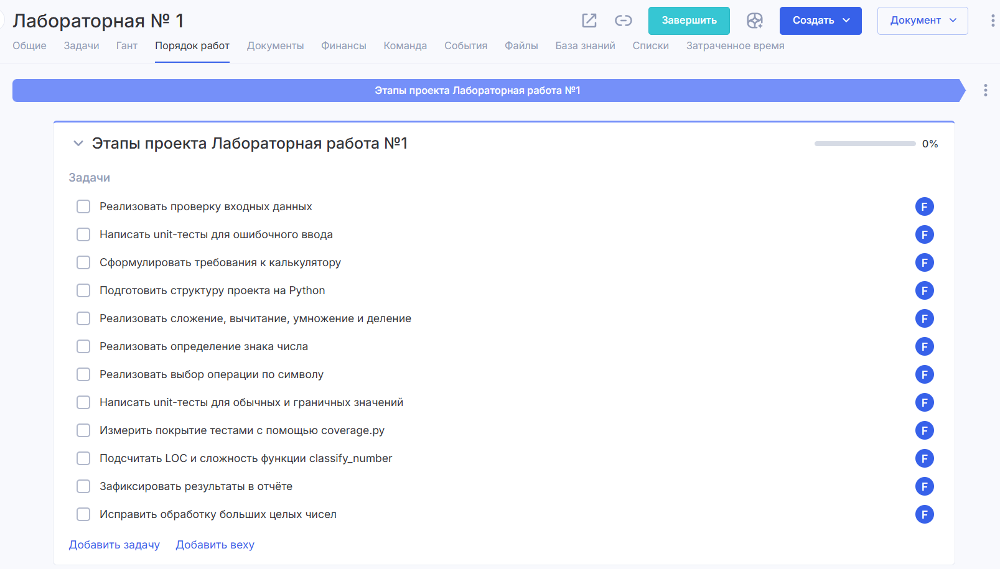
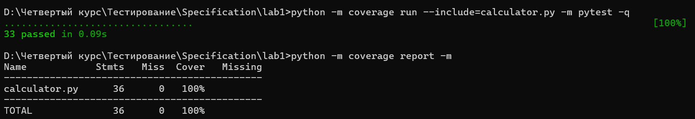
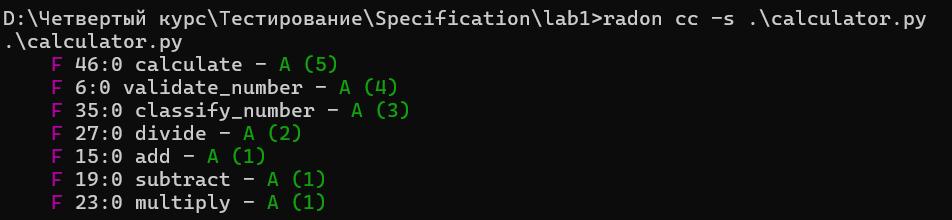

**МИНИСТЕРСТВО НАУКИ И ВЫСШЕГО ОБРАЗОВАНИЯ РОССИЙСКОЙ ФЕДЕРАЦИИ**

*ФЕДЕРАЛЬНОЕ ГОСУДАРСТВЕННОЕ БЮДЖЕТНОЕ ОБРАЗОВАТЕЛЬНОЕ УЧРЕЖДЕНИЕ ВЫСШЕГО ОБРАЗОВАНИЯ*

*«БЕЛГОРОДСКИЙ ГОСУДАРСТВЕННЫЙ ТЕХНОЛОГИЧЕСКИЙ УНИВЕРСИТЕТ им. В. Г. ШУХОВА» (БГТУ им. В. Г. Шухова)*

Кафедра программного обеспечения вычислительной техники и автоматизированных систем

 

# Лабораторная работа № 1

**Дисциплина** - Архитектура, проектирование и ППС  
**Тема** - Критерии качества ПО: сложность, корректность, надёжность, трудоёмкость. Оценка качества ПО.

 

Выполнила - Фатеева Марина Игоревна, группа ПВ-233 
Проверил - Доденко Олег Павлович

 

*Белгород, 2026*

---

## Цель работы

Освоить практические методы оценки качества и метрик программного обеспечения.

## 1. Теоретическая часть

| Проблема | Возможное решение | Инструменты и методы |
|---|---|---|
| Высокая сложность. Изменение одного модуля затрагивает зависимые компоненты и усложняет сопровождение | Разделить ответственность модулей и упростить ветвящиеся функции | Модульная архитектура, ревью кода, цикломатическая сложность |
| Дефекты на границах ввода и при отказах снижают корректность и надёжность | Проверять обычные, граничные и ошибочные сценарии | Unit-тесты, анализ граничных значений, анализ покрытия |
| Высокая трудоёмкость. Неясные требования и зависимости задач увеличивают объём переделок | Разбить работу на задачи с критериями готовности и отслеживать их выполнение | Kanban, трекер задач, оценка трудозатрат в человеко-часах |

## 2. Практическая часть

### 2.1. Проект и задачи

Объект тестирования и оценки - учебный калькулятор на Python. Модуль `calculator.py` выполняет четыре арифметические операции, определяет знак числа и проверяет входные данные.

В проекте «Лабораторная № 1» в Аспро.Cloud создано 12 задач.

### 2.2. Unit-тесты и покрытие

В `test_calculator.py` проверяются арифметика, выбор операции, знак числа, деление на ноль, недопустимые типы, бесконечности и NaN.

Тесты запущены через `pytest` с замером покрытия в `coverage.py`. Все **33 теста** прошли. Они выполнили **36 из 36 исполняемых строк** файла `calculator.py`. Покрытие по строкам составило **100 %**.

### 2.3. Размер и цикломатическая сложность

LOC (Lines of Code) - метрика размера программы в строках. В работе используется физический LOC: учитываются все строки `calculator.py`, включая пустые. Файл тестов в расчёт не входит. Для каждого диапазона количество строк считается по формуле «последний номер - первый номер + 1». Например, функция `validate_number` занимает строки с 6-й по 12-ю: 12 - 6 + 1 = 7.

| Строки | Содержимое | Количество |
|---|---|---:|
| 1, 3 | Описание модуля и импорт | 2 |
| 6–12 | `validate_number` | 7 |
| 15–16 | `add` | 2 |
| 19–20 | `subtract` | 2 |
| 23–24 | `multiply` | 2 |
| 27–32 | `divide` | 6 |
| 35–43 | `classify_number` | 9 |
| 46–57 | `calculate` | 12 |
| 2, 4–5, 13–14, 17–18, 21–22, 25–26, 33–34, 44–45 | Пустые строки | 15 |

**LOC = 2 + 7 + 2 + 2 + 2 + 6 + 9 + 12 + 15 = 57.** Без пустых строк: **57 - 15 = 42**.

В `classify_number` два условия (`x > 0` и `x == 0`), поэтому **V(G) = 2 + 1 = 3**.

В графе функции семь узлов: вызов проверки аргумента, два условия, три возврата и общий выход. Между узлами восемь рёбер, компонента связности одна. **V(G) = E - N + 2P = 8 - 7 + 2 × 1 = 3**. Рассмотрен поток управления внутри самой функции.

Radon подтвердил результат для `classify_number`: **A (3)**.

### 2.4. Дефектность и время реакции

Зарегистрирован дефект Q-14. Вызов `classify_number(10**400)` должен вернуть `positive`. Фактически возникает `OverflowError` при преобразовании целого числа в `float` внутри `math.isfinite`. Время первого ответа по карточке не фиксировалось.

### 2.5. Итоговые метрики

| Метрика | Значение |
|---|---|
| Размер | 57 LOC |
| Цикломатическая сложность `classify_number` | 3 |
| Зарегистрированные дефекты | 1 |
| Плотность зарегистрированных дефектов | 1 / 57 × 1000 ≈ 17,54 дефекта на 1000 строк |
| Время реакции на дефект | Нет данных |
| Покрытие исполняемых операторов | 100 % (36 из 36) |

## Заключение

Все 33 unit-теста пройдены. При покрытии операторов 100 % отдельной граничной проверкой выявлен дефект обработки больших целых чисел.
