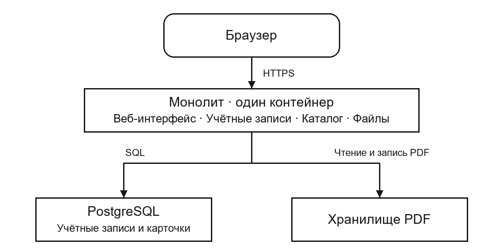
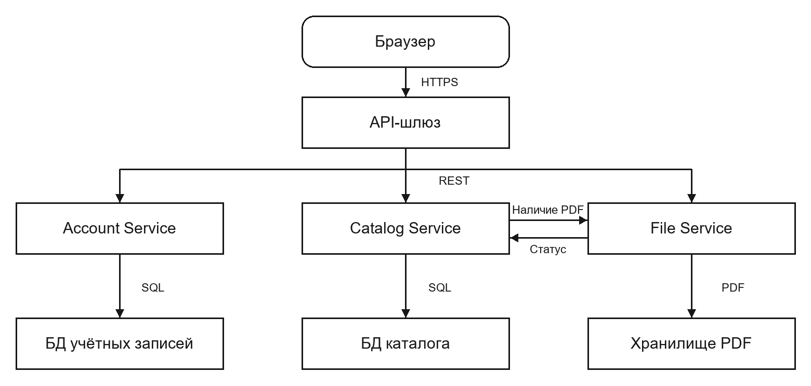
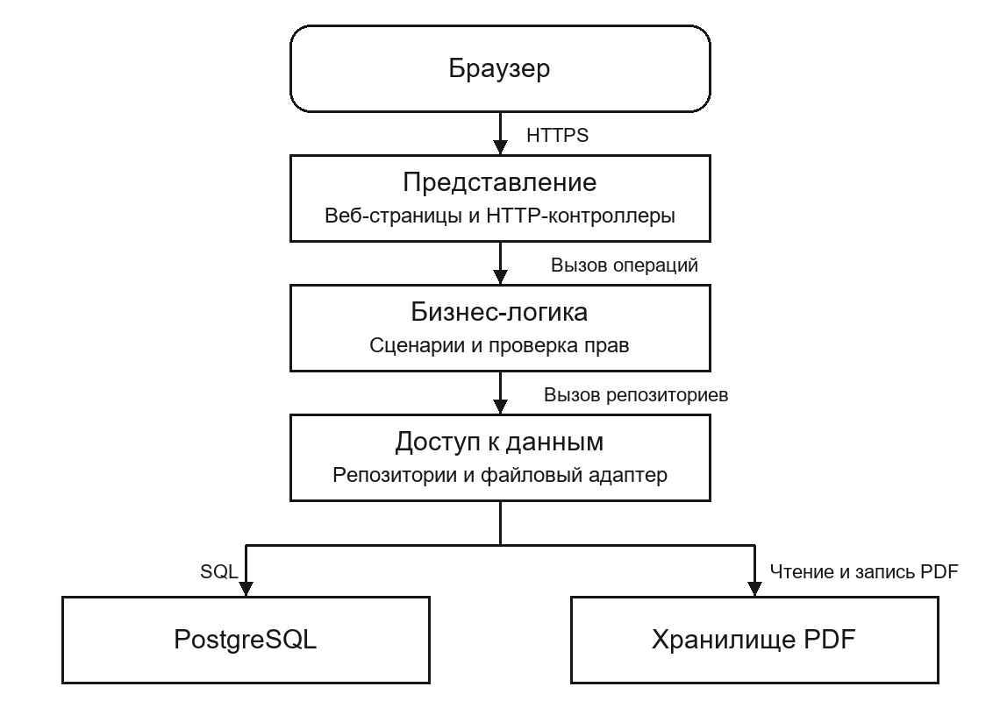

**МИНИСТЕРСТВО НАУКИ И ВЫСШЕГО ОБРАЗОВАНИЯ РОССИЙСКОЙ ФЕДЕРАЦИИ**

*ФЕДЕРАЛЬНОЕ ГОСУДАРСТВЕННОЕ БЮДЖЕТНОЕ ОБРАЗОВАТЕЛЬНОЕ УЧРЕЖДЕНИЕ ВЫСШЕГО ОБРАЗОВАНИЯ*

*«БЕЛГОРОДСКИЙ ГОСУДАРСТВЕННЫЙ ТЕХНОЛОГИЧЕСКИЙ УНИВЕРСИТЕТ им. В. Г. ШУХОВА» (БГТУ им. В. Г. Шухова)*

Кафедра программного обеспечения вычислительной техники и автоматизированных систем

 

# Лабораторная работа № 2

**Дисциплина** - Архитектура, проектирование и ППС  
**Тема** - Анализ требований, выбор архитектуры программного обеспечения и организация командной разработки

 

Выполнила - Фатеева Марина Игоревна, группа ПВ-233 
Проверил - Доденко Олег Павлович

 

*Белгород, 2026*

---

## Цель работы

Определить требования к информационной системе, сравнить архитектурные модели, составить техническое задание и распределить задачи разработки.

## 1. Описание проекта

| Параметр | Описание |
|---|---|
| Название | Электронная библиотека кафедры |
| Назначение | Предоставление доступа к учебным материалам кафедры через браузер |
| Аудитория | Студенты, преподаватели и библиотекари кафедры |
| Проблемы | Разрозненное хранение материалов, ручной поиск, отсутствие единого порядка публикации |
| Основные функции | Вход, поиск, просмотр карточек, скачивание файлов, публикация и архивирование материалов |
| Эксплуатация | Сервер кафедры под Linux, браузер на ПК или смартфоне, доступ по HTTPS из сети вуза или через VPN |

## 2. Требования

### Функциональные

| ID | Название | Описание | Пользователь | Ожидаемый результат |
|---|---|---|---|---|
| ФТ-01 | Вход | Ввести логин и пароль | Читатель, библиотекарь | Открывается доступ согласно роли |
| ФТ-02 | Поиск | Искать опубликованные материалы по названию и автору | Читатель | Отображаются совпадения или сообщение об их отсутствии |
| ФТ-03 | Просмотр карточки | Открыть результат поиска | Читатель | Отображаются название, автор, описание и ссылка на файл |
| ФТ-04 | Скачивание | Запросить PDF опубликованного материала | Читатель | Браузер получает файл |
| ФТ-05 | Публикация | Указать название, автора, описание и приложить PDF | Библиотекарь | Материал появляется в каталоге |
| ФТ-06 | Архивирование | Перевести опубликованный материал в архив | Библиотекарь | Карточка исчезает из поиска, прямое скачивание закрывается |

### Нефункциональные

| ID | Категория | Требование |
|---|---|---|
| НФТ-01 | Надёжность | Резервное копирование БД и файлов каждые 24 часа. При восстановлении из последней копии могут быть потеряны изменения, внесённые после её создания. Восстановление занимает не более 2 часов |
| НФТ-02 | Производительность | 95 % запросов поиска выполняются за 2 секунды или быстрее при 50 одновременных пользователях и каталоге из 10 000 записей |
| НФТ-03 | Безопасность | HTTPS. Перед хешированием к каждому паролю добавляется отдельное случайное значение (соль). Перед скачиванием сервер проверяет роль и статус публикации |
| НФТ-04 | Масштабируемость | Два экземпляра приложения могут работать за балансировщиком с общей БД и общим файловым хранилищем |
| НФТ-05 | Условия эксплуатации | Сервер Linux, PostgreSQL, доступ из сети вуза или через VPN, поддержка Chrome и Firefox |

## 3. Архитектура

### 3.1. Монолитная

1. **Основные компоненты.** Веб-интерфейс принимает запросы. Модуль учётных записей выполняет вход и определяет роль. Модуль каталога управляет поиском, публикацией и архивированием. Модуль файлов принимает и выдаёт PDF.
2. **Взаимодействие.** Браузер обращается к приложению по HTTPS. Модули вызывают методы друг друга в одном процессе. Например, при скачивании модуль файлов проверяет роль пользователя и статус публикации, затем читает PDF из хранилища.
3. **Хранение данных.** PostgreSQL хранит учётные записи, роли, карточки, статусы публикаций и идентификаторы файлов. Сами PDF размещаются в закрытом файловом хранилище.
4. **Развёртывание.** Все модули поставляются одним контейнерным образом и обновляются вместе. Для увеличения нагрузки запускаются два экземпляра за балансировщиком с общей БД и общим хранилищем PDF.
5. **Преимущества и недостатки.** Единая сборка упрощает выпуск и отладку. При росте нагрузки масштабируется всё приложение. Сбой процесса затрагивает все его модули.

### 3.2. Микросервисная

Каждый сервис развёртывается отдельно и владеет своим хранилищем. Шлюз проверяет подпись токена и направляет запросы к сервисам.

| Сервис | Назначение | Функции | Данные | Взаимодействие |
|---|---|---|---|---|
| Account Service | Управление доступом | Вход и выпуск токена | Логины, хеши паролей, роли | REST через шлюз, публичный ключ для проверки токенов |
| Catalog Service | Управление публикациями | Поиск, просмотр, публикация, архивирование | Карточки, статусы, идентификаторы PDF | REST через шлюз. Проверяет наличие PDF через API File Service |
| File Service | Хранение PDF | Загрузка и выдача PDF | PDF, размеры и идентификаторы файлов | REST через шлюз. Перед выдачей проверяет видимость материала через API Catalog Service |

### 3.3. Многослойная

| Слой | Назначение и компоненты | Взаимодействие |
|---|---|---|
| Представление | Веб-страницы, формы, HTTP-контроллеры | Принимает запросы браузера и вызывает бизнес-операции |
| Бизнес-логика | Сценарии входа, поиска, публикации, скачивания и архивирования | Проверяет роли и правила публикации, обращается к репозиториям и файловому адаптеру |
| Доступ к данным | Репозитории PostgreSQL и адаптер файлового хранилища | Выполняет запросы к БД и операции с PDF, возвращает данные бизнес-слою |

**Выбор архитектуры** - многослойный монолит. Три логических слоя размещаются в одном приложении. Единое развёртывание упрощает сопровождение системы кафедры, а разделение слоёв позволяет проверять бизнес-правила независимо от веб-интерфейса.

## 4. Техническое задание

### 4.1. Введение

«Электронная библиотека кафедры» - веб-система для каталогизации, публикации и выдачи учебных PDF.

### 4.2. Основания для разработки

Основание - учебное задание по дисциплине «Архитектура, проектирование и ППС». Условный заказчик - кафедра. Требования заказчика - единый каталог, доступ читателей к опубликованным материалам и управление публикациями библиотекарем.

### 4.3. Назначение и цели создания

Система автоматизирует выдачу учебных материалов. Цели - обеспечить самостоятельный поиск и скачивание PDF и сократить ручную обработку запросов.

### 4.4. Характеристика объекта автоматизации

Учебные материалы кафедры хранятся в разрозненных папках. Библиотекарь проверяет материалы и определяет, какие из них доступны читателям.

### 4.5. Требования к системе

- **Функции** - вход, поиск, просмотр, скачивание, публикация и архивирование по ФТ-01–ФТ-06.
- **Надёжность** - резервное копирование и восстановление по НФТ-01.
- **Производительность** - поиск под нагрузкой по НФТ-02.
- **Безопасность** - защищённый транспорт и разграничение доступа по НФТ-03.
- **Масштабируемость** - совместная работа двух экземпляров по НФТ-04.
- **Эксплуатация** - серверная и клиентская среда по НФТ-05.

### 4.6. Состав и содержание работ

| Этап | Работы | Результат |
|---|---|---|
| Анализ | Описание ролей, сценариев и требований | ТЗ и критерии приёмки |
| Проектирование | Проектирование слоёв, БД, API и экранов | Схемы, контракт API и макеты |
| Реализация | Разработка интерфейса, бизнес-логики и хранения | Рабочая сборка |
| Испытания | Проверка функций, доступа, нагрузки и восстановления | Протокол испытаний |
| Ввод | Развёртывание и демонстрация | Приёмочная сборка и документация |

### 4.7. Порядок контроля и приёмки

На стенде проверяются ФТ-01–ФТ-06, запрет публикации читателем, запрет скачивания архивного PDF по прямой ссылке, резервное восстановление, нагрузка, работа двух экземпляров и поддерживаемые браузеры. На демонстрации материал публикуют, затем находят в каталоге, скачивают и архивируют. Приёмка проводится после выполнения всех критериев раздела 2 и передачи документации. Результаты фиксируются в протоколе.

### 4.8. Подготовка к вводу в действие

Подготовить сервер и HTTPS, применить миграции БД, создать учётные записи для обеих ролей, загрузить тестовые PDF и настроить резервное копирование.

### 4.9. Требования к документации

В электронном виде подготовить ТЗ, схему архитектуры и данных, описание API, руководства пользователя и администратора, программу и протокол испытаний.

### 4.10. Источники разработки

- Учебное задание и требования из раздела 2 отчёта.
- ГОСТ 34.602-89

## 5. Команда разработки

| Участник и роль | Обязанности | Задачи доски | Результат |
|---|---|---|---|
| У1 - руководитель проекта | Планирование и организация приёмки | K01, K23 | План и демонстрация |
| У2 - системный аналитик | Проработка требований и контрактов | K02, K03, K05 | ТЗ, сценарии и контракт API |
| У3 - frontend-разработчик | Разработка слоя представления | K04, K12–K15 | Веб-интерфейс |
| У4 - backend-разработчик | Реализация бизнес-логики и API | K07–K11 | Серверное приложение |
| У5 - разработчик БД | Проектирование хранения и миграций | K06 | Схема БД, миграции и индексы |
| У6 - тестировщик | Подготовка и проведение испытаний | K19–K22 | Чек-лист и протокол испытаний |
| У7 - DevOps-инженер | Сборка, развёртывание и резервирование | K16–K18 | Стенд, CI и резервные копии |

## 6. Доска Kanban

Начальное состояние учебного проекта. Колонки Code Review и Testing заполняются по мере реализации.

| Backlog | To Do | In Progress | Code Review | Testing | Done |
|---|---|---|---|---|---|
| K07 У4 - реализовать вход | K04 У3 - подготовить макеты | K05 У2 - описать API | - | - | K01 У1 - сформировать план |
| K08 У4 - реализовать поиск | K06 У5 - создать схему БД, миграции и индексы | - | - | - | K02 У2 - определить роли и сценарии |
| K09 У4 - реализовать просмотр карточки и скачивание | K16 У7 - настроить CI | - | - | - | K03 У2 - подготовить ТЗ |
| K10 У4 - реализовать публикацию с проверкой PDF | - | - | - | - | K19 У6 - составить чек-лист |
| K11 У4 - реализовать архивирование | - | - | - | - | - |
| K12 У3 - создать форму входа | - | - | - | - | - |
| K13 У3 - создать экран поиска | - | - | - | - | - |
| K14 У3 - создать карточку и кнопку скачивания | - | - | - | - | - |
| K15 У3 - создать интерфейс библиотекаря | - | - | - | - | - |
| K17 У7 - развернуть стенд с HTTPS и балансировщиком | - | - | - | - | - |
| K18 У7 - настроить резервное копирование БД и PDF | - | - | - | - | - |
| K20 У6 - проверить сценарии, роли и браузеры | - | - | - | - | - |
| K21 У6 - проверить нагрузку и работу двух экземпляров | - | - | - | - | - |
| K22 У6 - проверить восстановление из копии | - | - | - | - | - |
| K23 У1 - провести демонстрацию и оформить приёмку | - | - | - | - | - |

## Заключение

Для электронной библиотеки определены шесть функциональных и пять нефункциональных требований. Из трёх архитектурных моделей выбран многослойный монолит. Техническое задание задаёт критерии приёмки, а доска Kanban распределяет 23 задачи между семью участниками.
