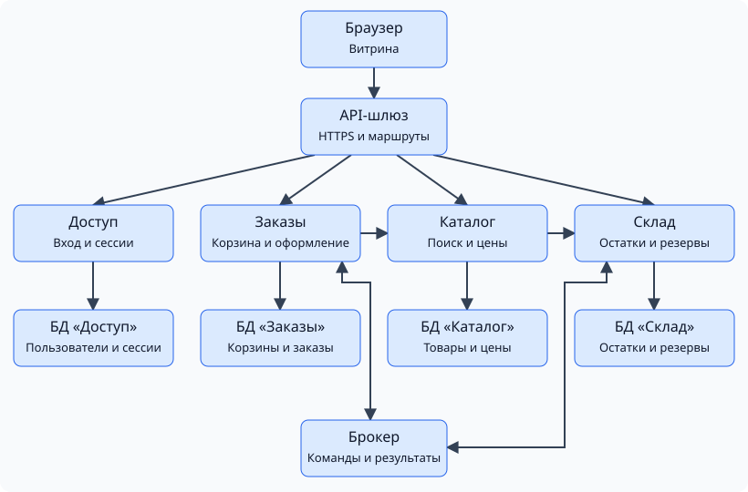
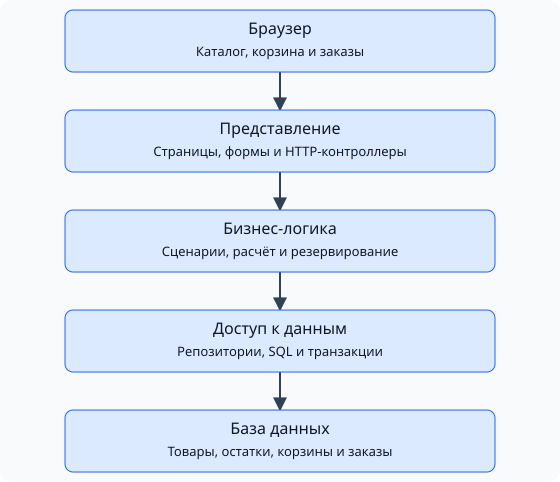
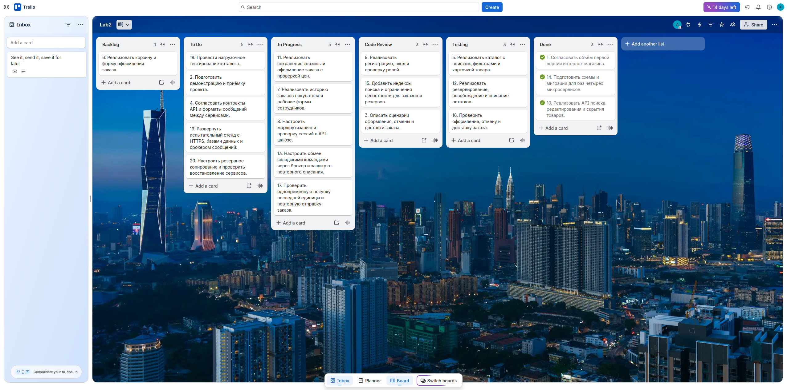

# Лабораторная работа № 2

**Тема:** Анализ требований, выбор архитектуры ПО и организация командной разработки  
**Проект:** Интернет-магазин товаров для дома  

---

## Цель работы

Получить навыки анализа требований, проектирования архитектуры информационной системы, формирования команды и распределения ответственности.

## Задание 1. Описание проекта

**Название и назначение.** «Интернет-магазин товаров для дома» позволяет покупателям выбирать товары и оформлять заказы на доставку. Сотрудники магазина ведут ассортимент, учитывают остатки и обрабатывают заказы.

**Целевая аудитория.** Покупатели, менеджеры каталога и склада, операторы заказов.

**Решаемые проблемы.** Покупатель может узнать цену и наличие без звонка в магазин. Сотрудники получают заказы с адресом и составом в единой системе. Резервирование товара при оформлении снижает риск принятия двух заказов на одну единицу товара.

**Основные функции.** Вход, просмотр каталога, поиск, корзина, оформление и отслеживание заказа, управление ассортиментом, остатками и статусами заказов.

**Эксплуатация.** Веб-приложение доступно по HTTPS на компьютерах и смартфонах. Первая версия обслуживает один склад и доставку с оплатой при получении. Оператор передаёт заказ в доставку по действующему процессу магазина и отмечает результат в системе.

## Задание 2. Формирование требований

### Функциональные требования

| ID | Название | Описание | Пользователь | Ожидаемый результат |
|---|---|---|---|---|
| ФТ-01 | Регистрация и вход | Зарегистрироваться с уникальным адресом электронной почты, войти или завершить сессию. Учётные записи сотрудников выдаёт администратор магазина. | Покупатель, сотрудник | Действующая сессия открывает операции по роли. После выхода защищённые операции требуют входа. |
| ФТ-02 | Поиск и карточка товара | Искать активные товары по части названия, фильтровать по категории и открыть карточку. | Посетитель | Выдача соответствует фильтрам. В карточке видны описание, цена и признак наличия. |
| ФТ-03 | Корзина | Добавить активный товар, изменить количество или удалить позицию. | Покупатель | Корзина сохраняется в аккаунте и показывает состав и предварительную сумму. Наличие проверяется при оформлении. |
| ФТ-04 | Оформление | Указать адрес и телефон, подтвердить показанный итог. Система проверяет актуальные цены и резервирует все позиции. | Покупатель | Покупатель получает номер подтверждённого заказа с зафиксированными ценами. При изменении цены система запрашивает повторное подтверждение, при нехватке товара заказ не подтверждается. Повтор запроса с тем же ключом возвращает исходный заказ или его состояние. |
| ФТ-05 | История заказов | Открыть список своих заказов и карточку отдельного заказа. | Покупатель | Видны состав, итог и актуальный статус собственного заказа. |
| ФТ-06 | Управление ассортиментом | Создавать, редактировать и скрывать карточки товаров, изменять цены. | Менеджер каталога | Изменения применяются к новым покупкам. Скрытая карточка пропадает из каталога, сохранённые цены в заказах остаются прежними. |
| ФТ-07 | Учёт остатков | Регистрировать поступление и корректировки остатков по артикулу. | Менеджер склада | Доступное количество равно физическому остатку за вычетом резерва. Корректировка, которая опустит остаток ниже резерва, отклоняется. |
| ФТ-08 | Обработка заказов | Передать подтверждённый заказ в доставку, отметить доставку или отменить заказ до передачи. | Оператор | При отмене резерв освобождается, при передаче в доставку он списывается со склада. После доставки заказ получает статус «Доставлен». |

### Нефункциональные требования

| ID | Категория | Требование |
|---|---|---|
| НФТ-01 | Надёжность | Ежедневно создавать согласованный комплект резервных копий. Целевые показатели восстановления — потеря данных до 24 часов и возврат системы в работу за 4 часа. Повтор доставки события или запроса не должен создавать второй заказ либо повторное списание. |
| НФТ-02 | Производительность | При 10 000 товарах и 100 виртуальных покупателях 95-й процентиль серверного времени ответа для поиска и карточки — до 2 с для каждой операции. Нагрузку измерять 15 минут при одном запросе на пользователя каждые 5 с с чередованием операций. |
| НФТ-03 | Безопасность | Использовать HTTPS, хранить пароли в виде хешей Argon2id с уникальной солью. Проверять роль на защищённых операциях и принадлежность корзины и заказа покупателю. Не записывать пароль, телефон и полный адрес в прикладные журналы. |
| НФТ-04 | Масштабируемость | Каталог поддерживает два параллельных экземпляра за балансировщиком с общей базой каталога. Проверить работу поиска при остановке одного экземпляра. |
| НФТ-05 | Условия эксплуатации | Контейнерный стенд Linux с 8 vCPU, 16 ГиБ ОЗУ и SSD. Основные пользовательские сценарии должны работать в Firefox и Chrome при ширине экрана 360 и 1280 CSS-пикселей. |

## Задание 3. Проектирование архитектуры

### 3.1. Монолитная архитектура

В одном веб-приложении находятся HTTP-интерфейс и модули пользователей, каталога, корзины, склада и заказов. Модули вызывают друг друга внутри процесса. Оформление записывает заказ и резервирует все позиции в одной транзакции PostgreSQL. База также хранит сессии, товарные карточки и корзины.

Веб-приложение выпускается одним контейнером за HTTPS-прокси. PostgreSQL развёртывается отдельно с постоянным томом. Преимущества — простое развёртывание, общие транзакции и сквозная отладка. Недостатки — обновление одного модуля требует выпуска приложения целиком, а рост нагрузки на каталог требует добавлять экземпляры всего приложения.

### 3.2. Микросервисная архитектура

Браузер обращается к API-шлюзу. Шлюз проверяет действительность сессии через сервис доступа для защищённых маршрутов. Сервисы проверяют полномочия перед изменением данных, а сервис заказов дополнительно проверяет принадлежность заказа или корзины. Каждый сервис развёртывается независимо и работает со своей БД. Внутренние запросы выполняются по HTTPS, складские команды и результаты передаются через брокер сообщений.

| Сервис | Назначение и функции | Данные | Взаимодействие |
|---|---|---|---|
| Доступ | Регистрация, вход, выход и проверка сессий. | Пользователи, хеши паролей, роли и сессии. | Обрабатывает запросы входа и проверки сессий от шлюза. |
| Каталог | Управление ассортиментом и ценами, поиск и просмотр карточек. | Артикулы, названия, категории, цены и признаки активности. | Принимает запросы шлюза, возвращает сервису заказов текущие цены и активность позиций. Для карточки получает признак наличия от склада. |
| Склад | Учёт остатков, резервирование, освобождение и списание. | Остатки, резервы по номеру заказа, идентификаторы обработанных команд. | Отвечает каталогу по HTTPS, получает команды сервиса заказов через брокер и публикует результаты. |
| Заказы | Ведение корзины, оформление, история и смена статусов. | Корзины, заказы, зафиксированные цены, адреса, ключи повторов запросов и статусы. | Принимает запросы шлюза, проверяет цены через каталог, отправляет команды складу и получает результаты через брокер. |

Сервис заказов проверяет цены и сохраняет заказ со статусом «Ожидает резерва» вместе с командой в локальной транзакции. Фоновый обработчик публикует команду в брокер. Склад одной транзакцией резервирует все позиции или отклоняет команду целиком и сохраняет результат для публикации. После получения результата заказ становится «Подтверждён» или «Отклонён». Повторные команды распознаются по идентификатору, а покупатель видит актуальное состояние по номеру заказа. При отмене и передаче в доставку итоговый статус устанавливается после подтверждения освобождения или списания резерва. Пока складская операция выполняется, конкурирующие действия оператора по тому же заказу блокируются.

Независимое масштабирование каталога и отдельные выпуски сервисов упрощают изменение загруженных частей системы. Эксплуатация требует брокера, наблюдения за обработкой событий и согласованного восстановления сервисных БД.

### 3.3. Многослойная архитектура

| Слой | Назначение и компоненты | Взаимодействие |
|---|---|---|
| Представление | Страницы каталога, корзины и заказов, формы сотрудников, HTTP-контроллеры. | Проверяет форму запроса, вызывает сценарий бизнес-логики и отображает результат. |
| Бизнес-логика | Сценарии поиска, оформления, резервирования и изменения статусов, проверка прав и цен. | Получает команды от слоя представления, обращается к репозиториям и возвращает результат сценарию вызова. |
| Доступ к данным | Репозитории товаров, корзин, остатков и заказов, SQL-запросы и управление транзакциями. | Выполняет операции в БД по запросу бизнес-логики и возвращает найденные записи или результат сохранения. |

Например, контроллер оформления передаёт корзину и контактные данные сценарию заказа. Сценарий проверяет цены и возможность резервирования через репозитории, сохраняет результат и возвращает его контроллеру.

### Выбор архитектуры

Для реализации выбрана микросервисная архитектура. Каталог можно масштабировать под поток просмотров отдельно от оформления и складских операций. Разделение на слои можно применять внутри каждого сервиса. Для согласованности заказа и резерва в выбранной модели используются локальные транзакции, повторяемая доставка сообщений и проверка повторов.

## Задание 4. Техническое задание

ТЗ оформлено по восьми разделам, указанным в лабораторной работе на основе ГОСТ 34.602-89.

### 1. Введение

Система «Интернет-магазин товаров для дома» предоставляет браузерную витрину и рабочие интерфейсы для сотрудников. Серверная часть состоит из API-шлюза и сервисов доступа, каталога, склада и заказов.

### 2. Основания для разработки

Основание — лабораторная работа № 2 по дисциплине «Архитектура, проектирование и ППС». В учебном сценарии заказчик — магазин товаров для дома. Его требования включают публикацию ассортимента, приём заказов с оплатой при получении, контроль остатков и отслеживание обработки заказов.

### 3. Назначение и цели создания системы

Система предназначена для розничных заказов с доставкой с одного склада. Цели разработки — предоставить покупателю самостоятельное оформление заказа, дать сотрудникам единый интерфейс обработки и исключить подтверждение заказа при недостатке доступного остатка.

### 4. Требования к системе

Реализовать ФТ-01–ФТ-08. При оформлении проверять активность товаров и цены, резервировать заказ целиком и сохранять согласованные цены. Обеспечить требования НФТ-01–НФТ-05 к восстановлению, быстродействию, защите, масштабированию и условиям эксплуатации. Развернуть сервисы по схеме раздела 3.2. Для учебного резервирования приостановить приём изменений, завершить обработку принятых команд, сохранить сервисные базы одним комплектом и возобновить работу.

### 5. Состав и содержание работ

| Этап | Работы | Результат |
|---|---|---|
| Анализ | Описать роли, состояния заказов, правила цены и резерва, условия приёмки. | Согласованные требования и критерии. |
| Проектирование | Спроектировать сервисы, базы, API и сообщения, определить обработку повторов. | Схемы, модели данных и контракты. |
| Разработка | Реализовать веб-интерфейс, шлюз, сервисы, миграции и обмен сообщениями. | Сборки компонентов и интегрированный стенд. |
| Испытания | Проверить ФТ и НФТ, в том числе конкурирующие покупки и восстановление. | Протокол испытаний и исправленная сборка. |
| Подготовка к вводу | Загрузить начальный ассортимент и остатки, создать учётные записи сотрудников, передать инструкции. | Подготовленный стенд и комплект документации. |

### 6. Порядок контроля и приёмки

На стенде проверяют ФТ-01–ФТ-08 и измеряют показатели НФТ-01–НФТ-05. Для проверки резерва два покупателя одновременно оформляют последнюю единицу товара. Подтверждается один заказ. Повтор запроса с тем же ключом возвращает номер исходного заказа, а повтор складской команды не меняет остаток второй раз. Тестировщик также проверяет запрет просмотра чужого заказа, нагрузку каталога, отказ одного его экземпляра и восстановление из резервной копии.

На демонстрации сотрудники создают товар и задают остаток, покупатель находит его и оформляет заказ, оператор фиксирует передачу в доставку и завершение, покупатель видит итоговый статус. Отдельно демонстрируется отмена до передачи и возврат зарезервированной позиции в доступный остаток. Критерий приёмки — успешное прохождение всех сценариев и достижение количественных порогов. Итоги фиксируются в протоколе приёмки.

### 7. Требования к составу и содержанию документации

Подготовить ТЗ, описание архитектуры, схемы сервисных БД, контракты API и сообщений, инструкции покупателя и сотрудников, руководство по развёртыванию и восстановлению, программу и протокол испытаний.

### 8. Источники разработки

- [Условие лабораторной работы № 2](../Laba-2.md).
- ГОСТ 34.602-89, источник структуры ТЗ по условию работы. [Карточка стандарта Росстандарта](https://protect.gost.ru/gost/details/192a6558-e2c5-49b4-baa6-5dcad1636888).
- Сценарии магазина и требования, сформулированные в заданиях 1 и 2 отчёта.

## Задание 5. Формирование команды

| Участник | Роль | Основные обязанности | Задачи | Результат |
|---|---|---|---|---|
| 1 | Руководитель проекта | Координирует сроки, интеграцию и приёмку. | Согласовать этапы, организовать интеграцию сервисов и демонстрацию. | План работ и протокол приёмки. |
| 2 | Системный аналитик | Формализует требования и правила магазина. | Описать состояния заказа и резерва, согласовать контракты и критерии. | ТЗ, модель статусов и спецификации интерфейсов. |
| 3 | Frontend-разработчик | Разрабатывает витрину и интерфейсы сотрудников. | Реализовать поиск, корзину, оформление, историю и рабочие формы. | Браузерный интерфейс, интегрированный со шлюзом. |
| 4 | Backend-разработчик | Отвечает за шлюз, доступ и каталог. | Реализовать проверку сессий, маршрутизацию, поиск и управление ассортиментом. | Сборки шлюза и двух сервисов, контракты HTTP. |
| 5 | Backend-разработчик | Отвечает за заказы и склад. | Реализовать корзину, резервирование, смену статусов и обработку повторов сообщений. | Сборки сервисов заказов и склада, контракты сообщений. |
| 6 | Разработчик базы данных | Проектирует отдельные схемы и обеспечивает целостность данных. | Подготовить миграции, индексы поиска и ограничения для заказов и резервов. | Схемы БД, миграции и проверка ограничений. |
| 7 | Тестировщик | Проверяет пользовательские сценарии и обмен между сервисами. | Проверить ФТ и НФТ, конкуренцию за остаток, повторы команд и сбои обмена. | Программа и протокол испытаний. |
| 8 | DevOps-инженер | Отвечает за испытательный стенд и эксплуатацию. | Развернуть контейнеры, БД и брокер, настроить HTTPS, балансировку, журналы и копирование. | Развёрнутый стенд, конфигурации и инструкция восстановления. |

## Задание 6. Формирование команды

Используеться система Trello.

## Заключение

Для интернет-магазина определены восемь функциональных и пять нефункциональных требований. Рассмотрены монолитная, микросервисная и многослойная архитектуры. Для разработки выбраны микросервисы с отдельным масштабированием каталога и согласованием заказов со складом. Техническое задание задаёт критерии проверки, а распределение ролей закрепляет ответственность за сервисы, данные, испытания и эксплуатацию.
