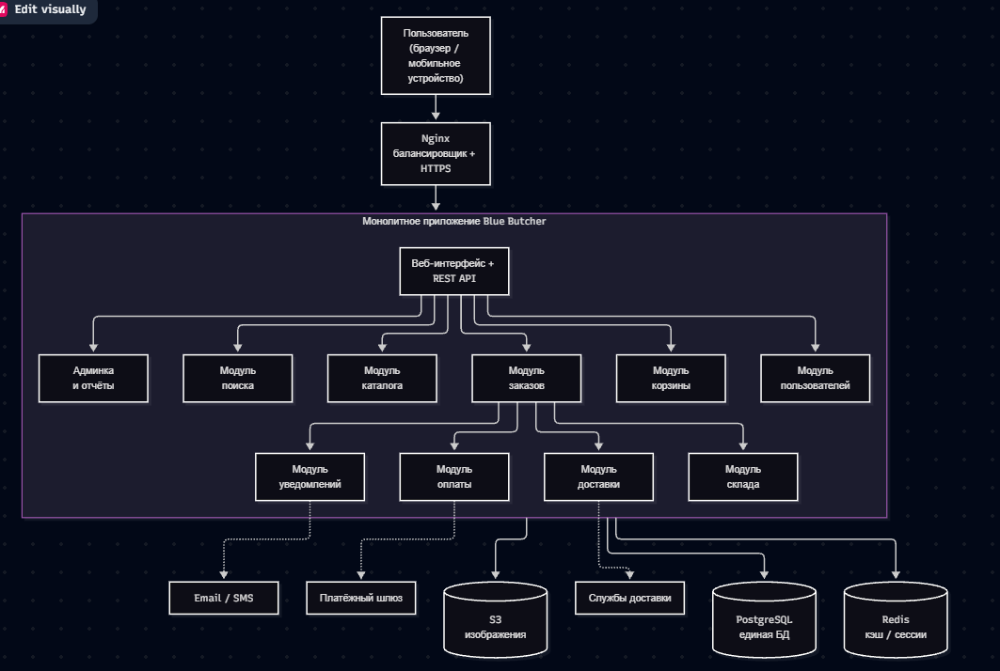
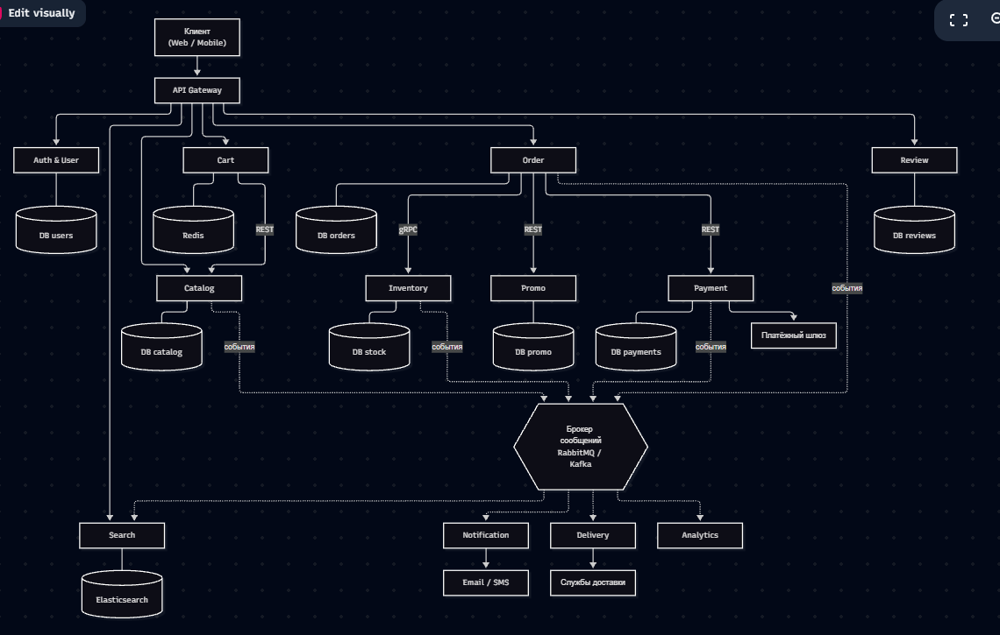
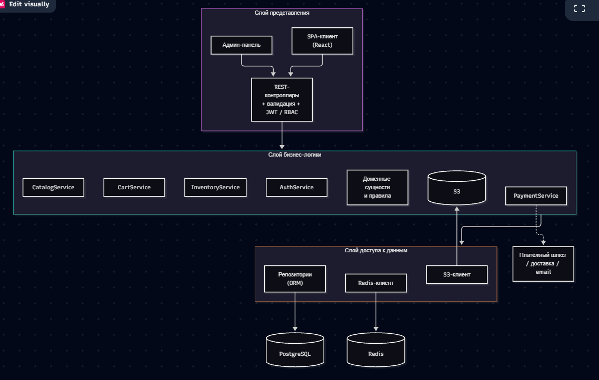

**МИНИСТЕРСТВО НАУКИ И ВЫСШЕГО ОБРАЗОВАНИЯ РОССИЙСКОЙ ФЕДЕРАЦИИ
**

*ФЕДЕРАЛЬНОЕ ГОСУДАРСТВЕННОЕ БЮДЖЕТНОЕ
ОБРАЗОВАТЕЛЬНОЕ УЧРЕЖДЕНИЕ ВЫСШЕГО ОБРАЗОВАНИЯ*

*«БЕЛГОРОДСКИЙ ГОСУДАРСТВЕННЫЙ
ТЕХНОЛОГИЧЕСКИЙ УНИВЕРСИТЕТ им. В. Г. ШУХОВА»
(БГТУ им. В.Г. Шухова)*

Кафедра программного обеспечения вычислительной техники и
автоматизированных систем

   

*Лабораторная работа №2*

**Тема:** Анализ требований, выбор архитектуры программного обеспечения и организация командной разработки

   

Выполнил: Ситников Алексей Павлович, группа ПВ 233

Проверил: Доденко Олег Павлович 

  

*Город, 2026*

---

## 1. Цель работы

Получить практические навыки анализа требований к программному обеспечению, проектирования архитектуры информационной системы, формирования команды разработки и распределения задач между участниками проекта.

**Для достижения цели в работе решены следующие задачи:**

1. выбран проект и описаны его назначение, аудитория и условия эксплуатации;
2. сформированы функциональные и нефункциональные требования;
3. спроектированы три варианта архитектуры (монолитная, микросервисная, многослойная) и выполнено их сравнение;
4. подготовлено техническое задание по структуре ГОСТ 34.602-89;
5. определены состав команды, роли и зоны ответственности;
6. создана Kanban-доска, содержащая более 20 задач.

---

## 2. Описание выбранного проекта

### 2.1. Название проекта

**«Blue Butcher»** — интернет-магазин.

### 2.2. Назначение системы

Информационная система предназначена для онлайн-продажи товаров: она позволяет покупателям находить товары, оформлять и оплачивать заказы, отслеживать их доставку, а сотрудникам магазина — управлять каталогом, складскими остатками, заказами и клиентской поддержкой.

### 2.3. Целевая аудитория

| Группа | Описание |
|---|---|
| **Гость** | Неавторизованный посетитель: просматривает каталог, ищет товары |
| **Покупатель** | Зарегистрированный пользователь: оформляет заказы, оставляет отзывы, ведёт избранное |
| **Менеджер каталога** | Сотрудник, наполняющий каталог товарами, ценами и акциями |
| **Оператор заказов** | Сотрудник, обрабатывающий заказы, возвраты и обращения клиентов |
| **Администратор** | Управляет пользователями, ролями, настройками и мониторингом системы |

Основная аудитория покупателей: жители городов от 18 до 55 лет, регулярно совершающие покупки онлайн с компьютера или смартфона.

### 2.4. Основные проблемы, которые решает система

- Покупатель тратит много времени на поиск и сравнение товаров в офлайн-точках.
- Отсутствие единого актуального источника информации о наличии и ценах товара.
- Ручная обработка заказов приводит к ошибкам, задержкам и потере заявок.
- Нет прозрачного статуса заказа и доставки для клиента.
- Сложно управлять остатками на складе и согласовывать их с продажами.
- Отсутствует аналитика продаж для принятия бизнес-решений.

### 2.5. Основные функции системы

1. Регистрация, аутентификация и управление профилем.
2. Каталог товаров с категориями, фильтрами и сортировкой.
3. Полнотекстовый поиск с подсказками.
4. Корзина и избранное.
5. Оформление заказа, выбор доставки и способа оплаты.
6. Онлайн-оплата банковской картой и СБП.
7. Отслеживание статуса заказа, история покупок.
8. Отзывы и рейтинги товаров.
9. Email- и push-уведомления.
10. Административная панель: товары, заказы, склад, промокоды, отчёты.

### 2.6. Предполагаемые условия эксплуатации

| Параметр | Значение |
|---|---|
| Режим работы | Круглосуточно (24/7) |
| Клиентские устройства | Современные браузеры (Chrome, Firefox, Safari, Edge — две последние версии), мобильные браузеры; адаптивная вёрстка |
| Серверная среда | Linux-серверы / облако, контейнеризация (Docker) |
| Пользователей | До 50 000 зарегистрированных, до 2 000 одновременных на старте |
| Каталог | До 100 000 товарных позиций |
| Пиковые нагрузки | Распродажи и праздничные периоды (рост трафика в 3–5 раз) |
| Эксплуатирующий персонал | 5–15 сотрудников магазина, 1–2 инженера сопровождения |
| Интеграции | Платёжный шлюз, службы доставки, почтовый/SMS-сервис, 1С (учёт) |

---

## 3. Функциональные и нефункциональные требования

### 3.1. Функциональные требования

| ID | Название | Описание | Пользователь | Ожидаемый результат |
|---|---|---|---|---|
| **FR-01** | Регистрация | Создание учётной записи по email/телефону и паролю с подтверждением email | Гость | Создан аккаунт, отправлено письмо подтверждения |
| **FR-02** | Аутентификация | Вход по логину и паролю, выход, восстановление пароля | Покупатель, сотрудник | Пользователь получает сессию (токен), доступ к функциям по роли |
| **FR-03** | Управление профилем | Редактирование личных данных, адресов доставки, смена пароля | Покупатель | Данные профиля сохранены и используются при заказе |
| **FR-04** | Просмотр каталога | Список товаров по категориям с пагинацией, карточка товара | Гость, покупатель | Отображаются товары с ценой, фото, описанием, наличием |
| **FR-05** | Фильтрация и сортировка | Фильтры по цене, бренду, характеристикам; сортировка по цене, популярности, рейтингу | Гость, покупатель | Список сужается по выбранным критериям |
| **FR-06** | Поиск товаров | Полнотекстовый поиск с подсказками и учётом опечаток | Гость, покупатель | Выдаются релевантные товары за < 1 с |
| **FR-07** | Корзина | Добавление, удаление, изменение количества; сохранение корзины между сессиями | Гость, покупатель | Корзина содержит выбранные товары, пересчитана итоговая сумма |
| **FR-08** | Избранное | Добавление товаров в список избранного | Покупатель | Товар сохранён и доступен в личном кабинете |
| **FR-09** | Оформление заказа | Выбор адреса, способа доставки и оплаты, применение промокода | Покупатель | Создан заказ со статусом «Новый», товары зарезервированы |
| **FR-10** | Онлайн-оплата | Оплата картой или через СБП через платёжный шлюз | Покупатель | Платёж проведён, статус заказа — «Оплачен», выслан чек |
| **FR-11** | Отслеживание заказа | Просмотр статуса и истории заказов, отмена до отгрузки | Покупатель | Покупатель видит актуальный статус и трек-номер |
| **FR-12** | Отзывы и рейтинги | Оставление оценки и комментария к купленному товару | Покупатель | Отзыв опубликован после модерации, пересчитан рейтинг |
| **FR-13** | Управление каталогом | Создание, редактирование, скрытие товаров и категорий, загрузка изображений | Менеджер каталога | Изменения отражаются на витрине |
| **FR-14** | Управление остатками | Приход, списание, резервирование и инвентаризация товаров | Менеджер каталога, оператор | Остатки актуальны, нельзя продать больше, чем есть |
| **FR-15** | Обработка заказов | Смена статусов, передача в доставку, оформление возвратов | Оператор заказов | Заказ проходит жизненный цикл до «Доставлен» |
| **FR-16** | Промокоды и акции | Создание скидок, промокодов с ограничением срока и количества | Менеджер каталога | Скидка применяется при оформлении заказа |
| **FR-17** | Уведомления | Email/push о регистрации, статусе заказа, оплате | Система → покупатель | Пользователь вовремя получает уведомление |
| **FR-18** | Администрирование | Управление пользователями и ролями, просмотр журнала действий | Администратор | Роли назначены, действия аудируются |
| **FR-19** | Отчёты и аналитика | Отчёты по продажам, популярным товарам, выручке за период | Администратор, менеджер | Сформирован отчёт с экспортом в CSV/XLSX |

### 3.2. Нефункциональные требования

#### Надёжность

| ID | Требование |
|---|---|
| **NFR-R1** | Доступность системы — не менее **99,5 %** в месяц (допустимый простой ≈ 3,6 ч). |
| **NFR-R2** | Резервное копирование БД — ежедневно полное, каждый час — инкрементальное; хранение копий 30 дней. |
| **NFR-R3** | Время восстановления после сбоя (RTO) — не более 1 часа, потеря данных (RPO) — не более 1 часа. |
| **NFR-R4** | Операции создания заказа и оплаты должны быть транзакционными, исключающими дублирование и потерю заказов. |
| **NFR-R5** | При недоступности внешнего сервиса (оплата, доставка) система корректно сообщает об ошибке и повторяет запрос. |

#### Производительность

| ID | Требование |
|---|---|
| **NFR-P1** | Время загрузки основных страниц — не более **2 с** (95-й перцентиль) при штатной нагрузке. |
| **NFR-P2** | Время ответа API — не более **300 мс** для чтения, **800 мс** для операций записи. |
| **NFR-P3** | Поддержка не менее **2 000 одновременных пользователей** и **100 запросов в секунду**. |
| **NFR-P4** | Поиск по каталогу из 100 000 товаров — не более 1 с. |
| **NFR-P5** | Оформление заказа (от нажатия кнопки до подтверждения) — не более 3 с. |

#### Безопасность

| ID | Требование |
|---|---|
| **NFR-S1** | Передача данных только по **HTTPS (TLS 1.2+)**. |
| **NFR-S2** | Пароли хранятся только в виде хэшей (bcrypt/Argon2) с солью. |
| **NFR-S3** | Ролевое разграничение доступа (RBAC): гость, покупатель, менеджер, оператор, администратор. |
| **NFR-S4** | Защита от OWASP Top 10: SQL-инъекции, XSS, CSRF, brute-force (ограничение попыток входа). |
| **NFR-S5** | Данные банковских карт не хранятся в системе; оплата выполняется на стороне сертифицированного шлюза (PCI DSS). |
| **NFR-S6** | Обработка персональных данных в соответствии с ФЗ-152 «О персональных данных». |
| **NFR-S7** | Журналирование критичных действий (вход, изменение заказов, цен, ролей). |

#### Масштабируемость

| ID | Требование |
|---|---|
| **NFR-M1** | Возможность горизонтального масштабирования веб-/API-слоя за балансировщиком нагрузки. |
| **NFR-M2** | Рост каталога до 1 000 000 товаров и аудитории до 500 000 пользователей без переработки архитектуры. |
| **NFR-M3** | Кэширование часто запрашиваемых данных (каталог, карточки товаров) в Redis. |
| **NFR-M4** | Возможность выделения отдельных модулей (поиск, заказы, оплата) в самостоятельные сервисы. |

#### Условия эксплуатации

| ID | Требование |
|---|---|
| **NFR-E1** | Поддержка браузеров: Chrome, Firefox, Safari, Edge (две последние версии); адаптивный интерфейс от 360 px. |
| **NFR-E2** | Развёртывание в Docker-контейнерах; окружения: dev, test, prod. |
| **NFR-E3** | Мониторинг (метрики, логи, алерты) и автоматические уведомления о сбоях. |
| **NFR-E4** | Плановое обслуживание допускается в ночное время (02:00–05:00) с предупреждением. |
| **NFR-E5** | Интерфейс на русском языке с возможностью добавления других языков (i18n). |
| **NFR-E6** | Соответствие WCAG 2.1 уровня AA для основных пользовательских сценариев (по возможности). |

---
## 4. Монолитная архитектура

### 4.1. Основные компоненты системы

Вся система реализуется как **единое приложение**, собираемое и запускаемое как один процесс. Внутри приложения выделены модули:

| Модуль | Назначение |
|---|---|
| Пользователи и аутентификация | Регистрация, вход, роли, профиль |
| Каталог | Товары, категории, характеристики, изображения |
| Поиск | Полнотекстовый поиск и фильтры |
| Корзина | Хранение выбранных товаров |
| Заказы | Оформление, статусы, история |
| Оплата | Интеграция с платёжным шлюзом |
| Склад | Остатки, резервирование |
| Доставка | Расчёт стоимости, интеграция со службами доставки |
| Уведомления | Email/SMS/push |
| Администрирование и отчёты | Панель управления, аналитика |

### 4.2. Принцип взаимодействия компонентов

Модули взаимодействуют **внутри одного процесса** через прямые вызовы методов/функций (in-process calls). Транзакции охватывают несколько модулей одновременно (например, создание заказа + резервирование остатков + запись платежа выполняются в одной транзакции БД). Внешние системы (платёжный шлюз, службы доставки, почта) подключаются через HTTP-клиенты.

### 4.3. Способ хранения данных

- **Единая реляционная СУБД PostgreSQL** — общая схема для всех модулей.
- **Redis** — кэш и хранение сессий/корзин.
- **Объектное хранилище (S3-совместимое)** — изображения товаров.

### 4.4. Особенности развертывания

- Приложение собирается в **один артефакт** (Docker-образ) и разворачивается целиком.
- Масштабирование — запуск нескольких одинаковых экземпляров за балансировщиком (Nginx), все экземпляры используют одну БД.
- Любое изменение (даже небольшое) требует пересборки и повторного развертывания всего приложения.

### 4.5. Схема

### 4.6. Преимущества и недостатки

| Преимущества | Недостатки |
|---|---|
| Простота разработки и отладки на старте | Рост кодовой базы усложняет сопровождение |
| Единый деплой, простая инфраструктура | Любое изменение требует развертывания всего приложения |
| Лёгкие транзакции (ACID) между модулями | Нельзя масштабировать отдельные модули независимо |
| Высокая скорость вызовов (без сети) | Сбой в одном модуле может остановить всё приложение |
| Минимальные затраты на старте | Жёсткая привязка к одному стеку технологий |
| Простое сквозное тестирование | Сложнее распараллеливать работу больших команд |

---

## 5. Микросервисная архитектура

### 5.1. Принципы разделения

Система разбивается на **независимые сервисы** по бизнес-возможностям (bounded contexts). Каждый сервис имеет собственную базу данных, независимо разворачивается и взаимодействует с другими по сети.

### 5.2. Описание сервисов

| № | Сервис | Назначение | Основные функции | Данные (собственная БД) | Взаимодействие |
|---|---|---|---|---|---|
| 1 | **API Gateway** | Единая точка входа | Маршрутизация, проверка JWT, rate limiting, агрегация ответов | — (конфигурация маршрутов) | REST → все сервисы |
| 2 | **Auth & User Service** | Управление пользователями | Регистрация, вход, выдача JWT, роли, профиль, адреса | Пользователи, роли, адреса (PostgreSQL) | REST; события `UserRegistered` |
| 3 | **Catalog Service** | Управление каталогом | CRUD товаров и категорий, характеристики, цены, изображения | Товары, категории, цены (PostgreSQL) | REST; события `ProductChanged` |
| 4 | **Search Service** | Поиск товаров | Индексация, полнотекстовый поиск, фильтры, подсказки | Поисковый индекс (Elasticsearch) | Подписка на `ProductChanged`; REST |
| 5 | **Cart Service** | Корзина и избранное | Добавление/удаление позиций, пересчёт суммы | Корзины, избранное (Redis + PostgreSQL) | REST → Catalog (проверка цены) |
| 6 | **Order Service** | Жизненный цикл заказа | Создание заказа, статусы, история, отмена, возвраты | Заказы, позиции, история статусов (PostgreSQL) | REST ← Gateway; события `OrderCreated`, `OrderCancelled`; gRPC → Inventory |
| 7 | **Inventory Service** | Складские остатки | Остатки, резервирование, списание, инвентаризация | Остатки, резервы, движения (PostgreSQL) | gRPC ← Order; события `StockReserved`, `StockReleased` |
| 8 | **Payment Service** | Платежи | Создание платежа, интеграция с шлюзом, обработка webhook, возвраты | Платежи, транзакции (PostgreSQL) | REST → платёжный шлюз; события `PaymentSucceeded`, `PaymentFailed` |
| 9 | **Delivery Service** | Доставка | Расчёт стоимости, создание отправления, трекинг | Отправления, тарифы, треки (PostgreSQL) | REST → службы доставки; события `ShipmentStatusChanged` |
| 10 | **Notification Service** | Уведомления | Email, SMS, push по шаблонам | Шаблоны, журнал отправок (PostgreSQL) | Подписка на события других сервисов |
| 11 | **Review Service** | Отзывы и рейтинги | Отзывы, модерация, расчёт рейтинга | Отзывы, оценки (PostgreSQL) | REST; события `ReviewPublished` |
| 12 | **Promo Service** | Скидки и промокоды | Создание и валидация промокодов, расчёт скидок | Промокоды, акции (PostgreSQL) | REST ← Order |
| 13 | **Analytics Service** | Отчёты | Агрегация продаж, отчёты, экспорт | Витрина данных (ClickHouse / PostgreSQL) | Подписка на события заказов и платежей |

### 5.3. Способы взаимодействия

- **Синхронно:** REST/HTTP (клиент → Gateway → сервисы), gRPC (между внутренними сервисами, где нужна низкая задержка, например Order → Inventory).
- **Асинхронно:** брокер сообщений (**RabbitMQ / Kafka**) — события `OrderCreated`, `PaymentSucceeded`, `StockReserved` и др.
- **Согласованность данных:** распределённые транзакции реализуются по паттерну **Saga** (оркестрация в Order Service): создание заказа → резервирование товара → оплата → подтверждение; при ошибке выполняются компенсирующие действия (снятие резерва, возврат платежа).

### 5.4. Схема

### 5.5. Преимущества и недостатки

| Преимущества | Недостатки |
|---|---|
| Независимое развертывание и масштабирование сервисов | Высокая сложность инфраструктуры (оркестрация, мониторинг, трассировка) |
| Изоляция сбоев: отказ одного сервиса не останавливает систему | Распределённые транзакции и согласованность данных (Saga) |
| Свобода выбора технологий для каждого сервиса | Сетевые задержки и необходимость отказоустойчивого взаимодействия |
| Удобно распараллеливать работу нескольких команд | Затратное тестирование (контрактные и интеграционные тесты) |
| Быстрые и безопасные релизы отдельных частей | Высокие затраты на старте, нужна зрелая DevOps-культура |

---

## 6. Многослойная архитектура

### 6.1. Описание слоёв

Приложение делится на логические слои. Каждый слой зависит только от нижележащего, что обеспечивает разделение ответственности.

#### Слой представления (Presentation Layer)

**Назначение:** взаимодействие с пользователем и внешними клиентами; приём запросов и отображение результата.

**Основные компоненты:**
- SPA-клиент на React/Vue (страницы каталога, корзины, оформления заказа, личного кабинета);
- административная панель;
- REST API-контроллеры (`ProductController`, `CartController`, `OrderController`, `AuthController`);
- DTO-объекты, валидаторы входных данных, обработчик ошибок;
- middleware аутентификации (JWT) и авторизации (RBAC).

**Взаимодействие:** принимает HTTP-запрос, проверяет и преобразует данные, вызывает сервисы слоя бизнес-логики и формирует ответ (JSON/HTML). Напрямую к БД не обращается.

#### Слой бизнес-логики (Business Logic Layer)

**Назначение:** реализация правил предметной области и сценариев использования.

**Основные компоненты:**
- сервисы: `AuthService`, `CatalogService`, `CartService`, `OrderService`, `PaymentService`, `InventoryService`, `PromoService`, `NotificationService`;
- доменные сущности: `User`, `Product`, `Category`, `Cart`, `Order`, `Payment`, `Review`;
- правила: расчёт стоимости и скидок, проверка остатков, конечный автомат статусов заказа;
- интеграционные адаптеры (платёжный шлюз, службы доставки, почта).

**Взаимодействие:** получает вызовы от слоя представления, обращается к слою доступа к данным через интерфейсы репозиториев, управляет транзакциями.

#### Слой доступа к данным (Data Access Layer)

**Назначение:** абстракция работы с хранилищами данных.

**Основные компоненты:**
- репозитории: `UserRepository`, `ProductRepository`, `OrderRepository`, `StockRepository` и др.;
- ORM-модели и миграции схемы;
- клиент Redis (кэш), клиент S3 (изображения), клиент поискового индекса;
- пул соединений с БД.

**Взаимодействие:** выполняет запросы к PostgreSQL, Redis, S3 по запросам слоя бизнес-логики; возвращает доменные объекты, скрывая детали SQL.

### 6.2. Схема

### 6.3. Преимущества и недостатки

| Преимущества | Недостатки |
|---|---|
| Чёткое разделение ответственности | Запрос проходит через все слои — небольшие накладные расходы |
| Удобство тестирования каждого слоя изолированно | Риск «анемичной» бизнес-логики и дублирования кода |
| Возможность заменить БД или UI без переписывания остальных слоёв | Изменение сквозной функции затрагивает все слои |
| Понятная структура, легко учить новых разработчиков | Масштабируется как единое целое, если слои в одном процессе |
| Параллельная работа frontend, backend и БД-разработчиков | Не решает проблему независимого масштабирования модулей |

---

## 7. Сравнение архитектур и выбор решения

| Критерий | Монолит | Микросервисы | Многослойная |
|---|---|---|---|
| Сложность разработки | Низкая | Высокая | Средняя |
| Скорость старта (MVP) | Высокая | Низкая | Высокая |
| Масштабируемость | Только целиком | По сервисам | Целиком (или по слоям) |
| Отказоустойчивость | Низкая | Высокая | Средняя |
| Стоимость инфраструктуры | Низкая | Высокая | Низкая |
| Сложность тестирования | Низкая | Высокая | Средняя |
| Требования к команде | 4–6 человек | 10+ человек, зрелый DevOps | 5–8 человек |
| Независимость релизов | Нет | Да | Нет |
| Подходит для | MVP, малый бизнес | Крупные высоконагруженные системы | Структурирование любого приложения |

**Выбор решения.** Для Blue Butcher на старте (до 2 000 одновременных пользователей, команда 7–8 человек) рационально использовать **модульный монолит с многослойной структурой внутри каждого модуля**. Такой подход:

- обеспечивает быстрый вывод продукта на рынок и низкую стоимость владения;
- удовлетворяет нефункциональным требованиям (NFR-P3, NFR-R1) за счёт горизонтального масштабирования экземпляров;
- сохраняет возможность дальнейшего выделения наиболее нагруженных модулей (поиск, заказы, оплата) в микросервисы (NFR-M4) по мере роста нагрузки и команды.

Состав команды в разделе 8 сформирован под выбранную архитектуру.

---

## 8. Состав команды разработки

Для разработки модульного монолита с многослойной структурой достаточно команды из **8 человек**:

| № | Роль | Количество |
|---|---|---|
| 1 | Руководитель проекта | 1 |
| 2 | Системный аналитик | 1 |
| 3 | Frontend-разработчик | 1 |
| 4 | Backend-разработчик | 2 |
| 5 | Разработчик базы данных | 1 |
| 6 | Тестировщик (QA) | 1 |
| 7 | DevOps-инженер | 1 |

**Обоснование соответствия архитектуре:**

- слой представления → frontend-разработчик;
- слой бизнес-логики → два backend-разработчика (разделение по модулям: A — пользователи, каталог, корзина; B — заказы, оплата, склад, доставка);
- слой доступа к данным → разработчик БД совместно с backend-разработчиками;
- единый артефакт развертывания → один DevOps-инженер вместо команды платформенных инженеров, необходимой для микросервисов.

> При переходе на микросервисы команда расширяется: добавляются отдельные backend-команды по доменам, SRE-инженер и специалист по безопасности.

---

## 9. Распределение ролей и ответственности

### 9.1. Руководитель проекта (Project Manager)

| Параметр | Описание |
|---|---|
| **Роль** | Планирование, координация и контроль проекта |
| **Обязанности** | Составление плана и графика; распределение задач; управление рисками и бюджетом; проведение планирований, ежедневных встреч и ретроспектив; взаимодействие с заказчиком |
| **Задачи** | Ведение Kanban-доски и бэклога; контроль сроков спринтов; приёмка этапов; отчётность перед заказчиком |
| **Результат** | План проекта, реестр рисков, отчёты о статусе, подписанные акты приёмки этапов |

### 9.2. Системный аналитик

| Параметр | Описание |
|---|---|
| **Роль** | Сбор, анализ и документирование требований |
| **Обязанности** | Интервью с заказчиком; описание пользовательских сценариев; согласование требований; поддержка актуальности документации |
| **Задачи** | Разработка ТЗ по ГОСТ 34.602-89; User Stories и критерии приёмки; BPMN-схемы процессов; описание API-контрактов совместно с backend |
| **Результат** | Техническое задание, спецификация требований (SRS), диаграммы UML/BPMN, документация API |

### 9.3. Frontend-разработчик

| Параметр | Описание |
|---|---|
| **Роль** | Разработка клиентской части (слой представления) |
| **Обязанности** | Вёрстка и реализация интерфейса; интеграция с REST API; адаптивность и кроссбраузерность; оптимизация скорости загрузки |
| **Задачи** | Страницы каталога, карточки товара, корзины, оформления заказа, личного кабинета, админ-панели; UI-компоненты |
| **Результат** | Работающий веб-интерфейс, UI-kit, сборка frontend-приложения, unit-тесты компонентов |

### 9.4. Backend-разработчик №1 (пользователи, каталог, корзина)

| Параметр | Описание |
|---|---|
| **Роль** | Реализация бизнес-логики и API базовых модулей |
| **Обязанности** | Разработка REST API; реализация аутентификации и RBAC; интеграция с Redis и поиском; написание unit-тестов |
| **Задачи** | Модули Auth, Catalog, Search, Cart, Review, Promo |
| **Результат** | Реализованные и протестированные модули, Swagger/OpenAPI-описание |

### 9.5. Backend-разработчик №2 (заказы, оплата, склад, доставка)

| Параметр | Описание |
|---|---|
| **Роль** | Реализация критичных бизнес-процессов и интеграций |
| **Обязанности** | Реализация жизненного цикла заказа; транзакционность; интеграции с платёжным шлюзом и службами доставки; уведомления |
| **Задачи** | Модули Order, Payment, Inventory, Delivery, Notification, Analytics |
| **Результат** | Работающий процесс «корзина → оплата → доставка», интеграционные адаптеры, документация API |

### 9.6. Разработчик базы данных

| Параметр | Описание |
|---|---|
| **Роль** | Проектирование и оптимизация хранилищ данных |
| **Обязанности** | Проектирование схемы БД; индексы и оптимизация запросов; миграции; резервное копирование |
| **Задачи** | ER-диаграмма; DDL-скрипты и миграции; тестовые и демо-данные; настройка индексов и репликации |
| **Результат** | Схема БД, миграции, описание структуры данных, регламент резервного копирования |

### 9.7. Тестировщик (QA-инженер)

| Параметр | Описание |
|---|---|
| **Роль** | Обеспечение качества продукта |
| **Обязанности** | Разработка тест-плана и тест-кейсов; ручное и автоматизированное тестирование; регистрация и контроль дефектов; нагрузочное тестирование |
| **Задачи** | Тест-кейсы по FR-01…FR-19; регрессионные автотесты (API и UI); нагрузочные тесты (NFR-P3); проверка безопасности |
| **Результат** | Тест-план, чек-листы, отчёты о тестировании и нагрузочных испытаниях, список дефектов |

### 9.8. DevOps-инженер

| Параметр | Описание |
|---|---|
| **Роль** | Инфраструктура, сборка, доставка и эксплуатация |
| **Обязанности** | Настройка CI/CD; контейнеризация; управление окружениями; мониторинг и логирование; обеспечение безопасности инфраструктуры |
| **Задачи** | Dockerfile и docker-compose; пайплайн сборки и деплоя; Nginx, HTTPS; Prometheus + Grafana, ELK; бэкапы |
| **Результат** | Автоматизированный CI/CD, окружения dev/test/prod, дашборды мониторинга, инструкция по развертыванию |

---
## 10. Доска задач

Для управления проектом использована Kanban-доска (формат применим в Trello, Jira, YouTrack или GitHub Projects). Доска содержит шесть колонок: **Backlog → To Do → In Progress → Code Review → Testing → Done**. Сформировано **32 задачи**.

**Правила работы с доской:**

- Задача попадает в *To Do* только после уточнения требований и оценки трудоёмкости.
- Лимит WIP (одновременно в работе) — не более 2 задач на исполнителя.
- Из *In Progress* в *Code Review* — после создания Pull Request и прохождения автотестов в CI.
- Из *Code Review* в *Testing* — после одобрения минимум одним участником команды.
- В *Done* — только после прохождения тестирования и выполнения критериев приёмки.

**Приоритеты:** 🔴 высокий, 🟡 средний, 🟢 низкий. **Оценка** — в часах (ч).

### 10.1. Состояние доски (по колонкам)

#### 📋 Backlog (9)

| ID | Задача | Исполнитель | Приоритет | Оценка |
|---|---|---|---|---|
| T-21 | Модуль уведомлений (email/SMS, шаблоны) | Backend 2 | 🟡 | 16 ч |
| T-22 | Модуль отзывов и рейтингов с модерацией | Backend 1 | 🟢 | 20 ч |
| T-23 | Административная панель (товары, заказы, пользователи) | Frontend | 🟡 | 40 ч |
| T-24 | Отчёты и аналитика продаж, экспорт CSV/XLSX | Backend 2 | 🟢 | 24 ч |
| T-27 | Нагрузочное тестирование (2 000 пользователей) | QA | 🟡 | 16 ч |
| T-29 | Настройка резервного копирования БД | DevOps | 🟡 | 8 ч |
| T-30 | Развертывание на prod, настройка HTTPS и домена | DevOps | 🔴 | 12 ч |
| T-31 | Пользовательская и эксплуатационная документация | Аналитик | 🟡 | 20 ч |
| T-32 | Подготовка демонстрации и защиты проекта | Руководитель | 🟡 | 8 ч |

#### 🗒️ To Do (7)

| ID | Задача | Исполнитель | Приоритет | Оценка |
|---|---|---|---|---|
| T-16 | Интеграция с платёжным шлюзом (карта, СБП, webhook) | Backend 2 | 🔴 | 24 ч |
| T-17 | Страницы корзины и оформления заказа | Frontend | 🔴 | 24 ч |
| T-18 | Личный кабинет: профиль, адреса, история заказов | Frontend | 🟡 | 20 ч |
| T-19 | Модуль промокодов и скидок | Backend 1 | 🟡 | 16 ч |
| T-20 | Интеграция со службами доставки (тарифы, трекинг) | Backend 2 | 🟡 | 24 ч |
| T-26 | Автотесты REST API (регрессионный набор) | QA | 🟡 | 24 ч |
| T-28 | Мониторинг и логирование (Prometheus, Grafana, ELK) | DevOps | 🟡 | 16 ч |

#### 🔧 In Progress (4)

| ID | Задача | Исполнитель | Приоритет | Оценка |
|---|---|---|---|---|
| T-11 | Страница каталога: список, карточка товара, фильтры | Frontend | 🔴 | 32 ч |
| T-12 | Поиск по каталогу (полнотекстовый, подсказки) | Backend 1 | 🔴 | 24 ч |
| T-13 | Модуль корзины (API, хранение в Redis) | Backend 1 | 🔴 | 16 ч |
| T-15 | Модуль заказов (создание, статусы, история) | Backend 2 | 🔴 | 32 ч |

#### 🔍 Code Review (2)

| ID | Задача | Исполнитель | Приоритет | Оценка |
|---|---|---|---|---|
| T-09 | Страницы регистрации, входа и восстановления пароля | Frontend | 🔴 | 16 ч |
| T-10 | Модуль каталога: CRUD товаров и категорий, загрузка изображений | Backend 1 | 🔴 | 28 ч |

#### 🧪 Testing (2)

| ID | Задача | Исполнитель | Приоритет | Оценка |
|---|---|---|---|---|
| T-08 | Модуль аутентификации: регистрация, вход, JWT, RBAC | Backend 1 | 🔴 | 28 ч |
| T-14 | Модуль склада: остатки, резервирование, списание | Backend 2 | 🔴 | 24 ч |

#### ✅ Done (8)

| ID | Задача | Исполнитель | Приоритет | Оценка |
|---|---|---|---|---|
| T-01 | Сбор и согласование требований | Аналитик | 🔴 | 16 ч |
| T-02 | Разработка технического задания по ГОСТ 34.602-89 | Аналитик | 🔴 | 24 ч |
| T-03 | Проектирование архитектуры (модульный монолит) | Руководитель, Backend 1–2 | 🔴 | 16 ч |
| T-04 | Проектирование схемы БД, ER-диаграмма, миграции | Разработчик БД | 🔴 | 24 ч |
| T-05 | Настройка репозитория, ветвления и CI-пайплайна | DevOps | 🔴 | 8 ч |
| T-06 | Docker-окружение для разработки и тестирования | DevOps | 🔴 | 8 ч |
| T-07 | Дизайн-макеты и UI-kit | Frontend | 🟡 | 24 ч |
| T-25 | Тест-план и тест-кейсы по FR-01…FR-19 | QA | 🟡 | 16 ч |

### 10.2. Сводная таблица

| Колонка | Количество задач |
|---|---|
| Backlog | 9 |
| To Do | 7 |
| In Progress | 4 |
| Code Review | 2 |
| Testing | 2 |
| Done | 8 |
| **Итого** | **32** |

### 10.3. Соответствие задач требованиям

| Требование | Задачи |
|---|---|
| FR-01, FR-02, FR-03 | T-08, T-09, T-18 |
| FR-04, FR-05, FR-13 | T-10, T-11, T-23 |
| FR-06 | T-12 |
| FR-07, FR-08 | T-13, T-17 |
| FR-09, FR-11, FR-15 | T-15, T-17, T-18 |
| FR-10 | T-16 |
| FR-12 | T-22 |
| FR-14 | T-14 |
| FR-16 | T-19 |
| FR-17 | T-21 |
| FR-18, FR-19 | T-23, T-24 |
| NFR (надёжность, производительность, эксплуатация) | T-27, T-28, T-29, T-30 |

---

## 11. Техническое задание

### ТЕХНИЧЕСКОЕ ЗАДАНИЕ

### на разработку информационной системы «Интернет-магазин Blue Butcher»

### 11.1. Введение

**Полное наименование системы:** Информационная система «Интернет-магазин электроники и товаров для дома Blue Butcher».

**Краткое наименование:** Blue Butcher.

**Назначение:** автоматизация процессов онлайн-торговли: представление каталога товаров, приём и оплата заказов, управление складом и доставкой, взаимодействие с клиентами.

**Краткое описание.** Blue Butcher — веб-приложение, состоящее из клиентской витрины для покупателей и административной панели для сотрудников магазина. Система работает через браузер, поддерживает адаптивный интерфейс для мобильных устройств и интегрируется с платёжным шлюзом, службами доставки и почтовыми сервисами.

### 11.2. Основания для разработки

1. **Основание выполнения проекта:** учебный план дисциплины «Архитектура, проектирование и ППС», лабораторная работа «Анализ требований, выбор архитектуры программного обеспечения и организация командной разработки».
2. **Учебное задание:** разработка проектной документации информационной системы, включающей анализ требований, проектирование архитектуры, ТЗ, формирование команды и план задач.
3. **Требования заказчика:** запуск интернет-магазина с каталогом до 100 000 товаров, онлайн-оплатой, интеграцией с доставкой и возможностью дальнейшего масштабирования.
4. **Заказчик:** условный заказчик. **Исполнитель:** студент.

### 11.3. Назначение и цели создания системы

**Назначение системы.** Система предназначена для продажи товаров через интернет и управления торговыми процессами магазина: каталог, заказы, оплата, склад, доставка, отзывы, аналитика.

**Цели создания:**

1. обеспечить покупателям удобный круглосуточный доступ к каталогу и оформлению заказов;
2. сократить время обработки заказа за счёт автоматизации;
3. исключить продажу отсутствующих товаров за счёт учёта остатков в реальном времени;
4. повысить прозрачность процесса: статусы заказов, история покупок;
5. предоставить руководству аналитику продаж;
6. создать основу для масштабирования бизнеса (рост каталога и аудитории).

**Критерии достижения целей:**

- доля заказов, оформленных без участия оператора, — не менее 90 %;
- время от добавления товара в корзину до оформления заказа — не более 3 минут;
- расхождение учётных и реальных остатков — не более 1 %.

### 11.4. Требования к системе

#### 11.4.1. Требования к структуре и архитектуре

- Архитектура — модульный монолит с многослойной структурой (слои представления, бизнес-логики, доступа к данным).
- Клиент-серверное взаимодействие по REST API (формат JSON), описание API — OpenAPI 3.0.
- Предусмотреть возможность выделения модулей в отдельные сервисы.

**Технологический стек (рекомендуемый):**

| Компонент | Технология |
|---|---|
| Frontend | React + TypeScript |
| Backend | Python (FastAPI / Django) либо Java (Spring Boot) |
| СУБД | PostgreSQL 15+ |
| Кэш и сессии | Redis |
| Поиск | PostgreSQL Full-Text Search (при росте — Elasticsearch) |
| Хранилище файлов | S3-совместимое |
| Контейнеризация и CI/CD | Docker, GitHub Actions / GitLab CI |
| Веб-сервер | Nginx |
| Мониторинг | Prometheus, Grafana, ELK |

#### 11.4.2. Функциональные требования

Система должна реализовывать функции, перечисленные в таблице.

| ID | Требование |
|---|---|
| FR-01 | Регистрация пользователей с подтверждением email |
| FR-02 | Аутентификация, выход, восстановление пароля |
| FR-03 | Управление профилем и адресами доставки |
| FR-04 | Просмотр каталога и карточки товара |
| FR-05 | Фильтрация и сортировка товаров |
| FR-06 | Полнотекстовый поиск товаров |
| FR-07 | Работа с корзиной |
| FR-08 | Избранное |
| FR-09 | Оформление заказа (адрес, доставка, оплата, промокод) |
| FR-10 | Онлайн-оплата картой и через СБП |
| FR-11 | Отслеживание и отмена заказа |
| FR-12 | Отзывы и рейтинги товаров с модерацией |
| FR-13 | Управление каталогом (CRUD товаров и категорий) |
| FR-14 | Управление складскими остатками и резервированием |
| FR-15 | Обработка заказов и возвратов оператором |
| FR-16 | Промокоды и акции |
| FR-17 | Email/push-уведомления |
| FR-18 | Администрирование пользователей и ролей, журнал аудита |
| FR-19 | Отчёты и аналитика продаж |

Подробное описание (пользователь, результат) приведено в разделе 3.1 отчёта.

#### 11.4.3. Требования к надёжности

- Доступность не менее 99,5 % в месяц.
- RPO ≤ 1 час, RTO ≤ 1 час.
- Резервное копирование: ежедневное полное и почасовое инкрементальное, хранение 30 дней.
- Транзакционность операций оформления заказа и оплаты; защита от дублирования платежей (идемпотентность запросов).
- Корректная обработка недоступности внешних сервисов (повторные попытки, сообщения пользователю).

#### 11.4.4. Требования к производительности

- Загрузка страниц ≤ 2 с (95-й перцентиль).
- Время ответа API: чтение ≤ 300 мс, запись ≤ 800 мс.
- Поддержка ≥ 2 000 одновременных пользователей, ≥ 100 запросов/с.
- Поиск по каталогу ≤ 1 с.

#### 11.4.5. Требования к безопасности

- Передача данных по HTTPS (TLS 1.2+).
- Хранение паролей в виде хэшей (bcrypt/Argon2).
- Ролевая модель доступа (RBAC).
- Защита от уязвимостей OWASP Top 10; ограничение числа попыток входа.
- Отсутствие хранения данных банковских карт; платежи через сертифицированный шлюз (PCI DSS).
- Соответствие ФЗ-152 «О персональных данных»: согласие на обработку, возможность удаления данных.
- Журналирование критичных действий.

#### 11.4.6. Требования к масштабируемости

- Горизонтальное масштабирование приложения за балансировщиком нагрузки.
- Рост каталога до 1 000 000 товаров и аудитории до 500 000 пользователей без изменения архитектуры.
- Кэширование часто запрашиваемых данных.

#### 11.4.7. Требования к условиям эксплуатации

- Поддерживаемые браузеры: Chrome, Firefox, Safari, Edge (две последние версии).
- Адаптивный интерфейс (от 360 px).
- Серверная среда: Linux, Docker; окружения dev/test/prod.
- Режим работы 24/7; плановое обслуживание — 02:00–05:00.
- Мониторинг, логирование, уведомления об авариях.
- Язык интерфейса — русский (с возможностью локализации).

#### 11.4.8. Требования к информационному и программному обеспечению

- Данные хранятся в реляционной БД; структура описывается ER-диаграммой и миграциями.
- Интеграции: платёжный шлюз (карта, СБП), службы доставки (расчёт и трекинг), email/SMS-провайдер, система учёта (опционально).
- Импорт товаров из CSV/XLSX.

### 11.5. Состав и содержание работ

| № | Этап | Основные работы | Результат | Срок |
|---|---|---|---|---|
| 1 | Предпроектное обследование и анализ требований | Интервью с заказчиком, формирование требований, определение границ проекта | Спецификация требований, ТЗ | Недели 1–2 |
| 2 | Проектирование | Проектирование архитектуры, БД, API, UI-макетов | Архитектурное описание, ER-диаграмма, макеты, OpenAPI | Недели 2–4 |
| 3 | Настройка инфраструктуры | Репозиторий, CI/CD, окружения, Docker | Работающий CI/CD, dev/test-окружения | Недели 2–3 |
| 4 | Разработка (спринты 1–3) | Реализация модулей: Auth, Catalog, Search, Cart, Order, Inventory, Payment, Delivery, Promo, Reviews, Notifications, Admin | Работающие модули, unit-тесты | Недели 4–11 |
| 5 | Тестирование | Функциональное, интеграционное, регрессионное, нагрузочное тестирование, проверка безопасности | Отчёты о тестировании, исправленные дефекты | Недели 9–12 |
| 6 | Опытная эксплуатация | Развертывание на prod-подобной среде, пилот, сбор обратной связи | Акт опытной эксплуатации, список доработок | Неделя 12 |
| 7 | Документирование и приёмка | Подготовка документации, обучение персонала, демонстрация | Комплект документации, акт приёмки | Недели 12–13 |

### 11.6. Порядок контроля и приемки

#### Способы проверки системы

1. **Модульное тестирование** — покрытие бизнес-логики unit-тестами не менее 70 %.
2. **Интеграционное тестирование** — проверка взаимодействия модулей, БД и внешних сервисов (в тестовом режиме).
3. **Функциональное тестирование** — выполнение тест-кейсов по всем требованиям FR-01…FR-19.
4. **Нагрузочное тестирование** — подтверждение NFR-P1…P5 (JMeter / k6).
5. **Тестирование безопасности** — проверка по чек-листу OWASP, сканирование уязвимостей.
6. **Приёмочное тестирование** — проверка сценариев заказчиком.

#### Критерии приёмки

- реализованы все функциональные требования приоритета «высокий» (100 %), «средний» — не менее 90 %;
- отсутствуют открытые дефекты критического и высокого уровня;
- достигнуты показатели производительности и надёжности из п. 11.4;
- развернута рабочая версия системы, доступная по URL;
- предоставлен полный комплект документации.

#### Порядок демонстрации проекта

1. Краткая презентация проекта и архитектуры (5 мин).
2. Демонстрация сценария покупателя: регистрация → поиск → корзина → оформление → оплата (тестовый платёж) → отслеживание.
3. Демонстрация сценариев сотрудников: добавление товара, обработка заказа, просмотр отчёта.
4. Демонстрация доски задач, CI/CD и мониторинга.
5. Ответы на вопросы заказчика, подписание акта приёмки.

### 11.7. Требования к составу и содержанию документации

| № | Документ | Ответственный |
|---|---|---|
| 1 | Техническое задание (ГОСТ 34.602-89) | Системный аналитик |
| 2 | Спецификация требований (SRS), пользовательские истории | Системный аналитик |
| 3 | Описание архитектуры (схемы, диаграммы UML/C4) | Руководитель, Backend |
| 4 | Описание структуры БД (ER-диаграмма, словарь данных) | Разработчик БД |
| 5 | Спецификация API (OpenAPI/Swagger) | Backend-разработчики |
| 6 | Дизайн-макеты и UI-kit | Frontend |
| 7 | План и протоколы тестирования, отчёты | Тестировщик |
| 8 | Руководство пользователя (покупатель, сотрудник) | Системный аналитик |
| 9 | Руководство администратора и инструкция по развертыванию | DevOps |
| 10 | План и отчёты проекта, доска задач | Руководитель проекта |
| 11 | Акт приёмки | Руководитель проекта |

### 11.8. Источники разработки

1. ГОСТ 34.602-89. Информационная технология. Комплекс стандартов на автоматизированные системы. Техническое задание на создание автоматизированной системы.
2. ГОСТ 34.601-90. Автоматизированные системы. Стадии создания.
3. ГОСТ Р ИСО/МЭК 25010. Системная и программная инженерия. Требования и оценка качества систем и программного обеспечения (SQuaRE). Модели качества.
4. Федеральный закон № 152-ФЗ «О персональных данных».
5. Стандарт безопасности данных платёжных карт PCI DSS.
6. OWASP Top 10 и OWASP ASVS — рекомендации по безопасности веб-приложений.
7. Ньюмен С. Создание микросервисов. — СПб.: Питер.
8. Фаулер М. Архитектура корпоративных программных приложений. — М.: Вильямс.
9. Мартин Р. Чистая архитектура. — СПб.: Питер.
10. Вигерс К., Бейтти Дж. Разработка требований к программному обеспечению. — СПб.: БХВ-Петербург.
11. Материалы лекций и методические указания по дисциплине «Архитектура, проектирование и ППС».

---

## 12. Заключение

В ходе лабораторной работы выполнено комплексное проектирование информационной системы **интернет-магазина «Blue Butcher»**:

1. **Описан проект:** определены назначение системы, целевая аудитория, решаемые проблемы, основные функции и условия эксплуатации.
2. **Сформированы требования:** 19 функциональных требований (FR-01…FR-19) и нефункциональные требования по надёжности, производительности, безопасности, масштабируемости и условиям эксплуатации.
3. **Спроектированы три архитектуры:**
   - *монолитная* — проста в разработке и развертывании, подходит для запуска продукта;
   - *микросервисная* — 13 независимых сервисов, обеспечивает независимое масштабирование и устойчивость, но требует сложной инфраструктуры и зрелой команды;
   - *многослойная* — обеспечивает чёткое разделение ответственности между представлением, бизнес-логикой и доступом к данным.
4. **Выбрано архитектурное решение:** для стартовых условий проекта (команда 8 человек, нагрузка до 2 000 одновременных пользователей) наиболее рациональным признан *модульный монолит с многослойной структурой*, допускающий поэтапную миграцию на микросервисы по мере роста.
5. **Подготовлено ТЗ** по структуре ГОСТ 34.602-89, включающее требования, этапы работ, порядок приёмки и перечень документации.
6. **Сформирована команда из 8 человек** с распределением ролей, обязанностей и результатов работы, согласованным с архитектурой; составлена матрица RACI.
7. **Создана Kanban-доска из 32 задач** с распределением по этапам Backlog, To Do, In Progress, Code Review, Testing, Done.
