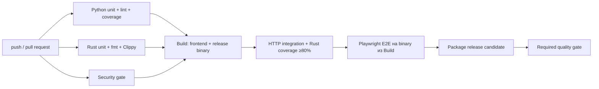

# CI/CD: GitHub Actions и GitLab CI с блокирующими quality gates

**Работа:** третья по имени файла `TestingPS/Laba-3.md`, №4 по заголовку.
**Выполнил:** Мороз Роман, ПВ-233. **Дата:** 26.11.2026.

Конфигурации: [GitHub Actions](../../.github/workflows/ci.yml),
[GitLab CI](../../.gitlab-ci.yml). Оба варианта используют одни исходники,
lockfiles, тесты и пороги; для запуска достаточно выбрать платформу.
CI работает на push и PR/MR. Нажатие Save в редакторе не является событием CI.

## Как проходит изменение

Первые три job независимы. Build имеет `needs: [python, rust, security]`,
поэтому ошибка unit, lint или аудита оставляет Build в skipped. Далее ошибка
integration блокирует E2E, ошибка E2E блокирует пакет. Артефакт `application`
создаётся до integration, но выпускным кандидатом считается только архив
`release-candidate` после E2E. Автоматического деплоя в production нет: для него
не задана целевая инфраструктура. Здесь CD означает проверенную упаковку,
готовую к доставке и отдельному развёртыванию.

Это следует семантике зависимостей и условий
[GitHub Actions](https://docs.github.com/en/actions/how-tos/write-workflows/choose-when-workflows-run/control-jobs-with-conditions)
и [GitLab CI YAML](https://docs.gitlab.com/ci/yaml/).

## GitHub Actions: что означает каждая часть

| Ключ / элемент | Значение в этом проекте | Зачем нужен |
|---|---|---|
| `name: CI` | Имя workflow и badge | Узнать нужный прогон среди остальных |
| `on.push` | Любой push в ветку или tag | Проверить каждый отправленный коммит |
| `on.pull_request` | Открытие/обновление PR | Проверить предлагаемое слияние |
| `workflow_dispatch` | Ручной запуск с выбором gate_demo | Повторить проверку и показать отказ |
| `permissions.contents: read` | Только чтение кода | Проверкам не нужно право push или публикации |
| `concurrency` | Один актуальный прогон на ref | Отменяет устаревшие прогоны той же ветки |
| `runs-on: ubuntu-24.04` | ОС runner | Согласованная Linux среда |
| `timeout-minutes` | Ограничение времени job | Зависший процесс не занимает runner бесконечно |
| `steps` | Последовательность команд внутри job | Ненулевой код команды останавливает обычные последующие шаги |
| `uses` с SHA | Закреплённая версия action | Изменение tag у автора не меняет проверку скрыто |
| `with` | Параметры action | Версии Node/Python, имя и путь артефакта |
| `run` | Команда shell | Запускает реальные инструменты и сохраняет exit code |
| `env` | Переменные окружения | Например GATE_DEMO и путь готового бинарника |
| `needs` | Успешные job-предшественники | Реальная блокировка следующих стадий |
| `if: always()` у upload | Загружать даже при ошибке тестов | Доступны причины падения и coverage |
| `retention-days` | Срок хранения артефакта | 7 дней для сборки, 14 — для основных отчётов |

Job `python`: locked uv, Ruff, 67 pytest-проверок, line/branch coverage.
Job `rust`: rustfmt, Clippy с `-D warnings`, 8 unit tests.
Job `security`: Bandit, pip-audit, npm audit для двух lockfiles, cargo-audit.
Job `build`: TypeScript typecheck, ESLint, Vite build и cargo release.
Job `integration`: 8 unit + 12 HTTP integration с инструментированным
coverage, выдаёт LCOV/Cobertura/HTML.
Job `e2e`: скачивает **binary и UI именно из Build**, устанавливает Chromium,
запускает шесть сценариев. Job `package` архивирует прошедшие проверку файлы.

Последний `required` имеет `if: always()`, собирает результаты всех job и
падает при любом failed/cancelled/skipped. Это важно: отдельный skipped job
GitHub может считать успешным для required check, поэтому одного обязательного
Build недостаточно. Для защиты main выбирается **Required quality gate**.

## Пороги

| Gate | Настройка | Что блокирует |
|---|---|---|
| Python coverage | `fail_under = 100`, branch включён в pyproject | Любое снижение ниже 100% (строже 80%) |
| Rust coverage | `cargo llvm-cov --fail-under-lines 80` | Менее 80% исполняемых строк обоих production-файлов |
| Python SAST | `bandit -lll TestingPS/Laba-1/delivery.py Specification/Laba-1/calculator.py` | Находку High; у Bandit нет отдельного Critical |
| Python SCA | `pip-audit` окружения locked uv | Любую известную уязвимость зависимостей |
| Rust SCA | `cargo audit` | Любую известную уязвимость Cargo.lock |
| Node SCA | `npm audit --audit-level=critical` в корне и frontend | Critical в UI или тестовом toolchain |
| Функциональные тесты | pytest / cargo / Playwright без подавления exit code | Любую ошибку проверки |

`pip-audit` выполняет dependency-check, аналогичный роли Safety, без требования
аккаунта коммерческого сервиса; статический анализ выполняет прямо указанный
в задании Bandit. Инструменты сканируют разные языки: Bandit не проверяет Rust,
поэтому его нельзя выдавать за аудит Rust backend.

Rust gate измеряет **line coverage**; стабильный LLVM branch coverage здесь
не заявляется. Python gate проверяет строки и исходы ветвей. `main.rs`, включая
запуск и остановку сервера, остаётся в знаменателе Rust coverage: низкое покрытие
entrypoint не скрыто исключением. Отчёт основан на
[cargo-llvm-cov](https://github.com/taiki-e/cargo-llvm-cov).

## GitLab CI: соответствие

| GitHub | GitLab | Особенности |
|---|---|---|
| `on` | `workflow.rules` | push, merge_request_event, web; дубли push/MR убираются |
| `jobs` | Именованные job в корне YAML | python, rust, security, build, integration, e2e, package |
| `runs-on` | `image` + runner | Rust/Node/uv Docker images; runner с Docker executor |
| Логические уровни `needs` | `stages` + `needs` | Оба механизма явно сохраняют блокировки |
| `steps.run` | `script` | Ненулевой код останавливает job |
| `upload-artifact if always` | `artifacts.when: always` | Отчёты загружаются при падении |
| upload JUnit/XML | `artifacts.reports` | GitLab отображает JUnit/Cobertura в интерфейсе |
| `gate_demo` input | `GATE_DEMO` variable | none / unit / coverage / security |
| `application` download | `needs: artifacts: true` | E2E получает binary и frontend от build |
| required status | Pipelines must succeed | Вместе с protected main блокирует merge |

Конфиг GitLab не использует `allow_failure: true`, `when: always` для сборки
или `|| true` вокруг обязательных тестов. Единственный `always` в артефактах
не превращает упавший job в успешный. Внешний public-api запускается отдельно
по переменной RUN_PUBLIC_API=1 и сохраняет failed при реальных дефектах.

## Доказательства блокировки

Локально исполнены **реальные инструменты** с изолированными ошибочными
fixtures; они не меняют рабочие тесты проекта:

| Сценарий | Команда | Наблюдение | Доказательство |
|---|---|---|---|
| Ошибка unit | `uv run --locked python TestingPS/Laba-3/scripts/demo_gate.py unit` | pytest FAIL, exit 1 | [gate-unit.txt](evidence/gate-unit.txt) |
| Недостаточное покрытие | `uv run --locked python TestingPS/Laba-3/scripts/demo_gate.py coverage` | 66,67% < 80%, exit 1 | [gate-coverage.txt](evidence/gate-coverage.txt) |
| Опасный вызов shell | `uv run --locked python TestingPS/Laba-3/scripts/demo_gate.py security` | Bandit B602 High, exit 1 | [gate-security.txt](evidence/gate-security.txt) |
| Critical зависимость | Gate по реальному исходному npm audit JSON | critical=1 → exit 1 | [gate-critical.txt](evidence/gate-critical.txt) |

Первый аудит обнаружил Critical в handlebars из Newman toolchain. После
фиксации `overrides.handlebars = 4.7.10` Critical = 0. High/Moderate остаются
в dev-инструментах и не обходят установленный порог: политика задания
блокирует именно Critical для npm. Rust и Python dependency audit — без
найденных уязвимостей на дату прогона; база уязвимостей изменяется со временем.
Результат валидатора fail-closed: отсутствующий/сломанный JSON — ошибка,
а не зелёный gate. Сводка security — [security.json](evidence/security.json).

Для **фактического hosted доказательства** после публикации ветки:

Ручной `workflow_dispatch` появится в UI GitHub, когда определение workflow
доступно в default branch. Первоначальный прогон ветки автоматически запускается
по push; доступность кнопки Run workflow не предполагается до этого условия.

1. Запустить Actions → CI → Run workflow → ветка moroz_roman → gate_demo=unit.
2. Сохранить скриншот: Python unit and lint failed; Build skipped;
   Integration, E2E, Package skipped; Required quality gate failed.
3. Повторить с coverage и security, сохранить вывод инструмента и граф.
4. Запустить none: все job должны завершиться успешно.
5. В GitLab повторить через Run pipeline с GATE_DEMO.

Hosted прогоны и скриншоты страницы GitHub **не выполнены**: изменения
локальные, gh и GitHub API credentials в среде отсутствуют. Локальный exit
code доказывает работу инструмента, а не факт skipped на сервере GitHub.

## Branch protection

YAML сам по себе не включает защиту ветки. Администратору GitHub после
первого прогона: Settings → Branches/Rulesets → правило main → Require a pull
request → Require status checks → **Required quality gate**, Require branches
to be up to date, запрет bypass при необходимости. Название required check
должно совпасть с реальным job, а не с ID `required` в YAML.
Основание: [официальная документация protected branches](https://docs.github.com/en/repositories/configuring-branches-and-merges-in-your-repository/managing-protected-branches/about-protected-branches).

GitLab: Settings → Repository → Protected branches → main; запрет прямого
push разработчикам; Settings → Merge requests → Merge checks → Pipelines
must succeed. Не разрешать merge со skipped pipeline. Административная
настройка удалённого проекта в этой среде не применена.

## Артефакты и badge

Python: HTML/XML coverage и JUnit. Rust: LCOV/Cobertura/HTML. Playwright:
HTML/JUnit, screenshots, trace и video при падении. Security: отчёты каждого
инструмента. Release candidate: tar.gz с binary и TestingPS/Laba-3/frontend/dist, без секретов.
Badge в [README](../../README.md) показывает реальный статус удалённого CI;
до первой публикации может показывать no status.

## Контрольные вопросы

1. **Пирамида тестирования** — много быстрых локальных проверок, меньше
   интеграционных, немного дорогих браузерных. Она ускоряет обратную связь
   и делает поиск причины отказа точнее; числа проекта приведены в UI-отчёте.
2. **Паттерны UI:** Page Object и Component Object скрывают селекторы,
   fixtures готовят изолированное окружение, data-driven tests покрывают
   входные классы. Здесь применены Page Object, browser fixtures и UUID-данные.
3. **Quality gates** — обязательные измеримые условия перехода: тесты,
   покрытие, lint, безопасность. Ненулевой exit code и зависимости job делают
   их блокирующими, а required checks связывают с разрешением merge.
4. **Порядок уровней:** unit проверяют коммит быстро; integration проверяют
   связи компонентов после сборки; E2E перед упаковкой проверяют готовый
   пользовательский путь. В данном CI все уровни запускаются на каждый push/PR,
   но последовательно проходят свои зависимости.

## Вывод

Оба конфига задают одинаковую цепочку доверия к выпускному пакету. Gates не
маскируют падения тестов, отчёты доступны после отказа, а отдельный итоговый
check учитывает skipped и cancelled. Локальные инструменты и сценарии отказа
проверены; завершение hosted части явно выделено в процедуру сдачи.
