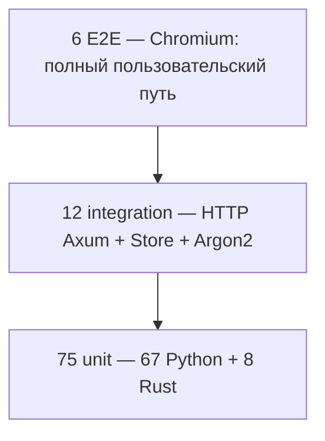

# UI-автоматизация и пирамида тестирования

**Исходный файл:** `TestingPS/Laba-3.md` (в тексте — работа №4).
**Выполнил:** Мороз Роман, ПВ-233. **Дата:** 26.11.2026.

## Цель и тестируемое приложение

Автоматизировать покупательские сценарии настоящим браузером, выделить Page
Objects и встроить проверку в блокирующий CI/CD pipeline.
Предложенный [магазин](https://github.com/Sajid788/edgistify-Assignment) использован
как источник React UI; зафиксирован upstream commit и описаны изменения в
[THIRD_PARTY.md](THIRD_PARTY.md). Backend реализован на Rust/Axum, как просил
пользователь для заданий без фиксированного языка. UI-тесты используют разрешённый
заданием Playwright, TypeScript — язык его тестового runner.

Запуск локальный: один процесс обслуживает API и собранный React.
Начальные товары детерминированы, пользователи создаются с UUID в email,
каждый тест получает отдельный browser context. Моков API и фиксированных
пользователей нет; сетевой доступ к upstream магазину не требуется.

## Сценарии

Предусловие: собран frontend, runner запускает сервер; для каждого теста
новый browser context и, если нужен вход, новая учётная запись.

| ID | Приоритет / тип | Шаги | Ожидаемый результат |
|---|---|---|---|
| UI-01 | P1, основной E2E | Регистрация → вход → поиск rust → размер M → добавление → корзина → адрес → заказ → пустая корзина → выход → защищённая страница | Успешный заказ и правильный адрес, цена 80, корзина очищена, после выхода redirect в login |
| UI-02 | P1, негативный | Создать пользователя → войти с неверным паролем | Ошибка Invalid credentials, token отсутствует, остаётся login |
| UI-03 | P2, поиск/границы | Поиск несуществующего имени → очистить строку | No products found → все три товара |
| UI-04 | P1, авторизация | Гость пытается добавить товар → открыть checkout | Подсказка входа, redirect в login |
| UI-05 | P1, уникальность | Зарегистрироваться → повторить email | Email already registered, остаётся signup |
| UI-06 | P1, корзина | Войти → добавить товар → удалить последнюю позицию | Your cart is empty |

Автотесты: [shop.spec.ts](e2e/shop.spec.ts),
Page Objects: [pages.ts](e2e/pages.ts),
настройки: [playwright.config.ts](playwright.config.ts).

`AuthPage` управляет формами, `CatalogPage` — поиском и добавлением,
`CartPage` — корзиной и заказом. Page Object скрывает селекторы, а сценарии
сохраняют бизнес-ожидания. Подход соответствует
[рекомендациям Playwright](https://playwright.dev/docs/pom).
Используются role/label и стабильные testid; ожидания привязаны к состоянию
страницы и ответам, `waitForTimeout` и фиксированных sleep нет.
Retries = 0: нестабильный тест виден сразу, повторы не скрывают проблему.

## Пирамида



Всего **93 локальных теста**: 75 unit (80,6%), 12 integration (12,9%),
6 E2E (6,5%). Это пирамида учебного репозитория целиком: из Python 34 теста
относятся к доставке и 33 — к отдельному калькулятору.
У самого магазина 8 Rust unit + 12 integration + 6 E2E; его HTTP-слой
занимает большую долю, потому что основные риски здесь — auth и изоляция.
Не требуется искусственно создавать десятки одинаковых unit-тестов ради процента.

| Уровень | Что проверяется | Почему этот объём |
|---|---|---|
| Unit | Тарифы, арифметика, валидация типов, суммы и переполнение, каталог, email, expiration | Много комбинаций, быстрый точный диагноз, без браузера и TCP |
| Integration | Роутинг, DTO, Argon2, сессии, принадлежность корзины, сумма/статусы заказа, ошибки JSON/лимита | Проверяет реальные связи компонентов через Router oneshot, без подмены Store |
| E2E | Критическая покупка, поиск и видимые ошибки | Браузер дороже и даёт менее локальный диагноз; детали границ остаются ниже |

Публичные 28 API-кейсов Restful-Booker не включены в пирамиду локального
магазина: это другая система и отдельная лабораторная.

## Прогоны и артефакты

```bash
npm ci
npm --prefix TestingPS/Laba-3/frontend ci
npm --prefix TestingPS/Laba-3/frontend run build
npx playwright install --with-deps chromium
npm run test:e2e
npx playwright show-report artifacts/playwright/html
```

Playwright запускает `cargo run --locked`, ждёт `/api/health` и останавливает
процесс после тестов. Если `SHOP_EXECUTABLE` задан, тестирует уже собранный
release binary. В CI передаётся бинарник стадии build, а не новая независимая сборка.

Фактический результат после исправления селектора: **6 passed**.
Протокол — [ui-tests.txt](evidence/ui-tests.txt); JUnit —
`artifacts/playwright/junit.xml`; HTML — `artifacts/playwright/html/`.
Скриншот каждого теста сохраняется при успехе и ошибке; video/trace — при ошибке.

Первый рабочий браузерный запуск дал 5 PASS и 1 FAIL: точный текстовый
селектор адреса не учитывал соседнюю подпись Shipping Address. Адрес уже был
в DOM, поэтому это **дефект автотеста**, не магазина. Добавлен стабильный
`order-address`, проверка содержимого сохранена, повторный прогон зелёный.
Доказательства: [лог падения](evidence/ui-failed-locator.txt),
[скриншот](evidence/ui-failed-locator.png),
[успешный экран](evidence/ui-success.png).

Дополнительная проверка извлечённого release-архива выявила HTTP 404 у
SPA-страниц при прямом переходе. Причина — `not_found_service` сохранял статус
404 даже при выдаче index.html. Он заменён на `fallback`; UI-03 теперь явно
требует HTTP 200 для `/products`. Повторная проверка пяти маршрутов пакета
сохранена в [package-smoke.json](evidence/package-smoke.json).
Воспроизведение после release build: `uv run --locked python TestingPS/Laba-3/scripts/package_smoke.py`.

В локальной Linux-среде отсутствовали libnss3/libnspr4, а sudo недоступен.
Для проверки библиотеки извлечены из Ubuntu deb в игнорируемый каталог
`artifacts/browser-libs`, запуск получил соответствующий `LD_LIBRARY_PATH`.
Конфиги CI устанавливают библиотеки штатно; этот локальный обход в них не нужен.

## Ограничения и вывод

Прогон проверяет Chromium desktop; Firefox/WebKit, мобильные размеры,
нагрузка и отдельный аудит accessibility в объём не включены.
Хранилище in-memory и модель bearer/localStorage явно описаны в ТЗ.
Проверка frontend не заменяет серверную авторизацию: её отдельно проверяют
интеграционные тесты с подменой цены, userId и чужими позициями.

Page Objects уменьшили цену изменения селекторов; быстрые уровни локализуют
ошибки, а E2E подтверждают целостный пользовательский путь. Блокировки CI/CD
и ответы на контрольные вопросы приведены в [следующем отчёте](ci-cd.md).
