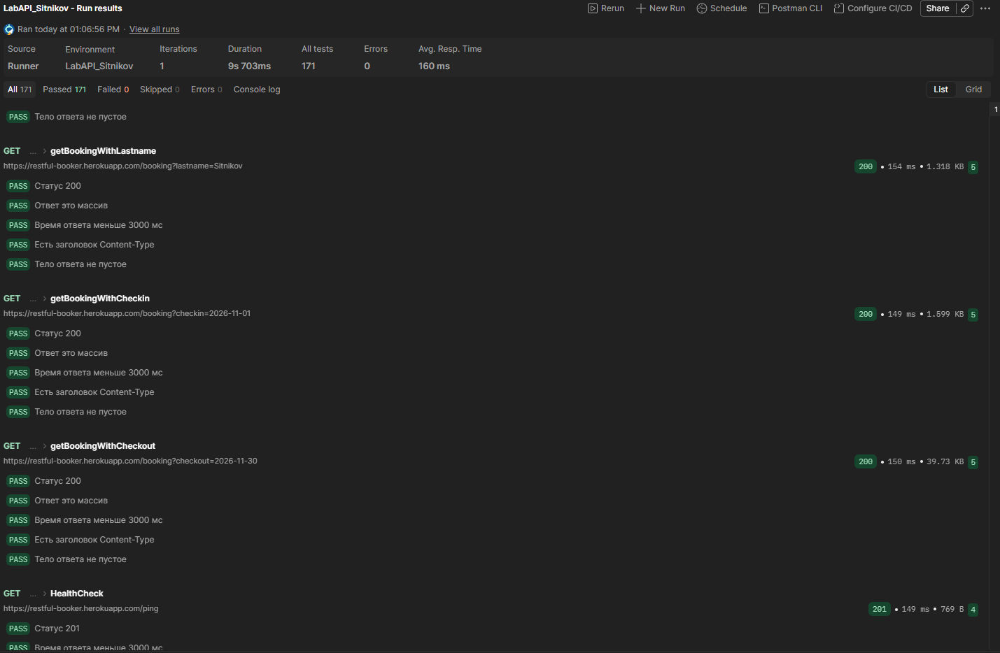
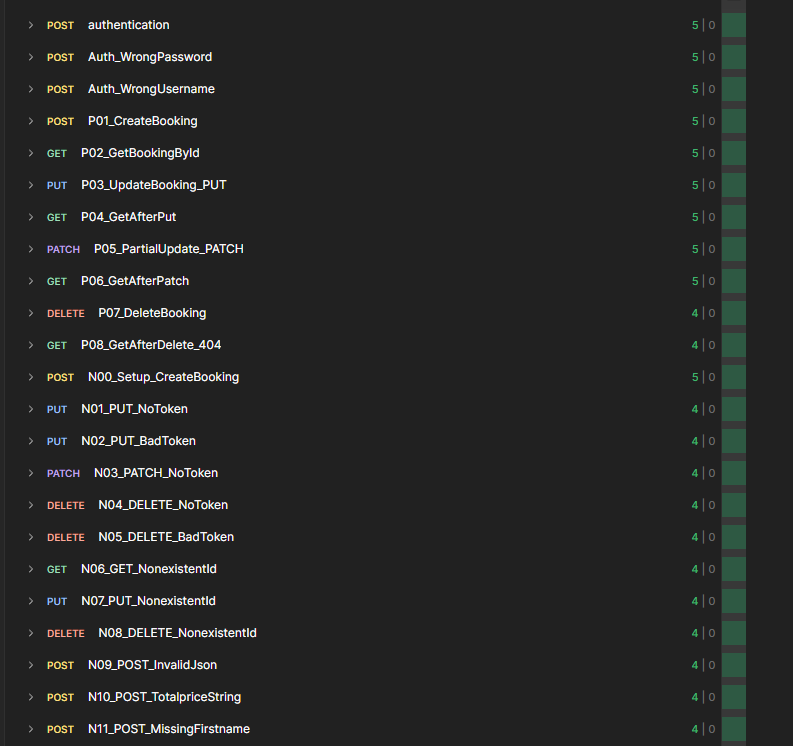
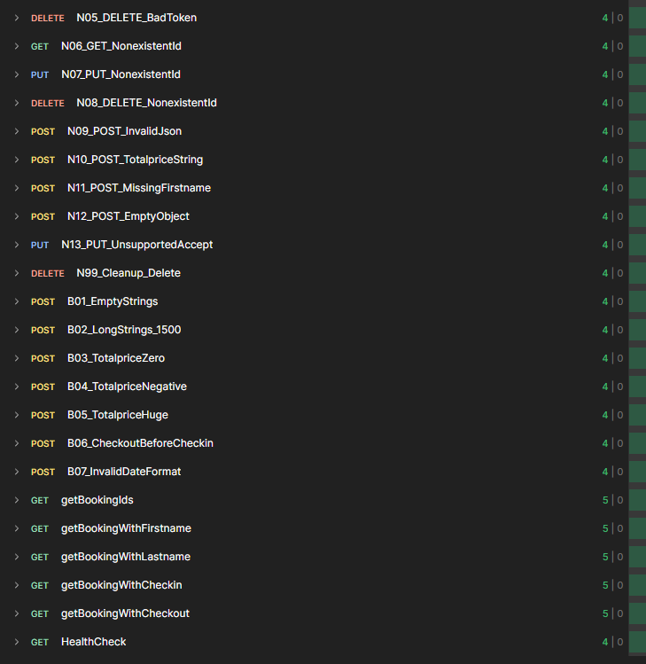

# Лабораторная работа № 3 
# «Интеграционное и API-тестирование»
## Ситников Алексей ПВ 233
## 1. Сервис и тестируемые эндпоинты

**Restful-Booker,** открытое учебное API бронирования отелей: https://restful-booker.herokuapp.com (документация: https://restful-booker.herokuapp.com/apidoc/index.html)

| Метод | Эндпоинт | Назначение | Токен |
|---|---|---|---|
| POST | `/auth` | получение токена (admin / password123) | нет |
| GET | `/booking` | список id бронирований, фильтры firstname, lastname, checkin, checkout | нет |
| GET | `/booking/{id}` | получение бронирования | нет |
| POST | `/booking` | создание бронирования | нет |
| PUT | `/booking/{id}` | полное обновление | да |
| PATCH | `/booking/{id}` | частичное обновление | да |
| DELETE | `/booking/{id}` | удаление | да |
| GET | `/ping` | проверка работоспособности | нет |

Коллекция состоит из папок `Auth`, `Booking` (подпапки `Positive`, `Negative`, `Boundary`) и `Health`. В каждом запросе есть описание (цель, входные данные, ожидаемый результат) и автоматическиe провероки: статус-код, время ответа менее 3000 мс, наличие заголовка Content-Type, непустое тело, а также проверки полей ответа там, где ответ в формате JSON. Токен и id сохраняются в переменные окружения скриптами (`token`, `bookingId`, `negBookingId`).

## 2. Таблица тест-кейсов

| ID | Эндпоинт | Тип | Входные данные | Ожидаемый результат                        | Фактический результат |
|---|---|---|---|--------------------------------------------|---|
| authentication | POST /auth | Позитивный | admin / password123 | 200, в теле token                          | 200, token получен |
| Auth_WrongPassword | POST /auth | Негативный | пароль wrong | 200, `reason: Bad credentials`, токена нет | 200, `reason: Bad credentials` |
| Auth_WrongUsername | POST /auth | Негативный | логин nobody | 200, `reason: Bad credentials`, токена нет | 200, `reason: Bad credentials` |
| getBookingIds | GET /booking | Позитивный | без фильтров | 200, массив объектов с bookingid           | 200, массив |
| getBookingWithFirstname | GET /booking | Позитивный | ?firstname=Alexsey | 200, массив                                | 200, массив |
| getBookingWithLastname | GET /booking | Позитивный | ?lastname=Sitnikov | 200, массив                                | 200, массив |
| getBookingWithCheckin | GET /booking | Позитивный | ?checkin=2026-11-01 | 200, массив                                | 200, массив |
| getBookingWithCheckout | GET /booking | Позитивный | ?checkout=2026-11-30 | 200, массив                                | 200, массив |
| P01_CreateBooking | POST /booking | Позитивный | корректный JSON со всеми полями | 200, bookingid и booking                   | 200, bookingid и booking |
| P02_GetBookingById | GET /booking/{id} | Позитивный | `{{bookingId}}` (id из P01) | 200, данные совпадают с созданными         | 200, данные совпадают |
| P03_UpdateBooking_PUT | PUT /booking/{id} | Позитивный | токен, totalprice=400, checkout=2026-11-22 | 200, данные обновлены                      | 200, данные обновлены |
| P04_GetAfterPut | GET /booking/{id} | Позитивный | `{{bookingId}}` | 200, totalprice=400                        | 200, totalprice=400 |
| P05_PartialUpdate_PATCH | PATCH /booking/{id} | Позитивный | токен, firstname=Alex, lastname=Sit | 200, имя и фамилия изменены, цена прежняя  | 200, имя и фамилия изменены, цена 400 |
| P06_GetAfterPatch | GET /booking/{id} | Позитивный | `{{bookingId}}` | 200, firstname=Alex, lastname=Sit          | 200, firstname=Alex, lastname=Sit |
| P07_DeleteBooking | DELETE /booking/{id} | Позитивный | токен | 201, тело Created                          | 201, тело Created |
| P08_GetAfterDelete_404 | GET /booking/{id} | Позитивный | `{{bookingId}}` удалённой записи | 404                                        | 404 |
| N01_PUT_NoToken | PUT /booking/{id} | Негативный | без Cookie | 403                                        | 403 |
| N02_PUT_BadToken | PUT /booking/{id} | Негативный | token=invalid123 | 403                                        | 403 |
| N03_PATCH_NoToken | PATCH /booking/{id} | Негативный | без Cookie | 403                                        | 403 |
| N04_DELETE_NoToken | DELETE /booking/{id} | Негативный | без Cookie | 403                                        | 403 |
| N05_DELETE_BadToken | DELETE /booking/{id} | Негативный | token=invalid123 | 403                                        | 403 |
| N06_GET_NonexistentId | GET /booking/999999999 | Негативный | несуществующий id | 404                                        | 404 |
| N07_PUT_NonexistentId | PUT /booking/999999999 | Негативный | верный токен | 404                                        | 405 |
| N08_DELETE_NonexistentId | DELETE /booking/999999999 | Негативный | верный токен | 404                                        | 405 |
| N09_POST_InvalidJson | POST /booking | Негативный | незакрытая скобка в JSON | 400                                        | 400 |
| N10_POST_TotalpriceString | POST /booking | Негативный | totalprice = "abc" | 500                                        | 500 |
| N11_POST_MissingFirstname | POST /booking | Негативный | нет поля firstname | 500                                        | 500 |
| N12_POST_EmptyObject | POST /booking | Негативный | тело {} | 500                                        | 500 |
| N13_PUT_UnsupportedAccept | PUT /booking/{id} | Негативный | Accept: text/plain | 418                                        | 418 |
| B01_EmptyStrings | POST /booking | Граничный | firstname и lastname пустые | 400                                        | 500 |
| B02_LongStrings_1500 | POST /booking | Граничный | строки по 1500 символов | 400                                        | 200 |
| B03_TotalpriceZero | POST /booking | Граничный | totalprice = 0 | 200                                        | 200 |
| B04_TotalpriceNegative | POST /booking | Граничный | totalprice = -100 | 400                                        | 200 |
| B05_TotalpriceHuge | POST /booking | Граничный | totalprice = 99999999999999 | 200                                        | 200 |
| B06_CheckoutBeforeCheckin | POST /booking | Граничный | checkin 2026-12-10, checkout 2026-12-01 | 400                                        | 200 |
| B07_InvalidDateFormat | POST /booking | Граничный | даты not-a-date и 31/31/2026 | 400                                        | 200 |
| HealthCheck | GET /ping | Позитивный | без параметров | 200                                        | 201, тело Created |


## 3. Расхождения с документацией и дефекты

### 3.1. Таблица расхождений


| № | Запрос                                                                   | Ожидалось (по REST / документации) | Получено                             | Вывод |
|---|--------------------------------------------------------------------------|---|--------------------------------------|---|
| 1 | PUT /booking/999999999 (с токеном)                                       | 404 Not Found | 405 Method Not Allowed               | Дефект. Для GET того же id возвращается 404, для PUT и DELETE 405 |
| 2 | DELETE /booking/999999999 (с токеном)                                    | 404 Not Found | 405                                  | Дефект, аналогично п. 1 |
| 3 | POST /auth с неверным паролем или логином                                | 401 Unauthorized | 200, тело `{"reason":"Bad credentials"}` | Особенность API. Клиент должен проверять тело, а не код |
| 4 | DELETE /booking/{id}                                                     | 200 или 204 | 201 Created                          | Особенность API: код «создано» для операции удаления |
| 5 | GET /ping                                                                | 200 OK | 201 Created                          | Особенность API |
| 6 | POST /booking без обязательного поля, строка в totalprice, пустой объект | 400 Bad Request | 500 Internal Server Error            | Дефект: ошибка клиента обрабатывается как ошибка сервера |
| 7 | POST /booking с пустым телом                                             | 400 | 500                                  | Дефект валидации |
| 8 | POST /booking с отрицательным totalprice                                 | 400 | 200                       | Дефект валидации |
| 9 | POST /booking, checkout раньше checkin                                   | 400 | 200                      | Дефект валидации |
| 10 | POST /booking с невалидной датой                                         | 400 | 200                      | Дефект валидации |
| 11 | POST /booking со строками по 1500 символов                               | 400 (ограничение длины) | 200                       | Дефект: нет ограничения длины |
| 12 | PUT с заголовком Accept: text/plain                                      | 406 Not Acceptable | 418                      | Особенность API: нестандартный код |

### 3.2. Баг-репорты

**BUG-1. PUT и DELETE несуществующего id возвращают 405 вместо 404**
- Шаги: 1) получить токен через `POST /auth`; 2) отправить `PUT {{baseUrl}}/booking/999999999` с заголовком `Cookie: token={{token}}` и корректным JSON; 3) аналогично `DELETE`.
- Ожидаемый результат: 404 Not Found, как у `GET /booking/999999999`.
- Фактический результат: 405 Method Not Allowed.
- Серьёзность: низкая. Данные не страдают, клиент получает неточный код.

**BUG-2. Некорректные данные при создании бронирования принимаются**
- Шаги: отправить `POST /booking` с одним из вариантов: пустые firstname и lastname; totalprice = -100; checkin 2026-12-10 и checkout 2026-12-01; даты `not-a-date` и `31/31/2026`; строки по 1500 символов.
- Ожидаемый результат: 400 Bad Request с описанием ошибки.
- Фактический результат: 200 OK, бронирование создано.
- Серьёзность: средняя. В базу попадают заведомо некорректные данные.

**BUG-3. Ошибки клиента приводят к 500**
- Шаги: отправить `POST /booking` без поля firstname, либо с totalprice = "abc", либо с телом `{}`.
- Ожидаемый результат: 400 Bad Request.
- Фактический результат: 500 Internal Server Error.
- Серьёзность: средняя. Сервер сообщает о собственной ошибке вместо ошибки в запросе.

**BUG-4. Неверные учётные данные в /auth дают 200** 
- Шаги: `POST /auth` с телом `{"username":"admin","password":"wrong"}`.
- Ожидаемый результат: 401 Unauthorized.
- Фактический результат: 200 OK и тело `{"reason":"Bad credentials"}`.
- Серьёзность: низкая. Клиенты, проверяющие только код, примут ошибку за успех.

**BUG-5. Нестандартные коды успеха и ошибок** 
- DELETE возвращает 201 вместо 200/204, `/ping` возвращает 201 вместо 200, PUT с неподдерживаемым Accept возвращает 418 вместо 406.
- Серьёзность: низкая.

## 4. Скриншоты прогона в Collection Runner




## 5. Экспортированные файлы

# Коллекция
```json
{
  "info": {
    "_postman_id": "aa3b05f1-a6f5-4d2a-8108-e81a1e6d1405",
    "name": "LabAPI_Sitnikov",
    "schema": "https://schema.getpostman.com/json/collection/v2.1.0/collection.json",
    "_exporter_id": "47417758"
  },
  "item": [
    {
      "name": "Auth",
      "item": [
        {
          "name": "authentication",
          "event": [
            {
              "listen": "test",
              "script": {
                "type": "text/javascript",
                "exec": [
                  "pm.test(\"Статус 200\", () => pm.response.to.have.status(200));",
                  "const json = pm.response.json();",
                  "pm.test(\"В ответе есть токен\", () => pm.expect(json).to.have.property(\"token\"));",
                  "pm.environment.set(\"token\", json.token);",
                  "pm.test(\"Время ответа меньше 3000 мс\", () => pm.expect(pm.response.responseTime).to.be.below(3000));",
                  "pm.test(\"Есть заголовок Content-Type\", () => pm.expect(pm.response.headers.has(\"Content-Type\")).to.be.true);",
                  "pm.test(\"Тело ответа не пустое\", () => pm.expect(pm.response.text().length).to.be.above(0));"
                ]
              }
            }
          ],
          "request": {
            "method": "POST",
            "header": [
              {
                "key": "Content-Type",
                "value": "application/json"
              },
              {
                "key": "Accept",
                "value": "application/json"
              }
            ],
            "body": {
              "mode": "raw",
              "raw": "{\n  \"username\": \"admin\",\n  \"password\": \"password123\"\n}",
              "options": {
                "raw": {
                  "language": "json"
                }
              }
            },
            "url": {
              "raw": "{{baseUrl}}/auth",
              "host": [
                "{{baseUrl}}"
              ],
              "path": [
                "auth"
              ]
            },
            "description": "**Цель:** получить токен и сохранить его в окружение\n\n**Входные данные:** POST {{baseUrl}}/auth, JSON {username: admin, password: password123}\n\n**Ожидаемый результат:** 200, в теле поле token; токен сохранён в переменную token"
          },
          "response": []
        },
        {
          "name": "Auth_WrongPassword",
          "event": [
            {
              "listen": "test",
              "script": {
                "type": "text/javascript",
                "exec": [
                  "pm.test(\"Статус 200\", () => pm.response.to.have.status(200));",
                  "const json = pm.response.json();",
                  "pm.test(\"Нет токена, есть reason\", () => {",
                  "  pm.expect(json).to.not.have.property(\"token\");",
                  "  pm.expect(json).to.have.property(\"reason\", \"Bad credentials\");",
                  "});",
                  "pm.test(\"Время ответа меньше 3000 мс\", () => pm.expect(pm.response.responseTime).to.be.below(3000));",
                  "pm.test(\"Есть заголовок Content-Type\", () => pm.expect(pm.response.headers.has(\"Content-Type\")).to.be.true);",
                  "pm.test(\"Тело ответа не пустое\", () => pm.expect(pm.response.text().length).to.be.above(0));"
                ]
              }
            }
          ],
          "request": {
            "method": "POST",
            "header": [
              {
                "key": "Content-Type",
                "value": "application/json"
              },
              {
                "key": "Accept",
                "value": "application/json"
              }
            ],
            "body": {
              "mode": "raw",
              "raw": "{\n  \"username\": \"admin\",\n  \"password\": \"wrong\"\n}",
              "options": {
                "raw": {
                  "language": "json"
                }
              }
            },
            "url": {
              "raw": "{{baseUrl}}/auth",
              "host": [
                "{{baseUrl}}"
              ],
              "path": [
                "auth"
              ]
            },
            "description": "**Цель:** проверить вход с неверным паролем\n\n**Входные данные:** username=admin, password=wrong\n\n**Ожидаемый результат:** 200 (особенность API), тело {\"reason\":\"Bad credentials\"}, поля token нет"
          },
          "response": []
        },
        {
          "name": "Auth_WrongUsername",
          "event": [
            {
              "listen": "test",
              "script": {
                "type": "text/javascript",
                "exec": [
                  "pm.test(\"Статус 200\", () => pm.response.to.have.status(200));",
                  "const json = pm.response.json();",
                  "pm.test(\"Нет токена, есть reason\", () => {",
                  "  pm.expect(json).to.not.have.property(\"token\");",
                  "  pm.expect(json).to.have.property(\"reason\", \"Bad credentials\");",
                  "});",
                  "pm.test(\"Время ответа меньше 3000 мс\", () => pm.expect(pm.response.responseTime).to.be.below(3000));",
                  "pm.test(\"Есть заголовок Content-Type\", () => pm.expect(pm.response.headers.has(\"Content-Type\")).to.be.true);",
                  "pm.test(\"Тело ответа не пустое\", () => pm.expect(pm.response.text().length).to.be.above(0));"
                ]
              }
            }
          ],
          "request": {
            "method": "POST",
            "header": [
              {
                "key": "Content-Type",
                "value": "application/json"
              },
              {
                "key": "Accept",
                "value": "application/json"
              }
            ],
            "body": {
              "mode": "raw",
              "raw": "{\n  \"username\": \"nobody\",\n  \"password\": \"password123\"\n}",
              "options": {
                "raw": {
                  "language": "json"
                }
              }
            },
            "url": {
              "raw": "{{baseUrl}}/auth",
              "host": [
                "{{baseUrl}}"
              ],
              "path": [
                "auth"
              ]
            },
            "description": "**Цель:** проверить вход с неверным логином\n\n**Входные данные:** username=nobody, password=password123\n\n**Ожидаемый результат:** 200 (особенность API), тело {\"reason\":\"Bad credentials\"}, поля token нет"
          },
          "response": []
        }
      ]
    },
    {
      "name": "Booking",
      "item": [
        {
          "name": "Positive",
          "item": [
            {
              "name": "P01_CreateBooking",
              "event": [
                {
                  "listen": "test",
                  "script": {
                    "type": "text/javascript",
                    "exec": [
                      "pm.test(\"Статус 200\", () => pm.response.to.have.status(200));",
                      "const json = pm.response.json();",
                      "pm.test(\"В ответе есть bookingid\", () => pm.expect(json).to.have.property(\"bookingid\"));",
                      "pm.environment.set(\"bookingId\", json.bookingid);",
                      "pm.test(\"Время ответа меньше 3000 мс\", () => pm.expect(pm.response.responseTime).to.be.below(3000));",
                      "pm.test(\"Есть заголовок Content-Type\", () => pm.expect(pm.response.headers.has(\"Content-Type\")).to.be.true);",
                      "pm.test(\"Тело ответа не пустое\", () => pm.expect(pm.response.text().length).to.be.above(0));"
                    ]
                  }
                }
              ],
              "request": {
                "method": "POST",
                "header": [
                  {
                    "key": "Content-Type",
                    "value": "application/json"
                  },
                  {
                    "key": "Accept",
                    "value": "application/json"
                  }
                ],
                "body": {
                  "mode": "raw",
                  "raw": "{\n  \"firstname\": \"Alexsey\",\n  \"lastname\": \"Sitnikov\",\n  \"totalprice\": 500,\n  \"depositpaid\": true,\n  \"bookingdates\": {\"checkin\": \"2026-11-07\", \"checkout\": \"2026-11-30\"},\n  \"additionalneeds\": \"Breakfast\"\n}",
                  "options": {
                    "raw": {
                      "language": "json"
                    }
                  }
                },
                "url": {
                  "raw": "{{baseUrl}}/booking",
                  "host": [
                    "{{baseUrl}}"
                  ],
                  "path": [
                    "booking"
                  ]
                },
                "description": "**Цель:** создать бронирование и сохранить его id\n\n**Входные данные:** POST {{baseUrl}}/booking, JSON со всеми полями\n\n**Ожидаемый результат:** 200, в теле bookingid и booking; bookingid сохранён в переменную bookingId"
              },
              "response": []
            },
            {
              "name": "P02_GetBookingById",
              "event": [
                {
                  "listen": "test",
                  "script": {
                    "type": "text/javascript",
                    "exec": [
                      "pm.test(\"Статус 200\", () => pm.response.to.have.status(200));",
                      "const j = pm.response.json();",
                      "pm.test(\"Данные совпадают с созданными\", () => {",
                      "  pm.expect(j.firstname).to.eql(\"Alexsey\");",
                      "  pm.expect(j.totalprice).to.eql(500);",
                      "});",
                      "pm.test(\"Время ответа меньше 3000 мс\", () => pm.expect(pm.response.responseTime).to.be.below(3000));",
                      "pm.test(\"Есть заголовок Content-Type\", () => pm.expect(pm.response.headers.has(\"Content-Type\")).to.be.true);",
                      "pm.test(\"Тело ответа не пустое\", () => pm.expect(pm.response.text().length).to.be.above(0));"
                    ]
                  }
                }
              ],
              "request": {
                "method": "GET",
                "header": [
                  {
                    "key": "Accept",
                    "value": "application/json"
                  }
                ],
                "url": {
                  "raw": "{{baseUrl}}/booking/{{bookingId}}",
                  "host": [
                    "{{baseUrl}}"
                  ],
                  "path": [
                    "booking",
                    "{{bookingId}}"
                  ]
                },
                "description": "**Цель:** получить созданное бронирование\n\n**Входные данные:** GET {{baseUrl}}/booking/{{bookingId}}\n\n**Ожидаемый результат:** 200, firstname=Alexsey, totalprice=500"
              },
              "response": []
            },
            {
              "name": "P03_UpdateBooking_PUT",
              "event": [
                {
                  "listen": "test",
                  "script": {
                    "type": "text/javascript",
                    "exec": [
                      "pm.test(\"Статус 200\", () => pm.response.to.have.status(200));",
                      "pm.test(\"totalprice обновлён\", () => pm.expect(pm.response.json().totalprice).to.eql(400));",
                      "pm.test(\"Время ответа меньше 3000 мс\", () => pm.expect(pm.response.responseTime).to.be.below(3000));",
                      "pm.test(\"Есть заголовок Content-Type\", () => pm.expect(pm.response.headers.has(\"Content-Type\")).to.be.true);",
                      "pm.test(\"Тело ответа не пустое\", () => pm.expect(pm.response.text().length).to.be.above(0));"
                    ]
                  }
                }
              ],
              "request": {
                "method": "PUT",
                "header": [
                  {
                    "key": "Content-Type",
                    "value": "application/json"
                  },
                  {
                    "key": "Accept",
                    "value": "application/json"
                  },
                  {
                    "key": "Cookie",
                    "value": "token={{token}}"
                  }
                ],
                "body": {
                  "mode": "raw",
                  "raw": "{\n  \"firstname\": \"Alexsey\",\n  \"lastname\": \"Sitnikov\",\n  \"totalprice\": 400,\n  \"depositpaid\": true,\n  \"bookingdates\": {\"checkin\": \"2026-11-07\", \"checkout\": \"2026-11-22\"},\n  \"additionalneeds\": \"Breakfast\"\n}",
                  "options": {
                    "raw": {
                      "language": "json"
                    }
                  }
                },
                "url": {
                  "raw": "{{baseUrl}}/booking/{{bookingId}}",
                  "host": [
                    "{{baseUrl}}"
                  ],
                  "path": [
                    "booking",
                    "{{bookingId}}"
                  ]
                },
                "description": "**Цель:** полностью обновить бронирование\n\n**Входные данные:** PUT {{baseUrl}}/booking/{{bookingId}}, заголовок Cookie: token={{token}}, JSON со всеми полями (totalprice=400, checkout=2026-11-22)\n\n**Ожидаемый результат:** 200, в теле обновлённые данные"
              },
              "response": []
            },
            {
              "name": "P04_GetAfterPut",
              "event": [
                {
                  "listen": "test",
                  "script": {
                    "type": "text/javascript",
                    "exec": [
                      "pm.test(\"Статус 200\", () => pm.response.to.have.status(200));",
                      "const j = pm.response.json();",
                      "pm.test(\"PUT сохранён\", () => {",
                      "  pm.expect(j.totalprice).to.eql(400);",
                      "  pm.expect(j.bookingdates.checkout).to.eql(\"2026-11-22\");",
                      "});",
                      "pm.test(\"Время ответа меньше 3000 мс\", () => pm.expect(pm.response.responseTime).to.be.below(3000));",
                      "pm.test(\"Есть заголовок Content-Type\", () => pm.expect(pm.response.headers.has(\"Content-Type\")).to.be.true);",
                      "pm.test(\"Тело ответа не пустое\", () => pm.expect(pm.response.text().length).to.be.above(0));"
                    ]
                  }
                }
              ],
              "request": {
                "method": "GET",
                "header": [
                  {
                    "key": "Accept",
                    "value": "application/json"
                  }
                ],
                "url": {
                  "raw": "{{baseUrl}}/booking/{{bookingId}}",
                  "host": [
                    "{{baseUrl}}"
                  ],
                  "path": [
                    "booking",
                    "{{bookingId}}"
                  ]
                },
                "description": "**Цель:** убедиться, что PUT сохранился\n\n**Входные данные:** GET {{baseUrl}}/booking/{{bookingId}}\n\n**Ожидаемый результат:** 200, totalprice=400, checkout=2026-11-22"
              },
              "response": []
            },
            {
              "name": "P05_PartialUpdate_PATCH",
              "event": [
                {
                  "listen": "test",
                  "script": {
                    "type": "text/javascript",
                    "exec": [
                      "pm.test(\"Статус 200\", () => pm.response.to.have.status(200));",
                      "const j = pm.response.json();",
                      "pm.test(\"Имя изменено, цена прежняя\", () => {",
                      "  pm.expect(j.firstname).to.eql(\"Alex\");",
                      "  pm.expect(j.totalprice).to.eql(400);",
                      "});",
                      "pm.test(\"Время ответа меньше 3000 мс\", () => pm.expect(pm.response.responseTime).to.be.below(3000));",
                      "pm.test(\"Есть заголовок Content-Type\", () => pm.expect(pm.response.headers.has(\"Content-Type\")).to.be.true);",
                      "pm.test(\"Тело ответа не пустое\", () => pm.expect(pm.response.text().length).to.be.above(0));"
                    ]
                  }
                }
              ],
              "request": {
                "method": "PATCH",
                "header": [
                  {
                    "key": "Content-Type",
                    "value": "application/json"
                  },
                  {
                    "key": "Accept",
                    "value": "application/json"
                  },
                  {
                    "key": "Cookie",
                    "value": "token={{token}}"
                  }
                ],
                "body": {
                  "mode": "raw",
                  "raw": "{\n  \"firstname\": \"Alex\",\n  \"lastname\": \"Sit\"\n}",
                  "options": {
                    "raw": {
                      "language": "json"
                    }
                  }
                },
                "url": {
                  "raw": "{{baseUrl}}/booking/{{bookingId}}",
                  "host": [
                    "{{baseUrl}}"
                  ],
                  "path": [
                    "booking",
                    "{{bookingId}}"
                  ]
                },
                "description": "**Цель:** частично обновить бронирование\n\n**Входные данные:** PATCH {{baseUrl}}/booking/{{bookingId}}, Cookie: token={{token}}, JSON {firstname: Alex, lastname: Sit}\n\n**Ожидаемый результат:** 200, имя и фамилия изменены, остальные поля прежние"
              },
              "response": []
            },
            {
              "name": "P06_GetAfterPatch",
              "event": [
                {
                  "listen": "test",
                  "script": {
                    "type": "text/javascript",
                    "exec": [
                      "pm.test(\"Статус 200\", () => pm.response.to.have.status(200));",
                      "const j = pm.response.json();",
                      "pm.test(\"PATCH сохранён\", () => {",
                      "  pm.expect(j.firstname).to.eql(\"Alex\");",
                      "  pm.expect(j.lastname).to.eql(\"Sit\");",
                      "});",
                      "pm.test(\"Время ответа меньше 3000 мс\", () => pm.expect(pm.response.responseTime).to.be.below(3000));",
                      "pm.test(\"Есть заголовок Content-Type\", () => pm.expect(pm.response.headers.has(\"Content-Type\")).to.be.true);",
                      "pm.test(\"Тело ответа не пустое\", () => pm.expect(pm.response.text().length).to.be.above(0));"
                    ]
                  }
                }
              ],
              "request": {
                "method": "GET",
                "header": [
                  {
                    "key": "Accept",
                    "value": "application/json"
                  }
                ],
                "url": {
                  "raw": "{{baseUrl}}/booking/{{bookingId}}",
                  "host": [
                    "{{baseUrl}}"
                  ],
                  "path": [
                    "booking",
                    "{{bookingId}}"
                  ]
                },
                "description": "**Цель:** убедиться, что PATCH сохранился\n\n**Входные данные:** GET {{baseUrl}}/booking/{{bookingId}}\n\n**Ожидаемый результат:** 200, firstname=Alex, lastname=Sit"
              },
              "response": []
            },
            {
              "name": "P07_DeleteBooking",
              "event": [
                {
                  "listen": "test",
                  "script": {
                    "type": "text/javascript",
                    "exec": [
                      "pm.test(\"Статус 201\", () => pm.response.to.have.status(201));",
                      "pm.test(\"Время ответа меньше 3000 мс\", () => pm.expect(pm.response.responseTime).to.be.below(3000));",
                      "pm.test(\"Есть заголовок Content-Type\", () => pm.expect(pm.response.headers.has(\"Content-Type\")).to.be.true);",
                      "pm.test(\"Тело ответа не пустое\", () => pm.expect(pm.response.text().length).to.be.above(0));"
                    ]
                  }
                }
              ],
              "request": {
                "method": "DELETE",
                "header": [
                  {
                    "key": "Cookie",
                    "value": "token={{token}}"
                  }
                ],
                "url": {
                  "raw": "{{baseUrl}}/booking/{{bookingId}}",
                  "host": [
                    "{{baseUrl}}"
                  ],
                  "path": [
                    "booking",
                    "{{bookingId}}"
                  ]
                },
                "description": "**Цель:** удалить бронирование\n\n**Входные данные:** DELETE {{baseUrl}}/booking/{{bookingId}}, Cookie: token={{token}}\n\n**Ожидаемый результат:** 201, тело Created"
              },
              "response": []
            },
            {
              "name": "P08_GetAfterDelete_404",
              "event": [
                {
                  "listen": "test",
                  "script": {
                    "type": "text/javascript",
                    "exec": [
                      "pm.test(\"Статус 404\", () => pm.response.to.have.status(404));",
                      "pm.test(\"Время ответа меньше 3000 мс\", () => pm.expect(pm.response.responseTime).to.be.below(3000));",
                      "pm.test(\"Есть заголовок Content-Type\", () => pm.expect(pm.response.headers.has(\"Content-Type\")).to.be.true);",
                      "pm.test(\"Тело ответа не пустое\", () => pm.expect(pm.response.text().length).to.be.above(0));"
                    ]
                  }
                }
              ],
              "request": {
                "method": "GET",
                "header": [
                  {
                    "key": "Accept",
                    "value": "application/json"
                  }
                ],
                "url": {
                  "raw": "{{baseUrl}}/booking/{{bookingId}}",
                  "host": [
                    "{{baseUrl}}"
                  ],
                  "path": [
                    "booking",
                    "{{bookingId}}"
                  ]
                },
                "description": "**Цель:** проверить, что удалённое бронирование недоступно\n\n**Входные данные:** GET {{baseUrl}}/booking/{{bookingId}} после удаления\n\n**Ожидаемый результат:** 404 Not Found"
              },
              "response": []
            }
          ]
        },
        {
          "name": "Negative",
          "item": [
            {
              "name": "N00_Setup_CreateBooking",
              "event": [
                {
                  "listen": "test",
                  "script": {
                    "type": "text/javascript",
                    "exec": [
                      "pm.test(\"Статус 200\", () => pm.response.to.have.status(200));",
                      "const json = pm.response.json();",
                      "pm.test(\"В ответе есть bookingid\", () => pm.expect(json).to.have.property(\"bookingid\"));",
                      "pm.environment.set(\"negBookingId\", json.bookingid);",
                      "pm.test(\"Время ответа меньше 3000 мс\", () => pm.expect(pm.response.responseTime).to.be.below(3000));",
                      "pm.test(\"Есть заголовок Content-Type\", () => pm.expect(pm.response.headers.has(\"Content-Type\")).to.be.true);",
                      "pm.test(\"Тело ответа не пустое\", () => pm.expect(pm.response.text().length).to.be.above(0));"
                    ]
                  }
                }
              ],
              "request": {
                "method": "POST",
                "header": [
                  {
                    "key": "Content-Type",
                    "value": "application/json"
                  },
                  {
                    "key": "Accept",
                    "value": "application/json"
                  }
                ],
                "body": {
                  "mode": "raw",
                  "raw": "{\n  \"firstname\": \"Alexsey\",\n  \"lastname\": \"Sitnikov\",\n  \"totalprice\": 500,\n  \"depositpaid\": true,\n  \"bookingdates\": {\"checkin\": \"2026-11-07\", \"checkout\": \"2026-11-30\"},\n  \"additionalneeds\": \"Breakfast\"\n}",
                  "options": {
                    "raw": {
                      "language": "json"
                    }
                  }
                },
                "url": {
                  "raw": "{{baseUrl}}/booking",
                  "host": [
                    "{{baseUrl}}"
                  ],
                  "path": [
                    "booking"
                  ]
                },
                "description": "**Цель:** подготовка: создать бронирование для негативных тестов\n\n**Входные данные:** POST {{baseUrl}}/booking, корректный JSON\n\n**Ожидаемый результат:** 200, id сохранён в negBookingId"
              },
              "response": []
            },
            {
              "name": "N01_PUT_NoToken",
              "event": [
                {
                  "listen": "test",
                  "script": {
                    "type": "text/javascript",
                    "exec": [
                      "pm.test(\"Статус 403\", () => pm.response.to.have.status(403));",
                      "pm.test(\"Время ответа меньше 3000 мс\", () => pm.expect(pm.response.responseTime).to.be.below(3000));",
                      "pm.test(\"Есть заголовок Content-Type\", () => pm.expect(pm.response.headers.has(\"Content-Type\")).to.be.true);",
                      "pm.test(\"Тело ответа не пустое\", () => pm.expect(pm.response.text().length).to.be.above(0));"
                    ]
                  }
                }
              ],
              "request": {
                "method": "PUT",
                "header": [
                  {
                    "key": "Content-Type",
                    "value": "application/json"
                  },
                  {
                    "key": "Accept",
                    "value": "application/json"
                  }
                ],
                "body": {
                  "mode": "raw",
                  "raw": "{\n  \"firstname\": \"Alexsey\",\n  \"lastname\": \"Sitnikov\",\n  \"totalprice\": 400,\n  \"depositpaid\": true,\n  \"bookingdates\": {\"checkin\": \"2026-11-07\", \"checkout\": \"2026-11-22\"},\n  \"additionalneeds\": \"Breakfast\"\n}",
                  "options": {
                    "raw": {
                      "language": "json"
                    }
                  }
                },
                "url": {
                  "raw": "{{baseUrl}}/booking/{{negBookingId}}",
                  "host": [
                    "{{baseUrl}}"
                  ],
                  "path": [
                    "booking",
                    "{{negBookingId}}"
                  ]
                },
                "description": "**Цель:** PUT без токена\n\n**Входные данные:** PUT {{baseUrl}}/booking/{{negBookingId}}, заголовка Cookie нет\n\n**Ожидаемый результат:** 403 Forbidden"
              },
              "response": []
            },
            {
              "name": "N02_PUT_BadToken",
              "event": [
                {
                  "listen": "test",
                  "script": {
                    "type": "text/javascript",
                    "exec": [
                      "pm.test(\"Статус 403\", () => pm.response.to.have.status(403));",
                      "pm.test(\"Время ответа меньше 3000 мс\", () => pm.expect(pm.response.responseTime).to.be.below(3000));",
                      "pm.test(\"Есть заголовок Content-Type\", () => pm.expect(pm.response.headers.has(\"Content-Type\")).to.be.true);",
                      "pm.test(\"Тело ответа не пустое\", () => pm.expect(pm.response.text().length).to.be.above(0));"
                    ]
                  }
                }
              ],
              "request": {
                "method": "PUT",
                "header": [
                  {
                    "key": "Content-Type",
                    "value": "application/json"
                  },
                  {
                    "key": "Accept",
                    "value": "application/json"
                  },
                  {
                    "key": "Cookie",
                    "value": "token=invalid123"
                  }
                ],
                "body": {
                  "mode": "raw",
                  "raw": "{\n  \"firstname\": \"Alexsey\",\n  \"lastname\": \"Sitnikov\",\n  \"totalprice\": 400,\n  \"depositpaid\": true,\n  \"bookingdates\": {\"checkin\": \"2026-11-07\", \"checkout\": \"2026-11-22\"},\n  \"additionalneeds\": \"Breakfast\"\n}",
                  "options": {
                    "raw": {
                      "language": "json"
                    }
                  }
                },
                "url": {
                  "raw": "{{baseUrl}}/booking/{{negBookingId}}",
                  "host": [
                    "{{baseUrl}}"
                  ],
                  "path": [
                    "booking",
                    "{{negBookingId}}"
                  ]
                },
                "description": "**Цель:** PUT с некорректным токеном\n\n**Входные данные:** Cookie: token=invalid123\n\n**Ожидаемый результат:** 403 Forbidden"
              },
              "response": []
            },
            {
              "name": "N03_PATCH_NoToken",
              "event": [
                {
                  "listen": "test",
                  "script": {
                    "type": "text/javascript",
                    "exec": [
                      "pm.test(\"Статус 403\", () => pm.response.to.have.status(403));",
                      "pm.test(\"Время ответа меньше 3000 мс\", () => pm.expect(pm.response.responseTime).to.be.below(3000));",
                      "pm.test(\"Есть заголовок Content-Type\", () => pm.expect(pm.response.headers.has(\"Content-Type\")).to.be.true);",
                      "pm.test(\"Тело ответа не пустое\", () => pm.expect(pm.response.text().length).to.be.above(0));"
                    ]
                  }
                }
              ],
              "request": {
                "method": "PATCH",
                "header": [
                  {
                    "key": "Content-Type",
                    "value": "application/json"
                  },
                  {
                    "key": "Accept",
                    "value": "application/json"
                  }
                ],
                "body": {
                  "mode": "raw",
                  "raw": "{\n  \"firstname\": \"Alex\",\n  \"lastname\": \"Sit\"\n}",
                  "options": {
                    "raw": {
                      "language": "json"
                    }
                  }
                },
                "url": {
                  "raw": "{{baseUrl}}/booking/{{negBookingId}}",
                  "host": [
                    "{{baseUrl}}"
                  ],
                  "path": [
                    "booking",
                    "{{negBookingId}}"
                  ]
                },
                "description": "**Цель:** PATCH без токена\n\n**Входные данные:** PATCH {{baseUrl}}/booking/{{negBookingId}}, Cookie нет\n\n**Ожидаемый результат:** 403 Forbidden"
              },
              "response": []
            },
            {
              "name": "N04_DELETE_NoToken",
              "event": [
                {
                  "listen": "test",
                  "script": {
                    "type": "text/javascript",
                    "exec": [
                      "pm.test(\"Статус 403\", () => pm.response.to.have.status(403));",
                      "pm.test(\"Время ответа меньше 3000 мс\", () => pm.expect(pm.response.responseTime).to.be.below(3000));",
                      "pm.test(\"Есть заголовок Content-Type\", () => pm.expect(pm.response.headers.has(\"Content-Type\")).to.be.true);",
                      "pm.test(\"Тело ответа не пустое\", () => pm.expect(pm.response.text().length).to.be.above(0));"
                    ]
                  }
                }
              ],
              "request": {
                "method": "DELETE",
                "header": [],
                "url": {
                  "raw": "{{baseUrl}}/booking/{{negBookingId}}",
                  "host": [
                    "{{baseUrl}}"
                  ],
                  "path": [
                    "booking",
                    "{{negBookingId}}"
                  ]
                },
                "description": "**Цель:** DELETE без токена\n\n**Входные данные:** DELETE {{baseUrl}}/booking/{{negBookingId}}, Cookie нет\n\n**Ожидаемый результат:** 403 Forbidden"
              },
              "response": []
            },
            {
              "name": "N05_DELETE_BadToken",
              "event": [
                {
                  "listen": "test",
                  "script": {
                    "type": "text/javascript",
                    "exec": [
                      "pm.test(\"Статус 403\", () => pm.response.to.have.status(403));",
                      "pm.test(\"Время ответа меньше 3000 мс\", () => pm.expect(pm.response.responseTime).to.be.below(3000));",
                      "pm.test(\"Есть заголовок Content-Type\", () => pm.expect(pm.response.headers.has(\"Content-Type\")).to.be.true);",
                      "pm.test(\"Тело ответа не пустое\", () => pm.expect(pm.response.text().length).to.be.above(0));"
                    ]
                  }
                }
              ],
              "request": {
                "method": "DELETE",
                "header": [
                  {
                    "key": "Cookie",
                    "value": "token=invalid123"
                  }
                ],
                "url": {
                  "raw": "{{baseUrl}}/booking/{{negBookingId}}",
                  "host": [
                    "{{baseUrl}}"
                  ],
                  "path": [
                    "booking",
                    "{{negBookingId}}"
                  ]
                },
                "description": "**Цель:** DELETE с некорректным токеном\n\n**Входные данные:** Cookie: token=invalid123\n\n**Ожидаемый результат:** 403 Forbidden"
              },
              "response": []
            },
            {
              "name": "N06_GET_NonexistentId",
              "event": [
                {
                  "listen": "test",
                  "script": {
                    "type": "text/javascript",
                    "exec": [
                      "pm.test(\"Статус 404\", () => pm.response.to.have.status(404));",
                      "pm.test(\"Время ответа меньше 3000 мс\", () => pm.expect(pm.response.responseTime).to.be.below(3000));",
                      "pm.test(\"Есть заголовок Content-Type\", () => pm.expect(pm.response.headers.has(\"Content-Type\")).to.be.true);",
                      "pm.test(\"Тело ответа не пустое\", () => pm.expect(pm.response.text().length).to.be.above(0));"
                    ]
                  }
                }
              ],
              "request": {
                "method": "GET",
                "header": [
                  {
                    "key": "Accept",
                    "value": "application/json"
                  }
                ],
                "url": {
                  "raw": "{{baseUrl}}/booking/999999999",
                  "host": [
                    "{{baseUrl}}"
                  ],
                  "path": [
                    "booking",
                    "999999999"
                  ]
                },
                "description": "**Цель:** получить несуществующее бронирование\n\n**Входные данные:** GET {{baseUrl}}/booking/999999999\n\n**Ожидаемый результат:** 404 Not Found"
              },
              "response": []
            },
            {
              "name": "N07_PUT_NonexistentId",
              "event": [
                {
                  "listen": "test",
                  "script": {
                    "type": "text/javascript",
                    "exec": [
                      "pm.test(\"Статус 405\", () => pm.response.to.have.status(405));",
                      "pm.test(\"Время ответа меньше 3000 мс\", () => pm.expect(pm.response.responseTime).to.be.below(3000));",
                      "pm.test(\"Есть заголовок Content-Type\", () => pm.expect(pm.response.headers.has(\"Content-Type\")).to.be.true);",
                      "pm.test(\"Тело ответа не пустое\", () => pm.expect(pm.response.text().length).to.be.above(0));"
                    ]
                  }
                }
              ],
              "request": {
                "method": "PUT",
                "header": [
                  {
                    "key": "Content-Type",
                    "value": "application/json"
                  },
                  {
                    "key": "Accept",
                    "value": "application/json"
                  },
                  {
                    "key": "Cookie",
                    "value": "token={{token}}"
                  }
                ],
                "body": {
                  "mode": "raw",
                  "raw": "{\n  \"firstname\": \"Alexsey\",\n  \"lastname\": \"Sitnikov\",\n  \"totalprice\": 400,\n  \"depositpaid\": true,\n  \"bookingdates\": {\"checkin\": \"2026-11-07\", \"checkout\": \"2026-11-22\"},\n  \"additionalneeds\": \"Breakfast\"\n}",
                  "options": {
                    "raw": {
                      "language": "json"
                    }
                  }
                },
                "url": {
                  "raw": "{{baseUrl}}/booking/999999999",
                  "host": [
                    "{{baseUrl}}"
                  ],
                  "path": [
                    "booking",
                    "999999999"
                  ]
                },
                "description": "**Цель:** PUT несуществующего id с верным токеном\n\n**Входные данные:** PUT {{baseUrl}}/booking/999999999, Cookie: token={{token}}\n\n**Ожидаемый результат:** 405 Method Not Allowed (особенность API)"
              },
              "response": []
            },
            {
              "name": "N08_DELETE_NonexistentId",
              "event": [
                {
                  "listen": "test",
                  "script": {
                    "type": "text/javascript",
                    "exec": [
                      "pm.test(\"Статус 405\", () => pm.response.to.have.status(405));",
                      "pm.test(\"Время ответа меньше 3000 мс\", () => pm.expect(pm.response.responseTime).to.be.below(3000));",
                      "pm.test(\"Есть заголовок Content-Type\", () => pm.expect(pm.response.headers.has(\"Content-Type\")).to.be.true);",
                      "pm.test(\"Тело ответа не пустое\", () => pm.expect(pm.response.text().length).to.be.above(0));"
                    ]
                  }
                }
              ],
              "request": {
                "method": "DELETE",
                "header": [
                  {
                    "key": "Cookie",
                    "value": "token={{token}}"
                  }
                ],
                "url": {
                  "raw": "{{baseUrl}}/booking/999999999",
                  "host": [
                    "{{baseUrl}}"
                  ],
                  "path": [
                    "booking",
                    "999999999"
                  ]
                },
                "description": "**Цель:** DELETE несуществующего id с верным токеном\n\n**Входные данные:** DELETE {{baseUrl}}/booking/999999999, Cookie: token={{token}}\n\n**Ожидаемый результат:** 405 Method Not Allowed (особенность API)"
              },
              "response": []
            },
            {
              "name": "N09_POST_InvalidJson",
              "event": [
                {
                  "listen": "test",
                  "script": {
                    "type": "text/javascript",
                    "exec": [
                      "pm.test(\"Статус 400\", () => pm.response.to.have.status(400));",
                      "pm.test(\"Время ответа меньше 3000 мс\", () => pm.expect(pm.response.responseTime).to.be.below(3000));",
                      "pm.test(\"Есть заголовок Content-Type\", () => pm.expect(pm.response.headers.has(\"Content-Type\")).to.be.true);",
                      "pm.test(\"Тело ответа не пустое\", () => pm.expect(pm.response.text().length).to.be.above(0));"
                    ]
                  }
                }
              ],
              "request": {
                "method": "POST",
                "header": [
                  {
                    "key": "Content-Type",
                    "value": "application/json"
                  },
                  {
                    "key": "Accept",
                    "value": "application/json"
                  }
                ],
                "body": {
                  "mode": "raw",
                  "raw": "{ \"firstname\": \"Alex\", \"lastname\": ",
                  "options": {
                    "raw": {
                      "language": "json"
                    }
                  }
                },
                "url": {
                  "raw": "{{baseUrl}}/booking",
                  "host": [
                    "{{baseUrl}}"
                  ],
                  "path": [
                    "booking"
                  ]
                },
                "description": "**Цель:** отправить некорректный JSON\n\n**Входные данные:** тело с незакрытой скобкой и пропущенной кавычкой\n\n**Ожидаемый результат:** 400 Bad Request"
              },
              "response": []
            },
            {
              "name": "N10_POST_TotalpriceString",
              "event": [
                {
                  "listen": "test",
                  "script": {
                    "type": "text/javascript",
                    "exec": [
                      "pm.test(\"Статус 500\", () => pm.response.to.have.status(200));",
                      "pm.test(\"Время ответа меньше 3000 мс\", () => pm.expect(pm.response.responseTime).to.be.below(3000));",
                      "pm.test(\"Есть заголовок Content-Type\", () => pm.expect(pm.response.headers.has(\"Content-Type\")).to.be.true);",
                      "pm.test(\"Тело ответа не пустое\", () => pm.expect(pm.response.text().length).to.be.above(0));"
                    ]
                  }
                }
              ],
              "request": {
                "method": "POST",
                "header": [
                  {
                    "key": "Content-Type",
                    "value": "application/json"
                  },
                  {
                    "key": "Accept",
                    "value": "application/json"
                  }
                ],
                "body": {
                  "mode": "raw",
                  "raw": "{\n  \"firstname\": \"Alexsey\",\n  \"lastname\": \"Sitnikov\",\n  \"totalprice\": \"abc\",\n  \"depositpaid\": true,\n  \"bookingdates\": {\"checkin\": \"2026-11-07\", \"checkout\": \"2026-11-30\"},\n  \"additionalneeds\": \"Breakfast\"\n}",
                  "options": {
                    "raw": {
                      "language": "json"
                    }
                  }
                },
                "url": {
                  "raw": "{{baseUrl}}/booking",
                  "host": [
                    "{{baseUrl}}"
                  ],
                  "path": [
                    "booking"
                  ]
                },
                "description": "**Цель:** передать строку в поле totalprice\n\n**Входные данные:** totalprice = \"abc\"\n\n**Ожидаемый результат:** 500 Internal Server Error (ожидаемо отклонение запроса; реальный код сверить по запуску)"
              },
              "response": []
            },
            {
              "name": "N11_POST_MissingFirstname",
              "event": [
                {
                  "listen": "test",
                  "script": {
                    "type": "text/javascript",
                    "exec": [
                      "pm.test(\"Статус 500\", () => pm.response.to.have.status(500));",
                      "pm.test(\"Время ответа меньше 3000 мс\", () => pm.expect(pm.response.responseTime).to.be.below(3000));",
                      "pm.test(\"Есть заголовок Content-Type\", () => pm.expect(pm.response.headers.has(\"Content-Type\")).to.be.true);",
                      "pm.test(\"Тело ответа не пустое\", () => pm.expect(pm.response.text().length).to.be.above(0));"
                    ]
                  }
                }
              ],
              "request": {
                "method": "POST",
                "header": [
                  {
                    "key": "Content-Type",
                    "value": "application/json"
                  },
                  {
                    "key": "Accept",
                    "value": "application/json"
                  }
                ],
                "body": {
                  "mode": "raw",
                  "raw": "{\n  \"lastname\": \"Sitnikov\",\n  \"totalprice\": 500,\n  \"depositpaid\": true,\n  \"bookingdates\": {\"checkin\": \"2026-11-07\", \"checkout\": \"2026-11-30\"}\n}",
                  "options": {
                    "raw": {
                      "language": "json"
                    }
                  }
                },
                "url": {
                  "raw": "{{baseUrl}}/booking",
                  "host": [
                    "{{baseUrl}}"
                  ],
                  "path": [
                    "booking"
                  ]
                },
                "description": "**Цель:** создать бронирование без обязательного поля firstname\n\n**Входные данные:** JSON без firstname\n\n**Ожидаемый результат:** 500 Internal Server Error"
              },
              "response": []
            },
            {
              "name": "N12_POST_EmptyObject",
              "event": [
                {
                  "listen": "test",
                  "script": {
                    "type": "text/javascript",
                    "exec": [
                      "pm.test(\"Статус 500\", () => pm.response.to.have.status(500));",
                      "pm.test(\"Время ответа меньше 3000 мс\", () => pm.expect(pm.response.responseTime).to.be.below(3000));",
                      "pm.test(\"Есть заголовок Content-Type\", () => pm.expect(pm.response.headers.has(\"Content-Type\")).to.be.true);",
                      "pm.test(\"Тело ответа не пустое\", () => pm.expect(pm.response.text().length).to.be.above(0));"
                    ]
                  }
                }
              ],
              "request": {
                "method": "POST",
                "header": [
                  {
                    "key": "Content-Type",
                    "value": "application/json"
                  },
                  {
                    "key": "Accept",
                    "value": "application/json"
                  }
                ],
                "body": {
                  "mode": "raw",
                  "raw": "{}",
                  "options": {
                    "raw": {
                      "language": "json"
                    }
                  }
                },
                "url": {
                  "raw": "{{baseUrl}}/booking",
                  "host": [
                    "{{baseUrl}}"
                  ],
                  "path": [
                    "booking"
                  ]
                },
                "description": "**Цель:** создать бронирование с пустым объектом\n\n**Входные данные:** тело {}\n\n**Ожидаемый результат:** 500 Internal Server Error"
              },
              "response": []
            },
            {
              "name": "N13_PUT_UnsupportedAccept",
              "event": [
                {
                  "listen": "test",
                  "script": {
                    "type": "text/javascript",
                    "exec": [
                      "pm.test(\"Статус 418\", () => pm.response.to.have.status(418));",
                      "pm.test(\"Время ответа меньше 3000 мс\", () => pm.expect(pm.response.responseTime).to.be.below(3000));",
                      "pm.test(\"Есть заголовок Content-Type\", () => pm.expect(pm.response.headers.has(\"Content-Type\")).to.be.true);",
                      "pm.test(\"Тело ответа не пустое\", () => pm.expect(pm.response.text().length).to.be.above(0));"
                    ]
                  }
                }
              ],
              "request": {
                "method": "PUT",
                "header": [
                  {
                    "key": "Content-Type",
                    "value": "application/json"
                  },
                  {
                    "key": "Accept",
                    "value": "text/plain"
                  },
                  {
                    "key": "Cookie",
                    "value": "token={{token}}"
                  }
                ],
                "body": {
                  "mode": "raw",
                  "raw": "{\n  \"firstname\": \"Alexsey\",\n  \"lastname\": \"Sitnikov\",\n  \"totalprice\": 400,\n  \"depositpaid\": true,\n  \"bookingdates\": {\"checkin\": \"2026-11-07\", \"checkout\": \"2026-11-22\"},\n  \"additionalneeds\": \"Breakfast\"\n}",
                  "options": {
                    "raw": {
                      "language": "json"
                    }
                  }
                },
                "url": {
                  "raw": "{{baseUrl}}/booking/{{negBookingId}}",
                  "host": [
                    "{{baseUrl}}"
                  ],
                  "path": [
                    "booking",
                    "{{negBookingId}}"
                  ]
                },
                "description": "**Цель:** PUT с неподдерживаемым заголовком Accept\n\n**Входные данные:** Accept: text/plain, верный токен\n\n**Ожидаемый результат:** 418 I'm a teapot (особенность API)"
              },
              "response": []
            },
            {
              "name": "N99_Cleanup_Delete",
              "event": [
                {
                  "listen": "test",
                  "script": {
                    "type": "text/javascript",
                    "exec": [
                      "pm.test(\"Статус 201\", () => pm.response.to.have.status(201));",
                      "pm.test(\"Время ответа меньше 3000 мс\", () => pm.expect(pm.response.responseTime).to.be.below(3000));",
                      "pm.test(\"Есть заголовок Content-Type\", () => pm.expect(pm.response.headers.has(\"Content-Type\")).to.be.true);",
                      "pm.test(\"Тело ответа не пустое\", () => pm.expect(pm.response.text().length).to.be.above(0));"
                    ]
                  }
                }
              ],
              "request": {
                "method": "DELETE",
                "header": [
                  {
                    "key": "Cookie",
                    "value": "token={{token}}"
                  }
                ],
                "url": {
                  "raw": "{{baseUrl}}/booking/{{negBookingId}}",
                  "host": [
                    "{{baseUrl}}"
                  ],
                  "path": [
                    "booking",
                    "{{negBookingId}}"
                  ]
                },
                "description": "**Цель:** уборка: удалить бронирование негативных тестов\n\n**Входные данные:** DELETE {{baseUrl}}/booking/{{negBookingId}}, Cookie: token={{token}}\n\n**Ожидаемый результат:** 201"
              },
              "response": []
            }
          ]
        },
        {
          "name": "Boundary",
          "item": [
            {
              "name": "B01_EmptyStrings",
              "event": [
                {
                  "listen": "test",
                  "script": {
                    "type": "text/javascript",
                    "exec": [
                      "pm.test(\"Статус 200\", () => pm.response.to.have.status(200));",
                      "pm.test(\"Время ответа меньше 3000 мс\", () => pm.expect(pm.response.responseTime).to.be.below(3000));",
                      "pm.test(\"Есть заголовок Content-Type\", () => pm.expect(pm.response.headers.has(\"Content-Type\")).to.be.true);",
                      "pm.test(\"Тело ответа не пустое\", () => pm.expect(pm.response.text().length).to.be.above(0));"
                    ]
                  }
                }
              ],
              "request": {
                "method": "POST",
                "header": [
                  {
                    "key": "Content-Type",
                    "value": "application/json"
                  },
                  {
                    "key": "Accept",
                    "value": "application/json"
                  }
                ],
                "body": {
                  "mode": "raw",
                  "raw": "{\n  \"firstname\": \"\",\n  \"lastname\": \"\",\n  \"totalprice\": 500,\n  \"depositpaid\": true,\n  \"bookingdates\": {\"checkin\": \"2026-11-07\", \"checkout\": \"2026-11-30\"},\n  \"additionalneeds\": \"\"\n}",
                  "options": {
                    "raw": {
                      "language": "json"
                    }
                  }
                },
                "url": {
                  "raw": "{{baseUrl}}/booking",
                  "host": [
                    "{{baseUrl}}"
                  ],
                  "path": [
                    "booking"
                  ]
                },
                "description": "**Цель:** пустые строки в firstname и lastname\n\n**Входные данные:** firstname=\"\", lastname=\"\"\n\n**Ожидаемый результат:** 200 (API почти не валидирует; по хорошей практике должен быть 400, это дефект)"
              },
              "response": []
            },
            {
              "name": "B02_LongStrings_1500",
              "event": [
                {
                  "listen": "prerequest",
                  "script": {
                    "type": "text/javascript",
                    "exec": [
                      "pm.variables.set(\"longStr\", \"a\".repeat(1500));"
                    ]
                  }
                },
                {
                  "listen": "test",
                  "script": {
                    "type": "text/javascript",
                    "exec": [
                      "pm.test(\"Статус 200\", () => pm.response.to.have.status(200));",
                      "pm.test(\"Время ответа меньше 3000 мс\", () => pm.expect(pm.response.responseTime).to.be.below(3000));",
                      "pm.test(\"Есть заголовок Content-Type\", () => pm.expect(pm.response.headers.has(\"Content-Type\")).to.be.true);",
                      "pm.test(\"Тело ответа не пустое\", () => pm.expect(pm.response.text().length).to.be.above(0));"
                    ]
                  }
                }
              ],
              "request": {
                "method": "POST",
                "header": [
                  {
                    "key": "Content-Type",
                    "value": "application/json"
                  },
                  {
                    "key": "Accept",
                    "value": "application/json"
                  }
                ],
                "body": {
                  "mode": "raw",
                  "raw": "{\n  \"firstname\": \"{{longStr}}\",\n  \"lastname\": \"{{longStr}}\",\n  \"totalprice\": 500,\n  \"depositpaid\": true,\n  \"bookingdates\": {\"checkin\": \"2026-11-07\", \"checkout\": \"2026-11-30\"},\n  \"additionalneeds\": \"Breakfast\"\n}",
                  "options": {
                    "raw": {
                      "language": "json"
                    }
                  }
                },
                "url": {
                  "raw": "{{baseUrl}}/booking",
                  "host": [
                    "{{baseUrl}}"
                  ],
                  "path": [
                    "booking"
                  ]
                },
                "description": "**Цель:** очень длинные строки (1500 символов)\n\n**Входные данные:** firstname и lastname по 1500 символов, генерируются в Pre-request\n\n**Ожидаемый результат:** 200 (по хорошей практике 400, дефект)"
              },
              "response": []
            },
            {
              "name": "B03_TotalpriceZero",
              "event": [
                {
                  "listen": "test",
                  "script": {
                    "type": "text/javascript",
                    "exec": [
                      "pm.test(\"Статус 200\", () => pm.response.to.have.status(200));",
                      "pm.test(\"Время ответа меньше 3000 мс\", () => pm.expect(pm.response.responseTime).to.be.below(3000));",
                      "pm.test(\"Есть заголовок Content-Type\", () => pm.expect(pm.response.headers.has(\"Content-Type\")).to.be.true);",
                      "pm.test(\"Тело ответа не пустое\", () => pm.expect(pm.response.text().length).to.be.above(0));"
                    ]
                  }
                }
              ],
              "request": {
                "method": "POST",
                "header": [
                  {
                    "key": "Content-Type",
                    "value": "application/json"
                  },
                  {
                    "key": "Accept",
                    "value": "application/json"
                  }
                ],
                "body": {
                  "mode": "raw",
                  "raw": "{\n  \"firstname\": \"Alexsey\",\n  \"lastname\": \"Sitnikov\",\n  \"totalprice\": 0,\n  \"depositpaid\": true,\n  \"bookingdates\": {\"checkin\": \"2026-11-07\", \"checkout\": \"2026-11-30\"},\n  \"additionalneeds\": \"Breakfast\"\n}",
                  "options": {
                    "raw": {
                      "language": "json"
                    }
                  }
                },
                "url": {
                  "raw": "{{baseUrl}}/booking",
                  "host": [
                    "{{baseUrl}}"
                  ],
                  "path": [
                    "booking"
                  ]
                },
                "description": "**Цель:** totalprice = 0\n\n**Входные данные:** totalprice=0\n\n**Ожидаемый результат:** 200"
              },
              "response": []
            },
            {
              "name": "B04_TotalpriceNegative",
              "event": [
                {
                  "listen": "test",
                  "script": {
                    "type": "text/javascript",
                    "exec": [
                      "pm.test(\"Статус 200\", () => pm.response.to.have.status(200));",
                      "pm.test(\"Время ответа меньше 3000 мс\", () => pm.expect(pm.response.responseTime).to.be.below(3000));",
                      "pm.test(\"Есть заголовок Content-Type\", () => pm.expect(pm.response.headers.has(\"Content-Type\")).to.be.true);",
                      "pm.test(\"Тело ответа не пустое\", () => pm.expect(pm.response.text().length).to.be.above(0));"
                    ]
                  }
                }
              ],
              "request": {
                "method": "POST",
                "header": [
                  {
                    "key": "Content-Type",
                    "value": "application/json"
                  },
                  {
                    "key": "Accept",
                    "value": "application/json"
                  }
                ],
                "body": {
                  "mode": "raw",
                  "raw": "{\n  \"firstname\": \"Alexsey\",\n  \"lastname\": \"Sitnikov\",\n  \"totalprice\": -100,\n  \"depositpaid\": true,\n  \"bookingdates\": {\"checkin\": \"2026-11-07\", \"checkout\": \"2026-11-30\"},\n  \"additionalneeds\": \"Breakfast\"\n}",
                  "options": {
                    "raw": {
                      "language": "json"
                    }
                  }
                },
                "url": {
                  "raw": "{{baseUrl}}/booking",
                  "host": [
                    "{{baseUrl}}"
                  ],
                  "path": [
                    "booking"
                  ]
                },
                "description": "**Цель:** отрицательный totalprice\n\n**Входные данные:** totalprice=-100\n\n**Ожидаемый результат:** 200 (должен быть 400, дефект)"
              },
              "response": []
            },
            {
              "name": "B05_TotalpriceHuge",
              "event": [
                {
                  "listen": "test",
                  "script": {
                    "type": "text/javascript",
                    "exec": [
                      "pm.test(\"Статус 200\", () => pm.response.to.have.status(200));",
                      "pm.test(\"Время ответа меньше 3000 мс\", () => pm.expect(pm.response.responseTime).to.be.below(3000));",
                      "pm.test(\"Есть заголовок Content-Type\", () => pm.expect(pm.response.headers.has(\"Content-Type\")).to.be.true);",
                      "pm.test(\"Тело ответа не пустое\", () => pm.expect(pm.response.text().length).to.be.above(0));"
                    ]
                  }
                }
              ],
              "request": {
                "method": "POST",
                "header": [
                  {
                    "key": "Content-Type",
                    "value": "application/json"
                  },
                  {
                    "key": "Accept",
                    "value": "application/json"
                  }
                ],
                "body": {
                  "mode": "raw",
                  "raw": "{\n  \"firstname\": \"Alexsey\",\n  \"lastname\": \"Sitnikov\",\n  \"totalprice\": 99999999999999,\n  \"depositpaid\": true,\n  \"bookingdates\": {\"checkin\": \"2026-11-07\", \"checkout\": \"2026-11-30\"},\n  \"additionalneeds\": \"Breakfast\"\n}",
                  "options": {
                    "raw": {
                      "language": "json"
                    }
                  }
                },
                "url": {
                  "raw": "{{baseUrl}}/booking",
                  "host": [
                    "{{baseUrl}}"
                  ],
                  "path": [
                    "booking"
                  ]
                },
                "description": "**Цель:** очень большое число в totalprice\n\n**Входные данные:** totalprice=99999999999999\n\n**Ожидаемый результат:** 200 (реальный код сверить по запуску)"
              },
              "response": []
            },
            {
              "name": "B06_CheckoutBeforeCheckin",
              "event": [
                {
                  "listen": "test",
                  "script": {
                    "type": "text/javascript",
                    "exec": [
                      "pm.test(\"Статус 200\", () => pm.response.to.have.status(200));",
                      "pm.test(\"Время ответа меньше 3000 мс\", () => pm.expect(pm.response.responseTime).to.be.below(3000));",
                      "pm.test(\"Есть заголовок Content-Type\", () => pm.expect(pm.response.headers.has(\"Content-Type\")).to.be.true);",
                      "pm.test(\"Тело ответа не пустое\", () => pm.expect(pm.response.text().length).to.be.above(0));"
                    ]
                  }
                }
              ],
              "request": {
                "method": "POST",
                "header": [
                  {
                    "key": "Content-Type",
                    "value": "application/json"
                  },
                  {
                    "key": "Accept",
                    "value": "application/json"
                  }
                ],
                "body": {
                  "mode": "raw",
                  "raw": "{\n  \"firstname\": \"Alexsey\",\n  \"lastname\": \"Sitnikov\",\n  \"totalprice\": 500,\n  \"depositpaid\": true,\n  \"bookingdates\": {\"checkin\": \"2026-12-10\", \"checkout\": \"2026-12-01\"},\n  \"additionalneeds\": \"Breakfast\"\n}",
                  "options": {
                    "raw": {
                      "language": "json"
                    }
                  }
                },
                "url": {
                  "raw": "{{baseUrl}}/booking",
                  "host": [
                    "{{baseUrl}}"
                  ],
                  "path": [
                    "booking"
                  ]
                },
                "description": "**Цель:** дата выезда раньше даты заезда\n\n**Входные данные:** checkin=2026-12-10, checkout=2026-12-01\n\n**Ожидаемый результат:** 200 (должен быть 400, дефект)"
              },
              "response": []
            },
            {
              "name": "B07_InvalidDateFormat",
              "event": [
                {
                  "listen": "test",
                  "script": {
                    "type": "text/javascript",
                    "exec": [
                      "pm.test(\"Статус 200\", () => pm.response.to.have.status(200));",
                      "pm.test(\"Время ответа меньше 3000 мс\", () => pm.expect(pm.response.responseTime).to.be.below(3000));",
                      "pm.test(\"Есть заголовок Content-Type\", () => pm.expect(pm.response.headers.has(\"Content-Type\")).to.be.true);",
                      "pm.test(\"Тело ответа не пустое\", () => pm.expect(pm.response.text().length).to.be.above(0));"
                    ]
                  }
                }
              ],
              "request": {
                "method": "POST",
                "header": [
                  {
                    "key": "Content-Type",
                    "value": "application/json"
                  },
                  {
                    "key": "Accept",
                    "value": "application/json"
                  }
                ],
                "body": {
                  "mode": "raw",
                  "raw": "{\n  \"firstname\": \"Alexsey\",\n  \"lastname\": \"Sitnikov\",\n  \"totalprice\": 500,\n  \"depositpaid\": true,\n  \"bookingdates\": {\"checkin\": \"not-a-date\", \"checkout\": \"31/31/2026\"},\n  \"additionalneeds\": \"Breakfast\"\n}",
                  "options": {
                    "raw": {
                      "language": "json"
                    }
                  }
                },
                "url": {
                  "raw": "{{baseUrl}}/booking",
                  "host": [
                    "{{baseUrl}}"
                  ],
                  "path": [
                    "booking"
                  ]
                },
                "description": "**Цель:** невалидный формат даты\n\n**Входные данные:** checkin=\"not-a-date\", checkout=\"31/31/2026\"\n\n**Ожидаемый результат:** 200 (должен быть 400, дефект; реальный код сверить по запуску)"
              },
              "response": []
            }
          ]
        },
        {
          "name": "getBookingIds",
          "event": [
            {
              "listen": "test",
              "script": {
                "type": "text/javascript",
                "exec": [
                  "pm.test(\"Статус 200\", () => pm.response.to.have.status(200));",
                  "pm.test(\"Ответ это массив\", () => pm.expect(pm.response.json()).to.be.an(\"array\"));",
                  "pm.test(\"Время ответа меньше 3000 мс\", () => pm.expect(pm.response.responseTime).to.be.below(3000));",
                  "pm.test(\"Есть заголовок Content-Type\", () => pm.expect(pm.response.headers.has(\"Content-Type\")).to.be.true);",
                  "pm.test(\"Тело ответа не пустое\", () => pm.expect(pm.response.text().length).to.be.above(0));"
                ]
              }
            }
          ],
          "request": {
            "method": "GET",
            "header": [
              {
                "key": "Accept",
                "value": "application/json"
              }
            ],
            "url": {
              "raw": "{{baseUrl}}/booking",
              "host": [
                "{{baseUrl}}"
              ],
              "path": [
                "booking"
              ]
            },
            "description": "**Цель:** получить список всех id бронирований\n\n**Входные данные:** GET {{baseUrl}}/booking, без параметров\n\n**Ожидаемый результат:** 200, массив объектов {bookingid}"
          },
          "response": []
        },
        {
          "name": "getBookingWithFirstname",
          "event": [
            {
              "listen": "test",
              "script": {
                "type": "text/javascript",
                "exec": [
                  "pm.test(\"Статус 200\", () => pm.response.to.have.status(200));",
                  "pm.test(\"Ответ это массив\", () => pm.expect(pm.response.json()).to.be.an(\"array\"));",
                  "pm.test(\"Время ответа меньше 3000 мс\", () => pm.expect(pm.response.responseTime).to.be.below(3000));",
                  "pm.test(\"Есть заголовок Content-Type\", () => pm.expect(pm.response.headers.has(\"Content-Type\")).to.be.true);",
                  "pm.test(\"Тело ответа не пустое\", () => pm.expect(pm.response.text().length).to.be.above(0));"
                ]
              }
            }
          ],
          "request": {
            "method": "GET",
            "header": [
              {
                "key": "Accept",
                "value": "application/json"
              }
            ],
            "url": {
              "raw": "{{baseUrl}}/booking?firstname=Alexsey",
              "host": [
                "{{baseUrl}}"
              ],
              "path": [
                "booking"
              ],
              "query": [
                {
                  "key": "firstname",
                  "value": "Alexsey"
                }
              ]
            },
            "description": "**Цель:** получить список id бронирований с фильтром по имени\n\n**Входные данные:** GET {{baseUrl}}/booking?firstname=Alexsey, токен не нужен\n\n**Ожидаемый результат:** 200, тело: массив объектов вида {bookingid: число}"
          },
          "response": []
        },
        {
          "name": "getBookingWithLastname",
          "event": [
            {
              "listen": "test",
              "script": {
                "type": "text/javascript",
                "exec": [
                  "pm.test(\"Статус 200\", () => pm.response.to.have.status(200));",
                  "pm.test(\"Ответ это массив\", () => pm.expect(pm.response.json()).to.be.an(\"array\"));",
                  "pm.test(\"Время ответа меньше 3000 мс\", () => pm.expect(pm.response.responseTime).to.be.below(3000));",
                  "pm.test(\"Есть заголовок Content-Type\", () => pm.expect(pm.response.headers.has(\"Content-Type\")).to.be.true);",
                  "pm.test(\"Тело ответа не пустое\", () => pm.expect(pm.response.text().length).to.be.above(0));"
                ]
              }
            }
          ],
          "request": {
            "method": "GET",
            "header": [
              {
                "key": "Accept",
                "value": "application/json"
              }
            ],
            "url": {
              "raw": "{{baseUrl}}/booking?lastname=Sitnikov",
              "host": [
                "{{baseUrl}}"
              ],
              "path": [
                "booking"
              ],
              "query": [
                {
                  "key": "lastname",
                  "value": "Sitnikov"
                }
              ]
            },
            "description": "**Цель:** получить список id бронирований с фильтром по фамилии\n\n**Входные данные:** GET {{baseUrl}}/booking?lastname=Sitnikov, токен не нужен\n\n**Ожидаемый результат:** 200, тело: массив объектов вида {bookingid: число}"
          },
          "response": []
        },
        {
          "name": "getBookingWithCheckin",
          "event": [
            {
              "listen": "test",
              "script": {
                "type": "text/javascript",
                "exec": [
                  "pm.test(\"Статус 200\", () => pm.response.to.have.status(200));",
                  "pm.test(\"Ответ это массив\", () => pm.expect(pm.response.json()).to.be.an(\"array\"));",
                  "pm.test(\"Время ответа меньше 3000 мс\", () => pm.expect(pm.response.responseTime).to.be.below(3000));",
                  "pm.test(\"Есть заголовок Content-Type\", () => pm.expect(pm.response.headers.has(\"Content-Type\")).to.be.true);",
                  "pm.test(\"Тело ответа не пустое\", () => pm.expect(pm.response.text().length).to.be.above(0));"
                ]
              }
            }
          ],
          "request": {
            "method": "GET",
            "header": [
              {
                "key": "Accept",
                "value": "application/json"
              }
            ],
            "url": {
              "raw": "{{baseUrl}}/booking?checkin=2026-11-01",
              "host": [
                "{{baseUrl}}"
              ],
              "path": [
                "booking"
              ],
              "query": [
                {
                  "key": "checkin",
                  "value": "2026-11-01"
                }
              ]
            },
            "description": "**Цель:** получить список id бронирований с фильтром по дате заезда\n\n**Входные данные:** GET {{baseUrl}}/booking?checkin=2026-11-01, токен не нужен\n\n**Ожидаемый результат:** 200, тело: массив объектов вида {bookingid: число}"
          },
          "response": []
        },
        {
          "name": "getBookingWithCheckout",
          "event": [
            {
              "listen": "test",
              "script": {
                "type": "text/javascript",
                "exec": [
                  "pm.test(\"Статус 200\", () => pm.response.to.have.status(200));",
                  "pm.test(\"Ответ это массив\", () => pm.expect(pm.response.json()).to.be.an(\"array\"));",
                  "pm.test(\"Время ответа меньше 3000 мс\", () => pm.expect(pm.response.responseTime).to.be.below(3000));",
                  "pm.test(\"Есть заголовок Content-Type\", () => pm.expect(pm.response.headers.has(\"Content-Type\")).to.be.true);",
                  "pm.test(\"Тело ответа не пустое\", () => pm.expect(pm.response.text().length).to.be.above(0));"
                ]
              }
            }
          ],
          "request": {
            "method": "GET",
            "header": [
              {
                "key": "Accept",
                "value": "application/json"
              }
            ],
            "url": {
              "raw": "{{baseUrl}}/booking?checkout=2026-11-30",
              "host": [
                "{{baseUrl}}"
              ],
              "path": [
                "booking"
              ],
              "query": [
                {
                  "key": "checkout",
                  "value": "2026-11-30"
                }
              ]
            },
            "description": "**Цель:** получить список id бронирований с фильтром по дате выезда\n\n**Входные данные:** GET {{baseUrl}}/booking?checkout=2026-11-30, токен не нужен\n\n**Ожидаемый результат:** 200, тело: массив объектов вида {bookingid: число}"
          },
          "response": []
        }
      ]
    },
    {
      "name": "Health",
      "item": [
        {
          "name": "HealthCheck",
          "event": [
            {
              "listen": "test",
              "script": {
                "type": "text/javascript",
                "exec": [
                  "pm.test(\"Статус 201\", () => pm.response.to.have.status(201));",
                  "pm.test(\"Время ответа меньше 3000 мс\", () => pm.expect(pm.response.responseTime).to.be.below(3000));",
                  "pm.test(\"Есть заголовок Content-Type\", () => pm.expect(pm.response.headers.has(\"Content-Type\")).to.be.true);",
                  "pm.test(\"Тело ответа не пустое\", () => pm.expect(pm.response.text().length).to.be.above(0));"
                ]
              }
            }
          ],
          "request": {
            "method": "GET",
            "header": [],
            "url": {
              "raw": "{{baseUrl}}/ping",
              "host": [
                "{{baseUrl}}"
              ],
              "path": [
                "ping"
              ]
            },
            "description": "**Цель:** проверить, что сервис работает\n\n**Входные данные:** GET {{baseUrl}}/ping, без заголовков и токена\n\n**Ожидаемый результат:** 201 Created, тело Created"
          },
          "response": []
        }
      ]
    }
  ]
}

```

# Переменные окружения
```json
{
	"id": "281ac335-0179-4046-a7ba-4bbc312a5f83",
	"name": "LabAPI_Sitnikov",
	"values": [
		{
			"key": "baseUrl",
			"value": "",
			"type": "default",
			"enabled": true
		},
		{
			"key": "token",
			"value": "",
			"type": "default",
			"enabled": true
		},
		{
			"key": "bookingId",
			"value": "",
			"type": "default",
			"enabled": true
		},
		{
			"key": "negBookingId",
			"value": "",
			"type": "default",
			"enabled": true
		}
	],
	"color": null,
	"_postman_variable_scope": "environment",
	"_postman_exported_at": "2026-11-07T09:57:51.205Z",
	"_postman_exported_using": "Postman/12.35.2"
}
```

## 6. Выводы

В работе построена коллекция Postman для Restful-Booker, покрывающая все 8 эндпоинтов. Токен и идентификаторы бронирований передаются между запросами автоматически через переменные окружения, поэтому коллекция проходит в Collection Runner без ручных действий. Составлены позитивные, негативные и граничные тест-кейсы с явными ожидаемыми кодами.


