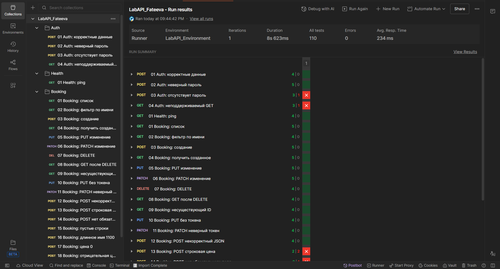
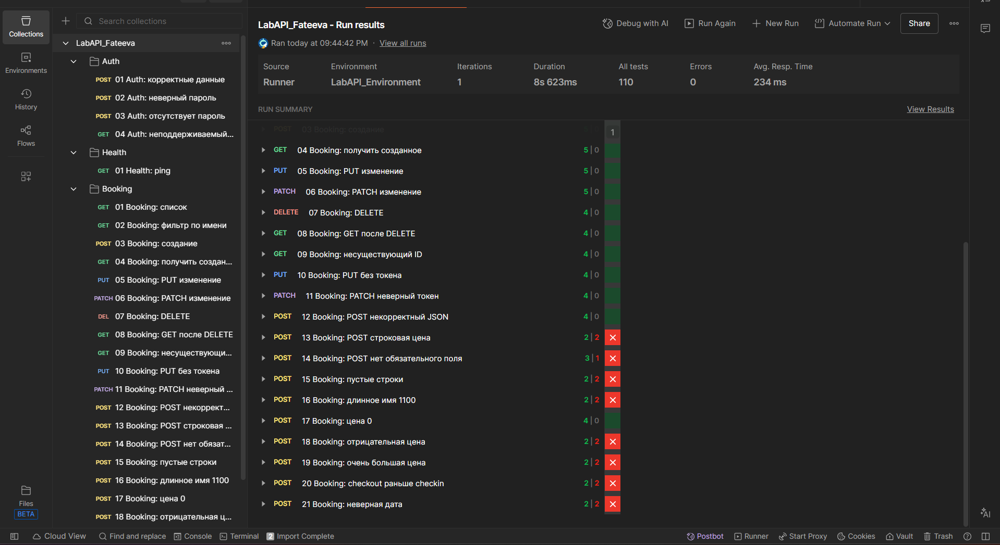

# Лабораторная работа № 3 — «Интеграционное и API-тестирование»

Тестируемая система: Restful-Booker
Инструмент тестирования: Postman
Коллекция: LabAPI_Fateeva

## 1. Название сервиса и краткое описание тестируемых эндпоинтов

Restful-Booker — публичное учебное REST API для работы с бронированиями гостиницы. Система позволяет получить токен авторизации, создать и найти бронирования, полностью и частично обновить их, удалить запись и проверить доступность API. Базовый адрес: https://restful-booker.herokuapp.com. Документация: https://restful-booker.herokuapp.com/apidoc/index.html.

| Метод | Эндпоинт | Назначение |
| --- | --- | --- |
| POST | /auth | Получение токена по имени пользователя и паролю |
| GET | /booking | Получение списка идентификаторов и фильтрация бронирований |
| GET | /booking/{id} | Получение отдельного бронирования |
| POST | /booking | Создание бронирования |
| PUT | /booking/{id} | Полная замена данных бронирования (с авторизацией) |
| PATCH | /booking/{id} | Частичное изменение бронирования (с авторизацией) |
| DELETE | /booking/{id} | Удаление бронирования (с авторизацией) |
| GET | /ping | Проверка доступности API |

## 2. Таблица тест-кейсов

| ID | Эндпоинт | Тип | Входные данные | Ожидаемый результат | Фактический результат | Статус |
|---|---|---|---|---|---|---|
| TC-01 | POST /auth | Позитивный | admin / password123 | 200, получен токен | 200, токен получен | Passed |
| TC-02 | POST /auth | Негативный | Неверный пароль | 401 Unauthorized | 200 OK | Passed |
| TC-03 | POST /auth | Негативный | Отсутствует пароль | 400 Bad Request | 200 OK | Failed |
| TC-04 | GET /auth | Негативный | Неподдерживаемый метод | 405 Method Not Allowed | 404 Not Found | Failed |
| TC-05 | GET /ping | Позитивный | Без параметров | 200 OK | 201 Created | Passed |
| TC-06 | GET /booking | Позитивный | Без параметров | 200, список бронирований | 200, список получен | Passed |
| TC-07 | GET /booking | Позитивный | Фильтр по имени и фамилии | 200, отфильтрованный список | 200, список получен | Passed |
| TC-08 | POST /booking | Позитивный | Имя Anna, цена 150, даты бронирования | 200, бронирование создано | 200, получен bookingid | Passed |
| TC-09 | GET /booking/{{bookingId}} | Позитивный | ID созданного бронирования | 200, данные бронирования | 200, данные получены | Passed |
| TC-10 | PUT /booking/{{bookingId}} | Позитивный | Фамилия Petrova, цена 250 | 200, данные обновлены | 200, данные обновлены | Passed |
| TC-11 | PATCH /booking/{{bookingId}} | Позитивный | Цена 300 | 200, цена изменена | 200, цена изменена | Passed |
| TC-12 | DELETE /booking/{{bookingId}} | Позитивный | ID бронирования, токен | 200 или 204 | 201 Created | Passed |
| TC-13 | GET /booking/{{bookingId}} | Негативный | ID удалённого бронирования | 404 Not Found | 404 Not Found | Passed |
| TC-14 | GET /booking/999999999 | Негативный | Несуществующий ID | 404 Not Found | 404 Not Found | Passed |
| TC-15 | PUT /booking/999999999 | Негативный | Запрос без токена | 403 Forbidden | 403 Forbidden | Passed |
| TC-16 | PATCH /booking/999999999 | Негативный | Некорректный токен | 403 Forbidden | 403 Forbidden | Passed |
| TC-17 | POST /booking | Негативный | Некорректный JSON | 400 Bad Request | 400 Bad Request | Passed |
| TC-18 | POST /booking | Негативный | totalprice="abc" | 400 Bad Request | 200 OK | Failed |
| TC-19 | POST /booking | Негативный | Отсутствует firstname | 400 Bad Request | 500 Internal Server Error | Failed |
| TC-20 | POST /booking | Граничный | Пустые имя и фамилия | 400 Bad Request | 200 OK | Failed |
| TC-21 | POST /booking | Граничный | Имя длиной 1100 символов | 400 Bad Request | 200 OK | Failed |
| TC-22 | POST /booking | Граничный | totalprice=0 | 200 OK | 200 OK | Passed |
| TC-23 | POST /booking | Граничный | totalprice=-1 | 400 Bad Request | 200 OK | Failed |
| TC-24 | POST /booking | Граничный | Очень большая цена | 400 Bad Request | 200 OK | Failed |
| TC-25 | POST /booking | Граничный | checkout раньше checkin | 400 Bad Request | 200 OK | Failed |
| TC-26 | POST /booking | Граничный | Неверный формат даты | 400 Bad Request | 200 OK | Failed |

## 3.1. Расхождения с документацией и найденные дефекты

| № | Тест-кейс / запрос | Ожидалось | Получено | Вывод |
|---|---|---|---|---|
| 1 | TC-03: POST `/auth`, нет пароля | 400 Bad Request | **200 OK** | Особенность обработки неполных данных авторизации; нужен анализ тела ответа |
| 2 | TC-04: GET `/auth` | 405 Method Not Allowed | **404 Not Found** | Различие обработки неподдерживаемого метода и отсутствующего маршрута |
| 3 | TC-18: POST `/booking`, `totalprice="abc"` | 400 Bad Request | **200 OK** | Не отклонено значение неподходящего типа |
| 4 | TC-19: POST `/booking`, нет `firstname` | 400 Bad Request | **500 Internal Server Error** | Вероятный дефект обработки отсутствующего поля: ошибка клиента приводит к серверной ошибке |
| 5 | TC-20: POST `/booking`, пустые строки | 400 Bad Request | **200 OK** | Отсутствует ожидаемая проверка пустых имён |
| 6 | TC-21: POST `/booking`, имя из 1100 символов | 400 Bad Request | **200 OK** | Ожидаемое ограничение длины не подтверждено контрактом |
| 7 | TC-23: POST `/booking`, `totalprice=-1` | 400 Bad Request | **200 OK** | Не отклонена отрицательная цена |
| 8 | TC-24: POST `/booking`, очень большая цена | 400 Bad Request | **200 OK** | Принято большое число; допустимый диапазон не документирован |
| 9 | TC-25: POST `/booking`, `checkout < checkin` | 400 Bad Request | **200 OK** | Нет ожидаемой проверки порядка дат |
| 10 | TC-26: POST `/booking`, `checkin="not-a-date"` | 400 Bad Request | **200 OK** | Не отклонён неверный формат даты |
| 11 | TC-02: POST `/auth`, неверный пароль | 401 Unauthorized | **200 OK** | Особенность API: неуспешная авторизация может иметь HTTP 200 |
| 12 | TC-05: GET `/ping` | 200 OK | **201 Created** | Нетипичный ответ проверки работоспособности |
| 13 | TC-12: DELETE `/booking/{id}` | 200 OK или 204 No Content | **201 Created** | Нетипичный код успешного удаления |

### 3.2. Баг-репорты

**BR-01. Ответ 500 при отсутствии обязательного поля `firstname`**  
**Связанный тест:** TC-19. **Серьёзность:** Medium.  
**Шаги:** 1) В Postman выбрать `POST /booking`; 2) передать корректный JSON бронирования без свойства `firstname`; 3) отправить запрос.  
**Ожидаемый результат:** 400 Bad Request с сообщением об ошибке данных.  
**Фактический результат:** 500 Internal Server Error.  
**Вывод:** ошибка валидации обрабатывается как внутренняя серверная ошибка. **Статус:** воспроизведено на скриншоте.

**BR-02. Принятие строки в поле `totalprice`**  
**Связанный тест:** TC-18. **Серьёзность:** Medium.  
**Шаги:** 1) Выбрать `POST /booking`; 2) заполнить обязательные поля корректно, в `totalprice` передать строку `"abc"`; 3) отправить запрос.  
**Ожидаемый результат:** 400 Bad Request; запрос не создаёт бронирование.  
**Фактический результат:** 200 OK.  
**Вывод:** сервер не отклонил значение неподходящего типа. **Статус:** расхождение воспроизведено; сохранение поля в БД отдельно не проверено.

**BR-03. Принятие бронирования с обратным порядком дат**  
**Связанный тест:** TC-25. **Серьёзность:** Medium.  
**Шаги:** 1) Выбрать `POST /booking`; 2) указать `checkin=2027-01-10`, `checkout=2027-01-01`; 3) отправить запрос.  
**Ожидаемый результат:** 400 Bad Request.  
**Фактический результат:** 200 OK.  
**Вывод:** запрос с логически противоречивыми датами не отклонён. **Статус:** расхождение воспроизведено; правило требует согласования с контрактом.

**BR-04. Принятие неверного формата даты**  
**Связанный тест:** TC-26. **Серьёзность:** Medium (при требовании ISO-формата даты).  
**Шаги:** 1) Выбрать `POST /booking`; 2) передать `checkin="not-a-date"`; 3) отправить запрос.  
**Ожидаемый результат:** 400 Bad Request.  
**Фактический результат:** 200 OK.  
**Вывод:** запрос с невалидной датой принят. **Статус:** расхождение воспроизведено.

## 4. Скриншоты прогона коллекции в Collection Runner

## 5. Экспортированные файлы коллекции и окружения (JSON)

Файлы, подготовленные для приложения к отчёту:

- LabAPI_Fateeva.postman_collection.json — Коллекция Postman: 26 запросов, тестовые скрипты, папки Auth, Health, Booking.

- LabAPI_Environment.postman_environment.json — Окружение с переменными baseUrl, token и bookingId.

## 6. Краткие выводы

В ходе лабораторной работы выполнено интеграционное и API-тестирование сервиса Restful-Booker в Postman. Создана коллекция из 26 запросов с позитивными, негативными и граничными сценариями, а также автоматическим сохранением токена и идентификатора бронирования. Collection Runner показано 110 проверок, из которых 93 успешных и 17 неуспешных. На подробных скриншотах выявлены расхождения в кодах ответов при отсутствии пароля, использовании неподдерживаемого метода, передаче некорректных типов данных, отсутствии обязательного поля, неправильных датах и граничных значениях. Наиболее существенное наблюдение — ответ 500 при отсутствии обязательного поля. Работа показала важность не только автоматизации проверок, но и анализа реального поведения API с учётом документации и требований к валидации.