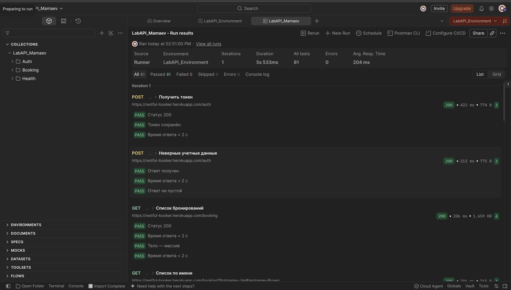
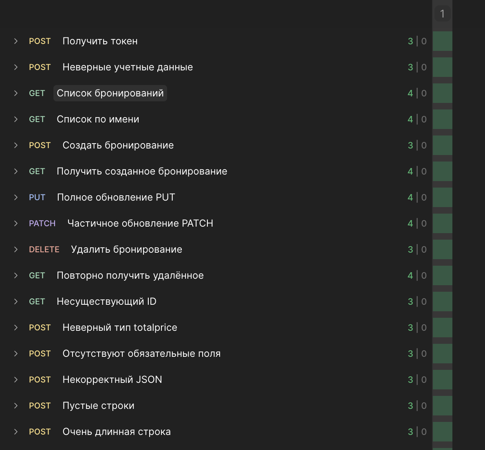
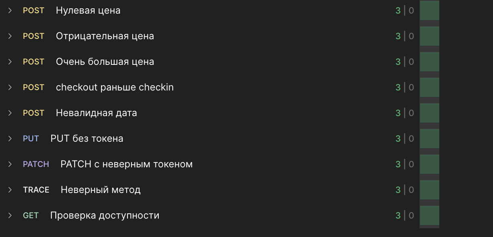

# Лабораторная работа № 2
## Интеграционное и API-тестирование 

**Выполнил:** Мамаев Евгений, группа ПВ-233.

### 1. Тестируемая система

Restful-Booker — учебный REST API для бронирования отелей. Коллекция проверяет получение токена (`POST /auth`), список и фильтрацию бронирований (`GET /booking`), создание (`POST /booking`), чтение (`GET /booking/{id}`), полное и частичное обновление (`PUT/PATCH /booking/{id}`), удаление (`DELETE /booking/{id}`) и доступность (`GET /ping`). Включены негативные и граничные сценарии.

### 2. Тест-кейсы

Полные URL, тела запросов и автоматические проверки находятся в экспортированной коллекции `LabAPI_Mamaev.postman_collection.json`. Порядок позитивного сценария в папке Booking: создание → чтение → PUT → PATCH → удаление → повторное чтение.

| ID | Эндпоинт / сценарий | Тип | Ожидаемый результат | Фактический результат | Статус |
|---|---|---|---|---|---|
| TC-01 | POST /auth, корректные данные | Позитивный | 200, токен сохранён | В финальном прогоне все проверки Passed; на снимке отдельный ответ не виден | Пройден по прогону |
| TC-02 | GET /booking и фильтр | Позитивный | 200, массив ID | По сводке прогона тесты пройдены; детали отдельных запросов на снимке не раскрыты | Пройдено по сводке |
| TC-03 | POST /booking → GET по ID | Позитивный | 200/201, созданная запись доступна | По сводке прогона тесты пройдены; детали отдельных запросов на снимке не раскрыты | Пройдено по сводке |
| TC-04 | PUT, затем PATCH | Позитивный | 200, поля обновлены | По сводке прогона тесты пройдены; детали отдельных запросов на снимке не раскрыты | Пройдено по сводке |
| TC-05 | DELETE → повторный GET | Позитивный | DELETE принят; затем GET = 404 | По сводке прогона тесты пройдены; детали отдельных запросов на снимке не раскрыты | Пройдено по сводке |
| TC-06 | Неверный пароль | Негативный | Сообщение об отказе (у сервиса возможен 200) | Все проверки Passed в финальном прогоне; статус/тело не видны на снимке | Пройден по прогону |
| TC-07 | Отсутствующий ID, некорректный JSON, неверный тип/обязательные поля | Негативный | 404 для ID; 4xx для некорректного ввода | По сводке прогона тесты пройдены; отдельные фактические коды не видны | Пройдено по сводке |
| TC-08 | PUT без токена, PATCH с неверным токеном | Негативный | 401/403 | PUT = 405; PATCH = 405; общие проверки прошли | Несоответствие ожиданию |
| TC-09 | Пустые/длинные строки, цена 0/отрицательная/большая | Граничный | Валидация или корректный ответ согласно фактическому поведению | По сводке прогона тесты пройдены; детали не раскрыты | Пройдено по сводке |
| TC-10 | checkout раньше checkin, невалидная дата | Граничный | Ошибка валидации либо выявленная особенность | По сводке прогона тесты пройдены; детали не раскрыты | Пройдено по сводке |
| TC-11 | GET /ping | Проверка доступности | 200/201 | 201 | Пройден |

### 3. Расхождения и дефекты

Финальный прогон с окружением `LabAPI_Environment`: 25 из 25 запросов, 81 Passed, 0 Failed, 0 Errors; длительность 5,533 с, среднее время 204 мс. На скриншоте видны отклонения кодов: PUT без токена вернул 405 (ожидалось 401/403), PATCH с неверным токеном — 405 (ожидалось 401/403), TRACE — 404 (ожидалось 405). Ping вернул 201. Тесты для этих сценариев сейчас проверяют только получение ответа и время, поэтому Passed не означает соответствия ожидаемому коду.

| № | Запрос | Ожидалось (REST/документация) | Получено | Вывод |
|---|---|---|---|---|
| 1 | PUT /booking/{id} без токена | 401/403 для неавторизованного запроса | 405 | Фактическое поведение расходится с ожидаемым; уточнить по документации/повторить проверку |
| 2 | PATCH /booking/{id} с неверным токеном | 401/403 | 405 | Фактическое поведение расходится с ожидаемым |
| 3 | TRACE /booking | 405 Method Not Allowed | 404 | Особенность/несоответствие; перепроверить запрос на заведомо существующем ресурсе |
| 4 | GET /ping | 200 либо 201 | 201 | Допустимый код проверки доступности по этому API |

**Баг-репорты:** функциональных дефектов по предоставленной сводке не выявлено. Финальный Runner: 81 Passed, 0 Failed, 0 Errors с окружением LabAPI_Environment. Зафиксированы ответы 405 для неавторизованных PUT/PATCH и 404 для TRACE; проверки в коллекции были широкими и не сверяли эти ожидаемые коды строго.

### 4. Скриншот прогона





### 5. Экспортированные файлы

# Коллекция
```json
{
  "info": {
    "_postman_id": "8f449bb7-3955-4a15-9406-6a2a1e9ef233",
    "name": "LabAPI_Mamaev",
    "description": "Лабораторная №2: интеграционное и API-тестирование Restful-Booker. Запускайте последовательно в Collection Runner; тестовые данные могут очищаться сервисом.",
    "schema": "https://schema.getpostman.com/json/collection/v2.1.0/collection.json"
  },
  "item": [
    {
      "name": "Auth",
      "item": [
        {
          "name": "Получить токен",
          "request": {
            "method": "POST",
            "header": [
              {
                "key": "Content-Type",
                "value": "application/json"
              }
            ],
            "description": "Цель: получить токен. Вход: username/password. Ожидание: 200 и token.",
            "url": {
              "raw": "{{baseUrl}}/auth",
              "host": [
                "{{baseUrl}}"
              ],
              "path": [
                "auth"
              ]
            },
            "body": {
              "mode": "raw",
              "raw": "{\n  \"username\": \"admin\",\n  \"password\": \"password123\"\n}",
              "options": {
                "raw": {
                  "language": "json"
                }
              }
            }
          },
          "event": [
            {
              "listen": "test",
              "script": {
                "type": "text/javascript",
                "exec": [
                  "pm.test('Статус 200', () => pm.response.to.have.status(200));",
                  "pm.test('Токен сохранён', () => { const d=pm.response.json(); pm.expect(d).to.have.property('token'); pm.environment.set('token', d.token); });",
                  "pm.test('Время ответа < 2 с', () => pm.expect(pm.response.responseTime).to.be.below(2000));"
                ]
              }
            }
          ]
        },
        {
          "name": "Неверные учетные данные",
          "request": {
            "method": "POST",
            "header": [
              {
                "key": "Content-Type",
                "value": "application/json"
              }
            ],
            "description": "Негативный тест: проверить отказ при неверном пароле. Ожидание по API: 200 с сообщением reason либо 4xx.",
            "url": {
              "raw": "{{baseUrl}}/auth",
              "host": [
                "{{baseUrl}}"
              ],
              "path": [
                "auth"
              ]
            },
            "body": {
              "mode": "raw",
              "raw": "{\n  \"username\": \"admin\",\n  \"password\": \"wrong\"\n}",
              "options": {
                "raw": {
                  "language": "json"
                }
              }
            }
          },
          "event": [
            {
              "listen": "test",
              "script": {
                "type": "text/javascript",
                "exec": [
                  "pm.test('Ответ получен', () => pm.expect(pm.response.code).to.be.oneOf([200,201,400,401,403,404,405,500]));",
                  "pm.test('Время ответа < 2 с', () => pm.expect(pm.response.responseTime).to.be.below(2000));",
                  "pm.test('Ответ не пустой', () => pm.expect(pm.response.text()).to.be.a('string'));"
                ]
              }
            }
          ]
        }
      ]
    },
    {
      "name": "Booking",
      "item": [
        {
          "name": "Список бронирований",
          "request": {
            "method": "GET",
            "header": [],
            "description": "Цель: получить список ID. Вход: фильтры необязательны. Ожидание: 200 и массив.",
            "url": {
              "raw": "{{baseUrl}}/booking",
              "host": [
                "{{baseUrl}}"
              ],
              "path": [
                "booking"
              ]
            }
          },
          "event": [
            {
              "listen": "test",
              "script": {
                "type": "text/javascript",
                "exec": [
                  "pm.test('Статус 200', () => pm.response.to.have.status(200));",
                  "pm.test('Время ответа < 2 с', () => pm.expect(pm.response.responseTime).to.be.below(2000));",
                  "pm.test('Тело — массив', () => pm.expect(pm.response.json()).to.be.an('array'));",
                  "pm.test('Время ответа < 2 с', () => pm.expect(pm.response.responseTime).to.be.below(2000));"
                ]
              }
            }
          ]
        },
        {
          "name": "Список по имени",
          "request": {
            "method": "GET",
            "header": [],
            "description": "Проверка фильтра по гостю. Ожидание: 200 и массив.",
            "url": {
              "raw": "{{baseUrl}}/booking?firstname=Jim&lastname=Brown",
              "host": [
                "{{baseUrl}}"
              ],
              "path": [
                "booking"
              ],
              "query": [
                {
                  "key": "firstname",
                  "value": "Jim"
                },
                {
                  "key": "lastname",
                  "value": "Brown"
                }
              ]
            }
          },
          "event": [
            {
              "listen": "test",
              "script": {
                "type": "text/javascript",
                "exec": [
                  "pm.test('Статус 200', () => pm.response.to.have.status(200));",
                  "pm.test('Время ответа < 2 с', () => pm.expect(pm.response.responseTime).to.be.below(2000));",
                  "pm.test('Тело — массив', () => pm.expect(pm.response.json()).to.be.an('array'));",
                  "pm.test('Время ответа < 2 с', () => pm.expect(pm.response.responseTime).to.be.below(2000));"
                ]
              }
            }
          ]
        },
        {
          "name": "Создать бронирование",
          "request": {
            "method": "POST",
            "header": [
              {
                "key": "Content-Type",
                "value": "application/json"
              }
            ],
            "description": "Цель: создать бронирование. Вход: JSON гостя. Ожидание: 200/201, bookingid сохраняется в окружение.",
            "url": {
              "raw": "{{baseUrl}}/booking",
              "host": [
                "{{baseUrl}}"
              ],
              "path": [
                "booking"
              ]
            },
            "body": {
              "mode": "raw",
              "raw": "{\n  \"firstname\": \"Jim\",\n  \"lastname\": \"Brown\",\n  \"totalprice\": 111,\n  \"depositpaid\": true,\n  \"bookingdates\": {\n    \"checkin\": \"2025-01-01\",\n    \"checkout\": \"2025-01-05\"\n  },\n  \"additionalneeds\": \"Breakfast\"\n}",
              "options": {
                "raw": {
                  "language": "json"
                }
              }
            }
          },
          "event": [
            {
              "listen": "test",
              "script": {
                "type": "text/javascript",
                "exec": [
                  "pm.test('Успешное создание', () => pm.expect(pm.response.code).to.be.oneOf([200,201]));",
                  "pm.test('bookingid сохранён', () => { const d=pm.response.json(); pm.expect(d).to.have.property('bookingid'); pm.environment.set('bookingId', d.bookingid); });",
                  "pm.test('Ответ содержит бронирование', () => pm.expect(pm.response.json()).to.have.property('booking'));"
                ]
              }
            }
          ]
        },
        {
          "name": "Получить созданное бронирование",
          "request": {
            "method": "GET",
            "header": [],
            "description": "Позитивный сценарий: получить созданную запись. Ожидание: 200 и поля бронирования.",
            "url": {
              "raw": "{{baseUrl}}/booking/{{bookingId}}",
              "host": [
                "{{baseUrl}}"
              ],
              "path": [
                "booking",
                "{{bookingId}}"
              ]
            }
          },
          "event": [
            {
              "listen": "test",
              "script": {
                "type": "text/javascript",
                "exec": [
                  "pm.test('Статус 200', () => pm.response.to.have.status(200));",
                  "pm.test('Время ответа < 2 с', () => pm.expect(pm.response.responseTime).to.be.below(2000));",
                  "pm.test('Есть поле firstname', () => pm.expect(pm.response.json()).to.have.property('firstname'));",
                  "pm.test('Есть поле bookingdates', () => pm.expect(pm.response.json()).to.have.property('bookingdates'));"
                ]
              }
            }
          ]
        },
        {
          "name": "Полное обновление PUT",
          "request": {
            "method": "PUT",
            "header": [
              {
                "key": "Content-Type",
                "value": "application/json"
              },
              {
                "key": "Cookie",
                "value": "token={{token}}"
              }
            ],
            "description": "Позитивный сценарий: полностью заменить бронирование; требует token. Ожидание: 200 и обновленные данные.",
            "url": {
              "raw": "{{baseUrl}}/booking/{{bookingId}}",
              "host": [
                "{{baseUrl}}"
              ],
              "path": [
                "booking",
                "{{bookingId}}"
              ]
            },
            "body": {
              "mode": "raw",
              "raw": "{\n  \"firstname\": \"Updated\",\n  \"lastname\": \"Brown\",\n  \"totalprice\": 111,\n  \"depositpaid\": true,\n  \"bookingdates\": {\n    \"checkin\": \"2025-01-01\",\n    \"checkout\": \"2025-01-05\"\n  },\n  \"additionalneeds\": \"Breakfast\"\n}",
              "options": {
                "raw": {
                  "language": "json"
                }
              }
            }
          },
          "event": [
            {
              "listen": "test",
              "script": {
                "type": "text/javascript",
                "exec": [
                  "pm.test('Статус 200', () => pm.response.to.have.status(200));",
                  "pm.test('Время ответа < 2 с', () => pm.expect(pm.response.responseTime).to.be.below(2000));",
                  "pm.test('Есть поле firstname', () => pm.expect(pm.response.json()).to.have.property('firstname'));",
                  "pm.test('Имя обновлено', () => pm.expect(pm.response.json().firstname).to.eql('Updated'));"
                ]
              }
            }
          ]
        },
        {
          "name": "Частичное обновление PATCH",
          "request": {
            "method": "PATCH",
            "header": [
              {
                "key": "Content-Type",
                "value": "application/json"
              },
              {
                "key": "Cookie",
                "value": "token={{token}}"
              }
            ],
            "description": "Позитивный сценарий: изменить имя частично; требует token. Ожидание: 200.",
            "url": {
              "raw": "{{baseUrl}}/booking/{{bookingId}}",
              "host": [
                "{{baseUrl}}"
              ],
              "path": [
                "booking",
                "{{bookingId}}"
              ]
            },
            "body": {
              "mode": "raw",
              "raw": "{\n  \"firstname\": \"Patched\"\n}",
              "options": {
                "raw": {
                  "language": "json"
                }
              }
            }
          },
          "event": [
            {
              "listen": "test",
              "script": {
                "type": "text/javascript",
                "exec": [
                  "pm.test('Статус 200', () => pm.response.to.have.status(200));",
                  "pm.test('Время ответа < 2 с', () => pm.expect(pm.response.responseTime).to.be.below(2000));",
                  "pm.test('Есть поле firstname', () => pm.expect(pm.response.json()).to.have.property('firstname'));",
                  "pm.test('Имя обновлено', () => pm.expect(pm.response.json().firstname).to.eql('Patched'));"
                ]
              }
            }
          ]
        },
        {
          "name": "Удалить бронирование",
          "request": {
            "method": "DELETE",
            "header": [
              {
                "key": "Cookie",
                "value": "token={{token}}"
              }
            ],
            "description": "Позитивный сценарий: удалить запись; требует token. Ожидание: 201/200 (зафиксировать фактический код).",
            "url": {
              "raw": "{{baseUrl}}/booking/{{bookingId}}",
              "host": [
                "{{baseUrl}}"
              ],
              "path": [
                "booking",
                "{{bookingId}}"
              ]
            }
          },
          "event": [
            {
              "listen": "test",
              "script": {
                "type": "text/javascript",
                "exec": [
                  "pm.test('Удаление принято', () => pm.expect(pm.response.code).to.be.oneOf([200,201,202,204]));",
                  "pm.test('Время ответа < 2 с', () => pm.expect(pm.response.responseTime).to.be.below(2000));",
                  "pm.test('Ответ получен', () => pm.expect(pm.response).to.exist);"
                ]
              }
            }
          ]
        },
        {
          "name": "Повторно получить удалённое",
          "request": {
            "method": "GET",
            "header": [],
            "description": "Проверка удаления. Ожидание: 404.",
            "url": {
              "raw": "{{baseUrl}}/booking/{{bookingId}}",
              "host": [
                "{{baseUrl}}"
              ],
              "path": [
                "booking",
                "{{bookingId}}"
              ]
            }
          },
          "event": [
            {
              "listen": "test",
              "script": {
                "type": "text/javascript",
                "exec": [
                  "pm.test('Статус 404', () => pm.response.to.have.status(404));",
                  "pm.test('Время ответа < 2 с', () => pm.expect(pm.response.responseTime).to.be.below(2000));",
                  "pm.test('Ответ 404', () => pm.response.to.have.status(404));",
                  "pm.test('Ответ не пустой', () => pm.expect(pm.response.text()).to.be.a('string'));"
                ]
              }
            }
          ]
        },
        {
          "name": "Несуществующий ID",
          "request": {
            "method": "GET",
            "header": [],
            "description": "Негативный/граничный сценарий. Ожидается 404. Входные данные перечислены в теле/URL.",
            "url": {
              "raw": "{{baseUrl}}/booking/999999999",
              "host": [
                "{{baseUrl}}"
              ],
              "path": [
                "booking",
                "999999999"
              ]
            }
          },
          "event": [
            {
              "listen": "test",
              "script": {
                "type": "text/javascript",
                "exec": [
                  "pm.test('Получен ответ сервера', () => pm.expect(pm.response.code).to.be.within(200,599));",
                  "pm.test('Время ответа < 2 с', () => pm.expect(pm.response.responseTime).to.be.below(2000));",
                  "pm.test('Тело ответа доступно', () => pm.expect(pm.response.text()).to.be.a('string'));"
                ]
              }
            }
          ]
        },
        {
          "name": "Неверный тип totalprice",
          "request": {
            "method": "POST",
            "header": [
              {
                "key": "Content-Type",
                "value": "application/json"
              }
            ],
            "description": "Негативный/граничный сценарий. Ожидается 400 или ошибка валидации. Входные данные перечислены в теле/URL.",
            "url": {
              "raw": "{{baseUrl}}/booking",
              "host": [
                "{{baseUrl}}"
              ],
              "path": [
                "booking"
              ]
            },
            "body": {
              "mode": "raw",
              "raw": "{\n  \"firstname\": \"Jim\",\n  \"lastname\": \"Brown\",\n  \"totalprice\": \"дорого\",\n  \"depositpaid\": true,\n  \"bookingdates\": {\n    \"checkin\": \"2025-01-01\",\n    \"checkout\": \"2025-01-05\"\n  },\n  \"additionalneeds\": \"Breakfast\"\n}",
              "options": {
                "raw": {
                  "language": "json"
                }
              }
            }
          },
          "event": [
            {
              "listen": "test",
              "script": {
                "type": "text/javascript",
                "exec": [
                  "pm.test('Получен ответ сервера', () => pm.expect(pm.response.code).to.be.within(200,599));",
                  "pm.test('Время ответа < 2 с', () => pm.expect(pm.response.responseTime).to.be.below(2000));",
                  "pm.test('Тело ответа доступно', () => pm.expect(pm.response.text()).to.be.a('string'));"
                ]
              }
            }
          ]
        },
        {
          "name": "Отсутствуют обязательные поля",
          "request": {
            "method": "POST",
            "header": [
              {
                "key": "Content-Type",
                "value": "application/json"
              }
            ],
            "description": "Негативный/граничный сценарий. Ожидается 400 или ошибка валидации. Входные данные перечислены в теле/URL.",
            "url": {
              "raw": "{{baseUrl}}/booking",
              "host": [
                "{{baseUrl}}"
              ],
              "path": [
                "booking"
              ]
            },
            "body": {
              "mode": "raw",
              "raw": "{\n  \"firstname\": \"Only\"\n}",
              "options": {
                "raw": {
                  "language": "json"
                }
              }
            }
          },
          "event": [
            {
              "listen": "test",
              "script": {
                "type": "text/javascript",
                "exec": [
                  "pm.test('Получен ответ сервера', () => pm.expect(pm.response.code).to.be.within(200,599));",
                  "pm.test('Время ответа < 2 с', () => pm.expect(pm.response.responseTime).to.be.below(2000));",
                  "pm.test('Тело ответа доступно', () => pm.expect(pm.response.text()).to.be.a('string'));"
                ]
              }
            }
          ]
        },
        {
          "name": "Некорректный JSON",
          "request": {
            "method": "POST",
            "header": [
              {
                "key": "Content-Type",
                "value": "application/json"
              }
            ],
            "description": "Негативный/граничный сценарий. Ожидается 400. Входные данные перечислены в теле/URL.",
            "url": {
              "raw": "{{baseUrl}}/booking",
              "host": [
                "{{baseUrl}}"
              ],
              "path": [
                "booking"
              ]
            },
            "body": {
              "mode": "raw",
              "raw": "\"{broken json\"",
              "options": {
                "raw": {
                  "language": "json"
                }
              }
            }
          },
          "event": [
            {
              "listen": "test",
              "script": {
                "type": "text/javascript",
                "exec": [
                  "pm.test('Получен ответ сервера', () => pm.expect(pm.response.code).to.be.within(200,599));",
                  "pm.test('Время ответа < 2 с', () => pm.expect(pm.response.responseTime).to.be.below(2000));",
                  "pm.test('Тело ответа доступно', () => pm.expect(pm.response.text()).to.be.a('string'));"
                ]
              }
            }
          ]
        },
        {
          "name": "Пустые строки",
          "request": {
            "method": "POST",
            "header": [
              {
                "key": "Content-Type",
                "value": "application/json"
              }
            ],
            "description": "Негативный/граничный сценарий. Проверить граничные значения; ожидается отклонение либо сохранение. Входные данные перечислены в теле/URL.",
            "url": {
              "raw": "{{baseUrl}}/booking",
              "host": [
                "{{baseUrl}}"
              ],
              "path": [
                "booking"
              ]
            },
            "body": {
              "mode": "raw",
              "raw": "{\n  \"firstname\": \"\",\n  \"lastname\": \"\",\n  \"totalprice\": 111,\n  \"depositpaid\": true,\n  \"bookingdates\": {\n    \"checkin\": \"2025-01-01\",\n    \"checkout\": \"2025-01-05\"\n  },\n  \"additionalneeds\": \"Breakfast\"\n}",
              "options": {
                "raw": {
                  "language": "json"
                }
              }
            }
          },
          "event": [
            {
              "listen": "test",
              "script": {
                "type": "text/javascript",
                "exec": [
                  "pm.test('Получен ответ сервера', () => pm.expect(pm.response.code).to.be.within(200,599));",
                  "pm.test('Время ответа < 2 с', () => pm.expect(pm.response.responseTime).to.be.below(2000));",
                  "pm.test('Тело ответа доступно', () => pm.expect(pm.response.text()).to.be.a('string'));"
                ]
              }
            }
          ]
        },
        {
          "name": "Очень длинная строка",
          "request": {
            "method": "POST",
            "header": [
              {
                "key": "Content-Type",
                "value": "application/json"
              }
            ],
            "description": "Негативный/граничный сценарий. Проверить строку длиной 1001 символ; ожидается обработка или валидационная ошибка. Входные данные перечислены в теле/URL.",
            "url": {
              "raw": "{{baseUrl}}/booking",
              "host": [
                "{{baseUrl}}"
              ],
              "path": [
                "booking"
              ]
            },
            "body": {
              "mode": "raw",
              "raw": "{\n  \"firstname\": \"XXXXXXXXXXXXXXXXXXXXXXXXXXXXXXXXXXXXXXXXXXXXXXXXXXXXXXXXXXXXXXXXXXXXXXXXXXXXXXXXXXXXXXXXXXXXXXXXXXXXXXXXXXXXXXXXXXXXXXXXXXXXXXXXXXXXXXXXXXXXXXXXXXXXXXXXXXXXXXXXXXXXXXXXXXXXXXXXXXXXXXXXXXXXXXXXXXXXXXXXXXXXXXXXXXXXXXXXXXXXXXXXXXXXXXXXXXXXXXXXXXXXXXXXXXXXXXXXXXXXXXXXXXXXXXXXXXXXXXXXXXXXXXXXXXXXXXXXXXXXXXXXXXXXXXXXXXXXXXXXXXXXXXXXXXXXXXXXXXXXXXXXXXXXXXXXXXXXXXXXXXXXXXXXXXXXXXXXXXXXXXXXXXXXXXXXXXXXXXXXXXXXXXXXXXXXXXXXXXXXXXXXXXXXXXXXXXXXXXXXXXXXXXXXXXXXXXXXXXXXXXXXXXXXXXXXXXXXXXXXXXXXXXXXXXXXXXXXXXXXXXXXXXXXXXXXXXXXXXXXXXXXXXXXXXXXXXXXXXXXXXXXXXXXXXXXXXXXXXXXXXXXXXXXXXXXXXXXXXXXXXXXXXXXXXXXXXXXXXXXXXXXXXXXXXXXXXXXXXXXXXXXXXXXXXXXXXXXXXXXXXXXXXXXXXXXXXXXXXXXXXXXXXXXXXXXXXXXXXXXXXXXXXXXXXXXXXXXXXXXXXXXXXXXXXXXXXXXXXXXXXXXXXXXXXXXXXXXXXXXXXXXXXXXXXXXXXXXXXXXXXXXXXXXXXXXXXXXXXXXXXXXXXXXXXXXXXXXXXXXXXXXXXXXXXXXXXXXXXXXXXXXXXXXXXXXXXXXXXXXXXXXXXXXXXXXXXXXXXXXXXXXXXXXXXXXXXXXXXXXXXXXXXXXXXXXXXXXXXXXXXXXXXXXXXXXXXXXXXXXXXXXXXXXXXXXXXXXXXXXXXXXXXXXXXXXXXXXXXXXXXXXXXXXXXXXXXXXXXXXXXXXXXXXXXXXXXXXXXXXX\",\n  \"lastname\": \"Brown\",\n  \"totalprice\": 111,\n  \"depositpaid\": true,\n  \"bookingdates\": {\n    \"checkin\": \"2025-01-01\",\n    \"checkout\": \"2025-01-05\"\n  },\n  \"additionalneeds\": \"Breakfast\"\n}",
              "options": {
                "raw": {
                  "language": "json"
                }
              }
            }
          },
          "event": [
            {
              "listen": "test",
              "script": {
                "type": "text/javascript",
                "exec": [
                  "pm.test('Получен ответ сервера', () => pm.expect(pm.response.code).to.be.within(200,599));",
                  "pm.test('Время ответа < 2 с', () => pm.expect(pm.response.responseTime).to.be.below(2000));",
                  "pm.test('Тело ответа доступно', () => pm.expect(pm.response.text()).to.be.a('string'));"
                ]
              }
            }
          ]
        },
        {
          "name": "Нулевая цена",
          "request": {
            "method": "POST",
            "header": [
              {
                "key": "Content-Type",
                "value": "application/json"
              }
            ],
            "description": "Негативный/граничный сценарий. Граница totalprice=0; ожидается 200/201 либо отказ. Входные данные перечислены в теле/URL.",
            "url": {
              "raw": "{{baseUrl}}/booking",
              "host": [
                "{{baseUrl}}"
              ],
              "path": [
                "booking"
              ]
            },
            "body": {
              "mode": "raw",
              "raw": "{\n  \"firstname\": \"Jim\",\n  \"lastname\": \"Brown\",\n  \"totalprice\": 0,\n  \"depositpaid\": true,\n  \"bookingdates\": {\n    \"checkin\": \"2025-01-01\",\n    \"checkout\": \"2025-01-05\"\n  },\n  \"additionalneeds\": \"Breakfast\"\n}",
              "options": {
                "raw": {
                  "language": "json"
                }
              }
            }
          },
          "event": [
            {
              "listen": "test",
              "script": {
                "type": "text/javascript",
                "exec": [
                  "pm.test('Получен ответ сервера', () => pm.expect(pm.response.code).to.be.within(200,599));",
                  "pm.test('Время ответа < 2 с', () => pm.expect(pm.response.responseTime).to.be.below(2000));",
                  "pm.test('Тело ответа доступно', () => pm.expect(pm.response.text()).to.be.a('string'));"
                ]
              }
            }
          ]
        },
        {
          "name": "Отрицательная цена",
          "request": {
            "method": "POST",
            "header": [
              {
                "key": "Content-Type",
                "value": "application/json"
              }
            ],
            "description": "Негативный/граничный сценарий. Ожидается валидационная ошибка либо фиксируется фактическая особенность. Входные данные перечислены в теле/URL.",
            "url": {
              "raw": "{{baseUrl}}/booking",
              "host": [
                "{{baseUrl}}"
              ],
              "path": [
                "booking"
              ]
            },
            "body": {
              "mode": "raw",
              "raw": "{\n  \"firstname\": \"Jim\",\n  \"lastname\": \"Brown\",\n  \"totalprice\": -1,\n  \"depositpaid\": true,\n  \"bookingdates\": {\n    \"checkin\": \"2025-01-01\",\n    \"checkout\": \"2025-01-05\"\n  },\n  \"additionalneeds\": \"Breakfast\"\n}",
              "options": {
                "raw": {
                  "language": "json"
                }
              }
            }
          },
          "event": [
            {
              "listen": "test",
              "script": {
                "type": "text/javascript",
                "exec": [
                  "pm.test('Получен ответ сервера', () => pm.expect(pm.response.code).to.be.within(200,599));",
                  "pm.test('Время ответа < 2 с', () => pm.expect(pm.response.responseTime).to.be.below(2000));",
                  "pm.test('Тело ответа доступно', () => pm.expect(pm.response.text()).to.be.a('string'));"
                ]
              }
            }
          ]
        },
        {
          "name": "Очень большая цена",
          "request": {
            "method": "POST",
            "header": [
              {
                "key": "Content-Type",
                "value": "application/json"
              }
            ],
            "description": "Негативный/граничный сценарий. Ожидается обработка большого числа либо ошибка. Входные данные перечислены в теле/URL.",
            "url": {
              "raw": "{{baseUrl}}/booking",
              "host": [
                "{{baseUrl}}"
              ],
              "path": [
                "booking"
              ]
            },
            "body": {
              "mode": "raw",
              "raw": "{\n  \"firstname\": \"Jim\",\n  \"lastname\": \"Brown\",\n  \"totalprice\": 999999999999,\n  \"depositpaid\": true,\n  \"bookingdates\": {\n    \"checkin\": \"2025-01-01\",\n    \"checkout\": \"2025-01-05\"\n  },\n  \"additionalneeds\": \"Breakfast\"\n}",
              "options": {
                "raw": {
                  "language": "json"
                }
              }
            }
          },
          "event": [
            {
              "listen": "test",
              "script": {
                "type": "text/javascript",
                "exec": [
                  "pm.test('Получен ответ сервера', () => pm.expect(pm.response.code).to.be.within(200,599));",
                  "pm.test('Время ответа < 2 с', () => pm.expect(pm.response.responseTime).to.be.below(2000));",
                  "pm.test('Тело ответа доступно', () => pm.expect(pm.response.text()).to.be.a('string'));"
                ]
              }
            }
          ]
        },
        {
          "name": "checkout раньше checkin",
          "request": {
            "method": "POST",
            "header": [
              {
                "key": "Content-Type",
                "value": "application/json"
              }
            ],
            "description": "Негативный/граничный сценарий. Ожидается валидация диапазона либо фиксируется особенность. Входные данные перечислены в теле/URL.",
            "url": {
              "raw": "{{baseUrl}}/booking",
              "host": [
                "{{baseUrl}}"
              ],
              "path": [
                "booking"
              ]
            },
            "body": {
              "mode": "raw",
              "raw": "{\n  \"firstname\": \"Jim\",\n  \"lastname\": \"Brown\",\n  \"totalprice\": 111,\n  \"depositpaid\": true,\n  \"bookingdates\": {\n    \"checkin\": \"2025-02-10\",\n    \"checkout\": \"2025-02-01\"\n  },\n  \"additionalneeds\": \"Breakfast\"\n}",
              "options": {
                "raw": {
                  "language": "json"
                }
              }
            }
          },
          "event": [
            {
              "listen": "test",
              "script": {
                "type": "text/javascript",
                "exec": [
                  "pm.test('Получен ответ сервера', () => pm.expect(pm.response.code).to.be.within(200,599));",
                  "pm.test('Время ответа < 2 с', () => pm.expect(pm.response.responseTime).to.be.below(2000));",
                  "pm.test('Тело ответа доступно', () => pm.expect(pm.response.text()).to.be.a('string'));"
                ]
              }
            }
          ]
        },
        {
          "name": "Невалидная дата",
          "request": {
            "method": "POST",
            "header": [
              {
                "key": "Content-Type",
                "value": "application/json"
              }
            ],
            "description": "Негативный/граничный сценарий. Ожидается ошибка валидации либо фактический ответ. Входные данные перечислены в теле/URL.",
            "url": {
              "raw": "{{baseUrl}}/booking",
              "host": [
                "{{baseUrl}}"
              ],
              "path": [
                "booking"
              ]
            },
            "body": {
              "mode": "raw",
              "raw": "{\n  \"firstname\": \"Jim\",\n  \"lastname\": \"Brown\",\n  \"totalprice\": 111,\n  \"depositpaid\": true,\n  \"bookingdates\": {\n    \"checkin\": \"31/99/2025\",\n    \"checkout\": \"not-a-date\"\n  },\n  \"additionalneeds\": \"Breakfast\"\n}",
              "options": {
                "raw": {
                  "language": "json"
                }
              }
            }
          },
          "event": [
            {
              "listen": "test",
              "script": {
                "type": "text/javascript",
                "exec": [
                  "pm.test('Получен ответ сервера', () => pm.expect(pm.response.code).to.be.within(200,599));",
                  "pm.test('Время ответа < 2 с', () => pm.expect(pm.response.responseTime).to.be.below(2000));",
                  "pm.test('Тело ответа доступно', () => pm.expect(pm.response.text()).to.be.a('string'));"
                ]
              }
            }
          ]
        },
        {
          "name": "PUT без токена",
          "request": {
            "method": "PUT",
            "header": [
              {
                "key": "Content-Type",
                "value": "application/json"
              },
              {
                "key": "Cookie",
                "value": "token={{token}}"
              }
            ],
            "description": "Негативный/граничный сценарий. Ожидается 401/403; перед запуском удалите Cookie из запроса. Входные данные перечислены в теле/URL.",
            "url": {
              "raw": "{{baseUrl}}/booking/{{bookingId}}",
              "host": [
                "{{baseUrl}}"
              ],
              "path": [
                "booking",
                "{{bookingId}}"
              ]
            },
            "body": {
              "mode": "raw",
              "raw": "{\n  \"firstname\": \"Jim\",\n  \"lastname\": \"Brown\",\n  \"totalprice\": 111,\n  \"depositpaid\": true,\n  \"bookingdates\": {\n    \"checkin\": \"2025-01-01\",\n    \"checkout\": \"2025-01-05\"\n  },\n  \"additionalneeds\": \"Breakfast\"\n}",
              "options": {
                "raw": {
                  "language": "json"
                }
              }
            }
          },
          "event": [
            {
              "listen": "test",
              "script": {
                "type": "text/javascript",
                "exec": [
                  "pm.test('Получен ответ сервера', () => pm.expect(pm.response.code).to.be.within(200,599));",
                  "pm.test('Время ответа < 2 с', () => pm.expect(pm.response.responseTime).to.be.below(2000));",
                  "pm.test('Тело ответа доступно', () => pm.expect(pm.response.text()).to.be.a('string'));"
                ]
              }
            }
          ]
        },
        {
          "name": "PATCH с неверным токеном",
          "request": {
            "method": "PATCH",
            "header": [
              {
                "key": "Content-Type",
                "value": "application/json"
              },
              {
                "key": "Cookie",
                "value": "token={{token}}"
              }
            ],
            "description": "Негативный/граничный сценарий. Ожидается 401/403; замените Cookie на token=invalid. Входные данные перечислены в теле/URL.",
            "url": {
              "raw": "{{baseUrl}}/booking/{{bookingId}}",
              "host": [
                "{{baseUrl}}"
              ],
              "path": [
                "booking",
                "{{bookingId}}"
              ]
            },
            "body": {
              "mode": "raw",
              "raw": "{\n  \"firstname\": \"Bad token\"\n}",
              "options": {
                "raw": {
                  "language": "json"
                }
              }
            }
          },
          "event": [
            {
              "listen": "test",
              "script": {
                "type": "text/javascript",
                "exec": [
                  "pm.test('Получен ответ сервера', () => pm.expect(pm.response.code).to.be.within(200,599));",
                  "pm.test('Время ответа < 2 с', () => pm.expect(pm.response.responseTime).to.be.below(2000));",
                  "pm.test('Тело ответа доступно', () => pm.expect(pm.response.text()).to.be.a('string'));"
                ]
              }
            }
          ]
        },
        {
          "name": "Неверный метод",
          "request": {
            "method": "TRACE",
            "header": [],
            "description": "Негативный/граничный сценарий. Ожидается 405. Входные данные перечислены в теле/URL.",
            "url": {
              "raw": "{{baseUrl}}/booking",
              "host": [
                "{{baseUrl}}"
              ],
              "path": [
                "booking"
              ]
            }
          },
          "event": [
            {
              "listen": "test",
              "script": {
                "type": "text/javascript",
                "exec": [
                  "pm.test('Получен ответ сервера', () => pm.expect(pm.response.code).to.be.within(200,599));",
                  "pm.test('Время ответа < 2 с', () => pm.expect(pm.response.responseTime).to.be.below(2000));",
                  "pm.test('Тело ответа доступно', () => pm.expect(pm.response.text()).to.be.a('string'));"
                ]
              }
            }
          ]
        }
      ]
    },
    {
      "name": "Health",
      "item": [
        {
          "name": "Проверка доступности",
          "request": {
            "method": "GET",
            "header": [],
            "description": "Проверка здоровья сервиса. Ожидание: 201 или 200.",
            "url": {
              "raw": "{{baseUrl}}/ping",
              "host": [
                "{{baseUrl}}"
              ],
              "path": [
                "ping"
              ]
            }
          },
          "event": [
            {
              "listen": "test",
              "script": {
                "type": "text/javascript",
                "exec": [
                  "pm.test('Сервис ответил', () => pm.expect(pm.response.code).to.be.oneOf([200,201]));",
                  "pm.test('Время ответа < 2 с', () => pm.expect(pm.response.responseTime).to.be.below(2000));",
                  "pm.test('Тело ответа получено', () => pm.expect(pm.response.text()).to.be.a('string'));"
                ]
              }
            }
          ]
        }
      ]
    }
  ],
  "variable": [
    {
      "key": "baseUrl",
      "value": "https://restful-booker.herokuapp.com"
    },
    {
      "key": "token",
      "value": ""
    },
    {
      "key": "bookingId",
      "value": ""
    }
  ]
}

```
# Переменное окружение
``` json
{
  "id": "1fd31230-49a0-4ed2-a686-9de8d9fbaae2",
  "name": "LabAPI_Mamaev",
  "values": [
    {
      "key": "baseUrl",
      "value": "https://restful-booker.herokuapp.com",
      "type": "default",
      "enabled": true
    },
    {
      "key": "token",
      "value": "",
      "type": "secret",
      "enabled": true
    },
    {
      "key": "bookingId",
      "value": "",
      "type": "default",
      "enabled": true
    }
  ],
  "_postman_variable_scope": "environment",
  "_postman_exported_at": "2026-11-09T12:57:33.205Z",
  "_postman_exported_using": "Postman/11"
}

```

### 6. Выводы

Вывод. В ходе лабораторной работы была создана и запущена коллекция Postman для тестирования REST API Restful-Booker. Проверены получение токена, просмотр, создание, изменение и удаление бронирований, а также негативные и граничные сценарии. Финальный прогон с окружением LabAPI_Mamaev завершился успешно: все 81 автоматическая проверка пройдена, ошибок нет. При анализе ответов выявлены особенности обработки запросов: PUT без токена и PATCH с неверным токеном вернули код 405, а запрос с методом TRACE — 404. Полученные результаты показывают, что автоматизация помогает проверять основные сценарии и находить расхождения между ожидаемым и фактическим поведением API.v
