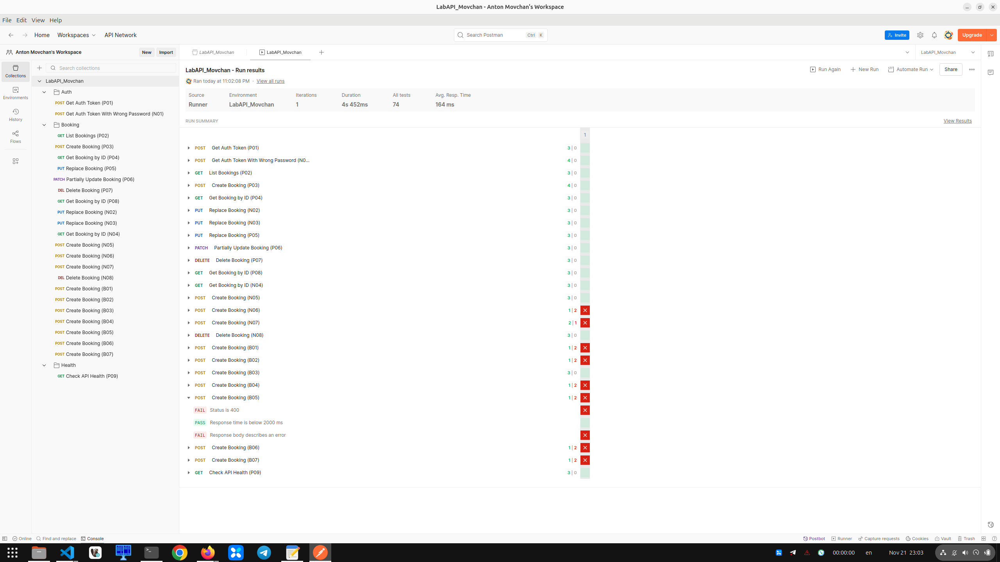

# Лабораторная работа № 3 «Интеграционное и API-тестирование»

**Студент:** Антон Мовчан, группа ПВ-233.

**Цель работы** — проверить REST API учебного сервиса Restful-Booker с помощью Postman, автоматизировать передачу данных между запросами и сопоставить ожидаемые результаты с фактическими. Сервис поддерживает получение токена, создание, чтение, обновление и удаление бронирований, а также проверку доступности API. [Документация Restful-Booker](https://restful-booker.herokuapp.com/apidoc/index.html)

## 1. Тестируемый сервис и эндпоинты

Коллекция `LabAPI_Movchan` содержит папки `Auth`, `Booking` и `Health`. Прогон выполнен с одноимённым окружением Postman.

| Переменная окружения | Начальное значение | Назначение |
| --- | --- | --- |
| `baseUrl` | `https://restful-booker.herokuapp.com` | Базовый адрес API |
| `token` | Пустое | Токен из ответа `POST /auth` |
| `bookingId` | Пустое | Идентификатор из поля `bookingid` ответа `POST /booking` |
| `expectedBooking` | Задаётся скриптом | Ожидаемые данные для проверок GET и PATCH |

### Покрытие API

В URL запросов использовалась переменная `{{baseUrl}}`. Запросы с телом отправлялись в формате JSON. Авторизованные операции PUT, PATCH и DELETE передавали токен в заголовке `Cookie` со значением `token={{token}}`.

| Папка | Запрос | Метод и путь | Цель | Входные данные | Ожидаемый результат |
| --- | --- | --- | --- | --- | --- |
| Auth | Get Auth Token | `POST /auth` | Получить токен | JSON с `username: "admin"` и `password: "password123"` | `200`, JSON с непустым `token` |
| Booking | List Bookings | `GET /booking` | Получить список идентификаторов | Без тела и параметров в данном прогоне | `200`, массив объектов с числовым `bookingid` |
| Booking | Get Booking by ID | `GET /booking/{{bookingId}}` | Получить созданное бронирование | ID из окружения, тело отсутствует | `200`, JSON с данными созданного бронирования |
| Booking | Create Booking | `POST /booking` | Создать бронирование | Полный JSON из примера ниже | `200`, JSON с `bookingid` и объектом `booking` |
| Booking | Replace Booking | `PUT /booking/{{bookingId}}` | Полностью обновить бронирование | ID, токен и полный JSON создания с `totalprice: 5000` | `200`, JSON обновлённого бронирования |
| Booking | Partially Update Booking | `PATCH /booking/{{bookingId}}` | Изменить только стоимость | ID, токен и JSON `{"totalprice": 123}` | `200`, стоимость равна `123`, остальные поля сохранены |
| Booking | Delete Booking | `DELETE /booking/{{bookingId}}` | Удалить созданное бронирование | ID и токен, тело отсутствует | `201 Created`. Удаление подтверждается повторным `GET` с кодом `404` |
| Health | Check API Health | `GET /ping` | Проверить доступность сервиса | Без параметров и тела | `201 Created` |

Ожидаемые коды базовых запросов соответствуют поведению Restful-Booker. [Документация коллекции Restful-Booker](https://www.postman.com/automation-in-testing/restful-booker-collections/documentation/55eh7vh/restful-booker)

В **Create Booking** использовалось следующее тестовое бронирование.

```json
{
  "firstname": "Anton",
  "lastname": "Movcahn",
  "totalprice": 200,
  "depositpaid": true,
  "bookingdates": {
    "checkin": "2026-01-01",
    "checkout": "2027-01-01"
  },
  "additionalneeds": "midnight snack"
}
```

### Автоматизация

Скрипты **Post-response** сохраняли токен из `POST /auth` в `token` и идентификатор из `POST /booking` в `bookingId`. Последующие запросы использовали этот идентификатор до повторного чтения после удаления. Каждый запрос содержал минимум три автоматические проверки HTTP-статуса, времени ответа и содержимого ответа. Порог времени составлял 2000 мс.

## 2. Тест-кейсы

В итоговом прогоне N02 и N03 выполнялись после успешного чтения P04 и до обновления и удаления бронирования. Для B02 и B05 ожидаемый код `400` отражал гипотезы об ограничениях длины имени и максимальной стоимости.

| ID | Эндпоинт | Тип | Входные данные | Ожидаемый результат | Фактический результат | Статус |
| --- | --- | --- | --- | --- | --- | --- |
| P01 | `POST /auth` | Позитивный | Корректные логин и пароль | `200`, непустой токен | `200`, получен непустой токен | Пройден |
| P02 | `GET /booking` | Позитивный | Без фильтров | `200`, массив идентификаторов | `200`, получен массив идентификаторов | Пройден |
| P03 | `POST /booking` | Позитивный | JSON из раздела 1 | `200`, данные и ID созданной записи | `200`, получен ID, данные совпали с отправленным JSON | Пройден |
| P04 | `GET /booking/{id}` | Позитивный | ID из P03 | `200`, данные совпадают с P03 | `200`, данные совпали с отправленными при создании | Пройден |
| P05 | `PUT /booking/{id}` | Позитивный | ID из P03, токен из P01, полный JSON с ценой `5000` | `200`, полные обновлённые данные | `200`, данные совпали с телом PUT | Пройден |
| P06 | `PATCH /booking/{id}` | Позитивный | ID из P03, токен из P01, цена `123` | `200`, цена изменена, остальные поля сохранены | `200`, цена изменена на 123, остальные поля совпали с данными PUT | Пройден |
| P07 | `DELETE /booking/{id}` | Позитивный | ID из P03, токен из P01 | `201`, запись удалена | `201`, тело ответа `Created` | Пройден |
| P08 | `GET /booking/{id}` | Позитивный, проверка удаления | ID из P03 после P07 | `404`, запись недоступна | `404`, ответ содержит `Not Found` | Пройден |
| P09 | `GET /ping` | Позитивный | Без параметров | `201`, сервис доступен | `201`, тело ответа `Created` | Пройден |
| N01 | `POST /auth` | Негативный | `admin` и неверный пароль | `200`, JSON с причиной `Bad credentials`, токен отсутствует | `200`, `Bad credentials`, токен отсутствует | Пройден |
| N02 | `PUT /booking/{id}` | Негативный | Существующий ID и корректное тело, без токена | `403`, запрос отклонён | `403`, `Forbidden`. Запрос отклонён до удаления бронирования | Пройден |
| N03 | `PUT /booking/{id}` | Негативный | Существующий ID и корректное тело, неверный токен | `403`, запрос отклонён | `403`, `Forbidden`. Запрос отклонён до удаления бронирования | Пройден |
| N04 | `GET /booking/-1` | Негативный | Несуществующий ID `-1` | `404`, запись недоступна | `404`, ответ содержит `Not Found` | Пройден |
| N05 | `POST /booking` | Негативный | Некорректный JSON, например `{"firstname":` | `400`, запрос отклонён | `400`, некорректный JSON отклонён | Пройден |
| N06 | `POST /booking` | Негативный | `"totalprice": "abc"` | `400`, неверный тип отклонён | `200`, проверка тела на ошибку также не прошла | Не пройден |
| N07 | `POST /booking` | Негативный | Удалено обязательное поле `firstname` | `400`, запрос отклонён | `500`, сервер вернул внутреннюю ошибку | Не пройден |
| N08 | `DELETE /booking/{id}` | Коды ответов | Повторное удаление после P08 с действующим токеном | `405`, повторное удаление отклонено | `405`, ответ содержит `Method Not Allowed` | Пройден |
| B01 | `POST /booking` | Граничный | `firstname` и `lastname` равны `""` | `400`, пустые имена отклонены | `200`, проверка тела на ошибку также не прошла | Не пройден |
| B02 | `POST /booking` | Граничный | `firstname` длиной 1001 символ | `400`, гипотеза об ограничении длины | `200`, проверка тела на ошибку также не прошла | Не пройден |
| B03 | `POST /booking` | Граничный | `totalprice: 0` | `200`, цена сохранена как число `0` | `200`, в ответе есть ID, стоимость равна 0 | Пройден |
| B04 | `POST /booking` | Граничный | `totalprice: -1` | `400`, отрицательная цена отклонена | `200`, проверка тела на ошибку также не прошла | Не пройден |
| B05 | `POST /booking` | Граничный | `totalprice: 9007199254740991` | `400`, гипотеза о верхнем ограничении цены | `200`, проверка тела на ошибку также не прошла | Не пройден |
| B06 | `POST /booking` | Граничный | В `bookingdates` дата выезда `2025-12-31` раньше даты заезда `2026-01-01` | `400`, неверный порядок дат отклонён | `200`, проверка тела на ошибку также не прошла | Не пройден |
| B07 | `POST /booking` | Граничный | `bookingdates.checkin` равен `"invalid-date"` | `400`, неверный формат даты отклонён | `200`, проверка тела на ошибку также не прошла | Не пройден |

Фактические результаты получены из [выгрузки Collection Runner](LabAPI_Movchan.postman_test_run.json). Статус «Пройден» означает, что все проверки запроса прошли.

## 3. Расхождения и дефекты

Ожидания в таблице основаны на типичных статусах REST-операций и гипотезах валидации вводимых данных.

| № | Запрос | Ожидалось | Получено | Вывод |
| --- | --- | --- | --- | --- |
| 1 | P03 — создание бронирования | `201 Created` как типичный ответ на создание ресурса | `200 OK`, ID и данные бронирования | Особенность API. Проверка Restful-Booker ожидает `200` |
| 2 | P07 — удаление бронирования | `204 No Content` как типичный ответ на удаление без тела | `201 Created` с телом `Created`. Повторный GET вернул `404` | Особенность API |
| 3 | P09 — проверка доступности | `200 OK` для успешной проверки | `201 Created` с телом `Created` | Особенность API |
| 4 | N01 — неверный пароль | HTTP-код ошибки аутентификации | `200 OK`, `Bad credentials`, токен отсутствует | Особенность API. Ошибка указана в теле ответа |
| 5 | N08 — повторное удаление | `404 Not Found` для отсутствующего ресурса | `405 Method Not Allowed` | Особенность API |
| 6 | N06 — строка вместо числовой цены | `400 Bad Request` | `200 OK` | Дефект валидации типа |
| 7 | N07 — отсутствует обязательное имя | `400 Bad Request` | `500 Internal Server Error` | Дефект обработки некорректного запроса |
| 8 | B01 — пустые имена, B04 — отрицательная цена | `400 Bad Request` при проверке допустимости значений | `200 OK` в обоих случаях | Расхождение с ожидаемой валидацией данных |
| 9 | B02 — имя длиной 1001 символ, B05 — очень большая цена | `400 Bad Request` по гипотезе о верхних границах | `200 OK` в обоих случаях | Гипотеза о заданных ограничениях не подтвердилась |
| 10 | B06 — выезд раньше заезда, B07 — неверный формат даты | `400 Bad Request` | `200 OK` в обоих случаях | Расхождение с ожидаемой валидацией дат |

Выгрузка содержит коды ответов и результаты проверок. Тела ответов в выгрузке отсутствуют. По ней можно подтвердить код `200` в N06 и граничных сценариях, а возвращённые значения полей остаются неизвестными.

### Баг-репорты

Во всех сценариях использовался `POST {{baseUrl}}/booking` с типом содержимого `application/json`. За основу был взят JSON из раздела 1.

| ID | Дефект | Шаги воспроизведения | Ожидаемый результат | Фактический результат | Серьёзность |
| --- | --- | --- | --- | --- | --- |
| BUG-01 | API отвечает успехом при строковой цене | Запрос N06 отправлен с `"totalprice": "abc"` | `400`, неверный тип поля отклонён | `200` | Средняя |
| BUG-02 | Сервер возвращает внутреннюю ошибку при отсутствии обязательного поля | Запрос N07 отправлен без `firstname` | `400`, сообщается об отсутствующем поле | `500` | Средняя |
| BUG-03 | API отвечает успехом при недопустимых датах | В B06 указана дата выезда раньше даты заезда. В B07 указано `"invalid-date"` в `checkin` | `400` в обоих случаях | `200` в обоих случаях | Средняя |

## 4. Результаты Collection Runner

21 ноября 2026 года выполнена одна итерация коллекции `LabAPI_Movchan`. Из 24 тест-кейсов прошли 16. Из 74 автоматических проверок прошли 59, завершились ошибкой 15. Время ответа составило от 148 до 507 мс, в среднем 164 мс. Все проверки времени ответа прошли.

В N06, B01, B02 и B04–B07 не прошли проверки HTTP-статуса и тела ошибки. В N07 не прошла только проверка статуса.



## 5. Файлы JSON

- [Коллекция Postman](LabAPI_Movchan.postman_collection.json)
- [Окружение Postman](LabAPI_Movchan.postman_environment.json)
- [Результаты итогового прогона](LabAPI_Movchan.postman_test_run.json)

## 6. Выводы

Цепочка создания, чтения, обновления и удаления бронирования прошла с автоматической передачей токена и ID. После удаления повторный GET вернул `404`. Попытки обновить существующее бронирование без токена и с неверным токеном вернули `403`.

Некорректный JSON был отклонён с кодом `400`, отсутствие обязательного поля вызвало `500`, а строковая цена и некорректные даты получили `200`. При интеграции с этим API важно учитывать коды ответов и проверять содержимое ответа.
