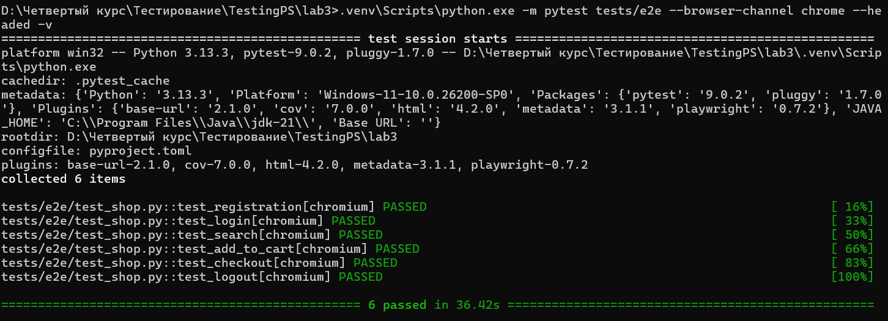
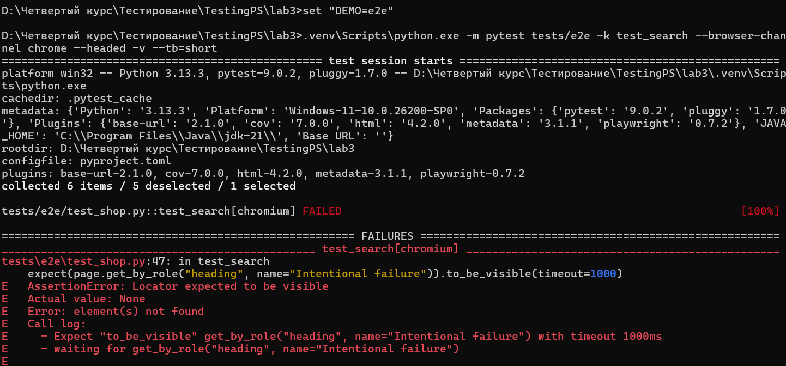
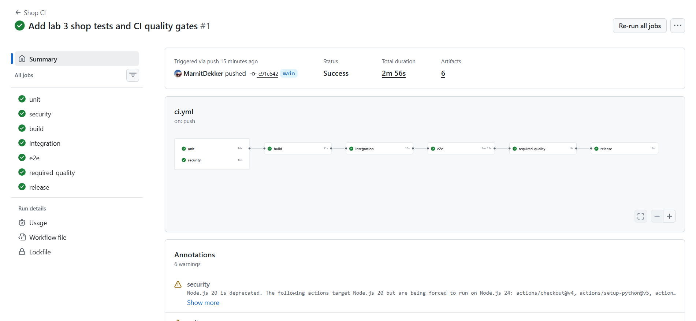
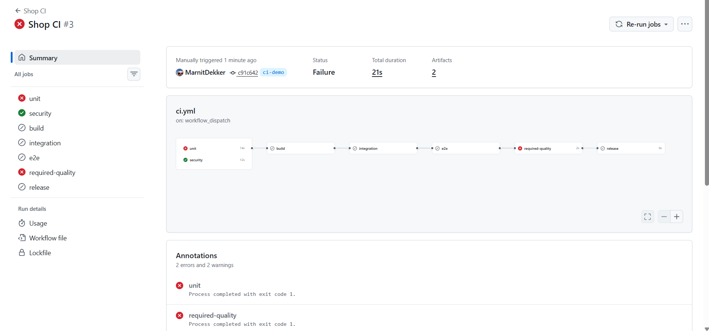
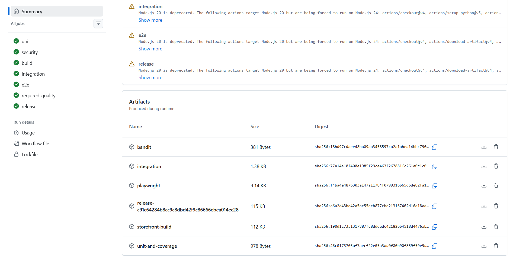
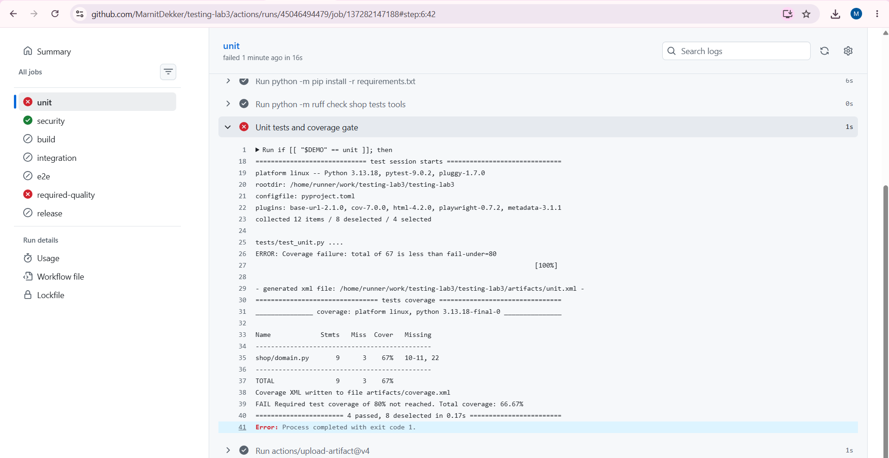
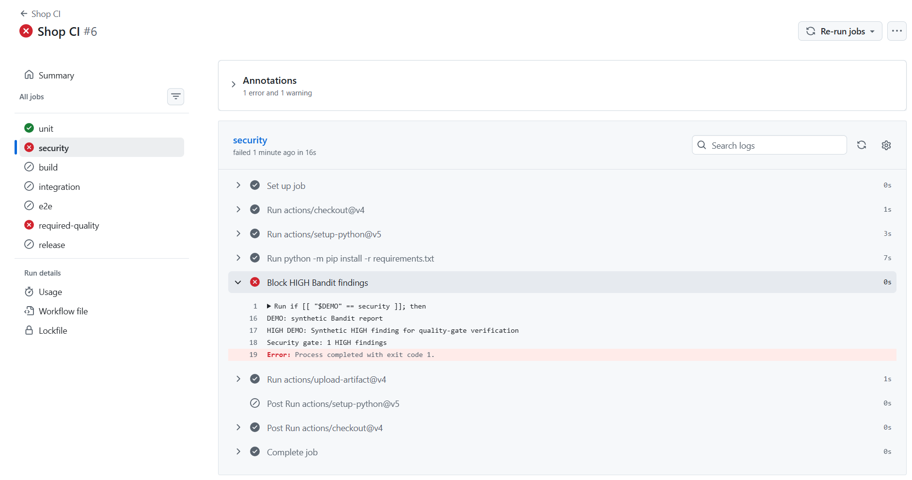
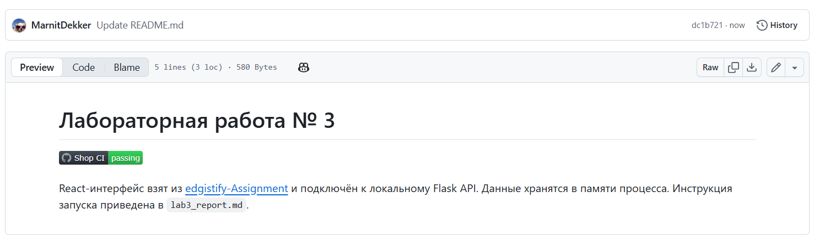
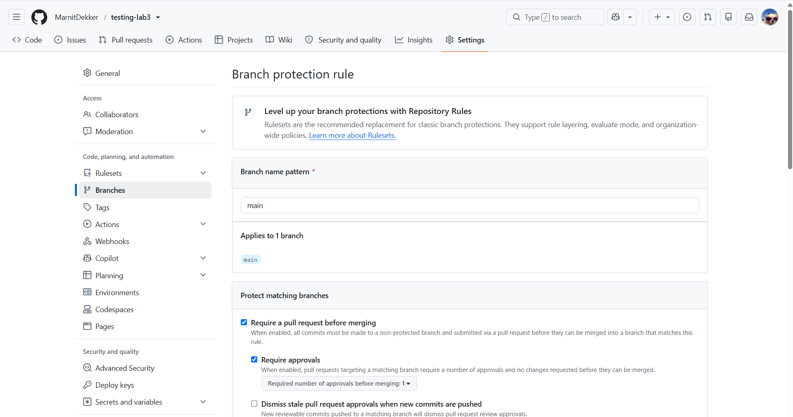
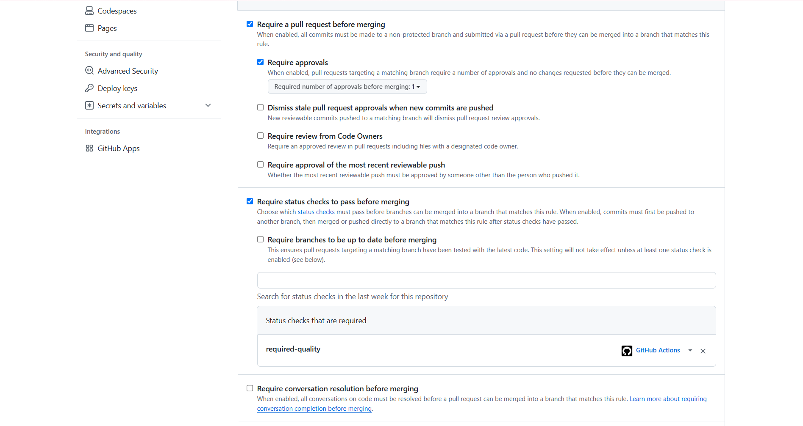

<div align="center">

**МИНИСТЕРСТВО НАУКИ И ВЫСШЕГО ОБРАЗОВАНИЯ РОССИЙСКОЙ ФЕДЕРАЦИИ**

*ФЕДЕРАЛЬНОЕ ГОСУДАРСТВЕННОЕ БЮДЖЕТНОЕ ОБРАЗОВАТЕЛЬНОЕ УЧРЕЖДЕНИЕ ВЫСШЕГО ОБРАЗОВАНИЯ*

*«БЕЛГОРОДСКИЙ ГОСУДАРСТВЕННЫЙ ТЕХНОЛОГИЧЕСКИЙ УНИВЕРСИТЕТ им. В. Г. ШУХОВА» (БГТУ им. В. Г. Шухова)*

Кафедра программного обеспечения вычислительной техники и автоматизированных систем

# Лабораторная работа № 3

**Тема** - Автоматизация UI-тестов и построение CI/CD-пайплайна с блокирующими quality gates

</div>

<div align="right">

Выполнила - Фатеева Марина Игоревна, группа ПВ-233<br>
Проверил - Доденко Олег Павлович

</div>

<div align="center">

*Белгород, 2026*

</div>

---

## Цель работы

Освоить автоматизацию браузерных тестов и настроить проверки, блокирующие сборку и выпуск при ошибках.

## 1. UI-автоматизация

За основу взят React-интерфейс магазина [edgistify-Assignment](https://github.com/Sajid788/edgistify-Assignment). В каталог добавлено поле поиска. Вместо удалённого API интерфейс обращается к локальному Flask API. Сервер выдаёт два тестовых товара, Classic Tee и Canvas Cap, и хранит аккаунты, корзины и заказы в памяти процесса.

[Репозиторий лабораторной работы](https://github.com/MarnitDekker/testing-lab3)

Фикстура `base_url` в `tests/e2e/conftest.py` запускает Flask на свободном локальном порту. Сервер отдаёт сборку React и принимает HTTP-запросы браузера. После прогона сервер останавливается. Playwright открывает отдельный браузерный контекст для каждого теста. Для входа, корзины, заказа и выхода фикстура заранее регистрирует через API пользователя с уникальным email. В тесте регистрации аккаунт создаётся через форму.

Методы класса `ShopPages` в `tests/e2e/pages.py` выполняют действия с формами и кнопками. Проверки результатов находятся в `tests/e2e/test_shop.py`.

### Фрагменты Page Object и теста оформления заказа

```python
from playwright.sync_api import expect


class ShopPages:
    def __init__(self, page):
        self.page = page

    def register(self, email, password):
        self.page.goto("/signup")
        self.page.get_by_placeholder("Name").fill("Lab User")
        self.page.get_by_placeholder("Email").fill(email)
        self.page.get_by_placeholder("Password").fill(password)
        self.page.get_by_role("button", name="Sign Up").click()
        expect(self.page).to_have_url("/login")

    def login(self, email, password):
        self.page.goto("/login")
        self.page.locator('input[type="email"]').fill(email)
        self.page.locator('input[type="password"]').fill(password)
        self.page.get_by_role("button", name="Login", exact=True).click()
        expect(self.page).to_have_url("/")

    def search(self, query):
        self.page.goto("/products")
        self.page.get_by_role("searchbox", name="Search products").fill(query)

    def add_tee(self):
        self.search("tee")
        expect(self.page.get_by_role("heading", name="Canvas Cap")).to_have_count(0)
        self.page.get_by_role("button", name="Add Cart").click()
        expect(self.page.get_by_text("Item added to cart")).to_be_visible()
        nav = self.page.get_by_role("navigation")
        nav.get_by_role("link", name="Cart", exact=True).click()
        expect(self.page.get_by_role("heading", name="Your Cart")).to_be_visible()

    def order(self, email):
        self.page.get_by_role("button", name="Proceed to Checkout").click()
        for field, value in {
            "firstName": "Lab", "lastName": "User", "email": email,
            "address": "10 Test Street", "city": "Belgorod", "pinCode": "308000",
        }.items():
            self.page.locator(f'input[name="{field}"]').fill(value)
        expect(self.page.get_by_text("$20", exact=True)).to_be_visible()
        self.page.get_by_role("button", name="Place Order", exact=True).click()
```

В тесте после отправки формы проверяются заголовок подтверждения и название заказанного товара.

```python
def test_checkout(pages, page, account):
    pages.login(account, PASSWORD)
    pages.add_tee()
    pages.order(account)
    expect(page.get_by_role("heading", name="Order Placed Successfully!")).to_be_visible()
    expect(page.get_by_text("Classic Tee", exact=True)).to_be_visible()
```

| Сценарий | Действия и проверка |
|---|---|
| Регистрация | Открывается форма входа, созданная учётная запись позволяет войти |
| Вход | Вводятся email и пароль, проверяются переход на главную и наличие кнопки Logout |
| Поиск | Запрос tee оставляет Classic Tee и скрывает Canvas Cap |
| Добавление в корзину | Classic Tee отображается в корзине |
| Оформление заказа | Добавляется Classic Tee, заполняется адрес, проверяется сумма $20 и подтверждение с товаром |
| Выход | После выхода переход в корзину перенаправляет на вход |

В штатном прогоне пройдены все 6 сценариев Playwright.



В демонстрационном прогоне выбран только `test_search`. При `DEMO=e2e` тест ожидает заголовок `Intentional failure`, которого нет на странице. На скриншоте видны статус `FAILED`, строка проверки и сообщение `element(s) not found`. Снимок подтверждает, что Playwright фиксирует невыполненное ожидание и показывает причину ошибки.



## 2. Пирамида тестирования

В основании пирамиды находятся 12 unit-тестов, на среднем уровне - 8 интеграционных проверок API, на вершине - 6 браузерных E2E-тестов.

| Уровень | Количество | Назначение |
|---|---:|---|
| Unit | 12 | Быстрые проверки вариантов поиска, валидации и расчёта суммы |
| Integration | 8 | Проверка HTTP-контрактов регистрации и входа, каталога, корзины и заказа |
| E2E | 6 | По одному браузерному сценарию на каждую ключевую операцию |

В `test_unit.py` три параметризованные проверки по четыре случая. Поиск проверяется с пустым запросом, пробелами, другим регистром и отсутствующим товаром. Валидация проверяется на корректных данных, пустом имени, неверном email и коротком пароле. Расчёт суммы проверяется на пустой корзине, одной позиции, большем количестве и нескольких позициях.

В `test_integration.py` тестовый клиент Flask проверяет регистрацию и повторный email, каталог, добавление и удаление позиции, оформление заказа и очистку корзины, нормализацию email при входе, отказ при неверном размере, изоляцию корзин и отказ в доступе к заказам без действующего токена.

Разные комбинации входных данных проверяются быстрыми unit-тестами. Правила, зависящие от HTTP и состояния аккаунта, проверяются через API. В браузере оставлено по одному тесту на каждую обязательную пользовательскую операцию.

## 3. CI/CD и quality gates

Workflow из `.github/workflows/ci.yml` запускается на каждый `push` и `pull_request`. Сначала выполняются Ruff, unit-тесты, контроль покрытия и Bandit. Затем собирается React-приложение, запускаются интеграционные и браузерные тесты. Job `required-quality` требует успешного завершения всех пяти стадий. Релизный архив публикуется только после успешного push в `main`.

| Проверка | Блокирующее условие | Что останавливается |
|---|---|---|
| Unit и lint | Тест или Ruff завершился с ошибкой | Сборка и последующие стадии |
| Coverage | Покрытие ниже 80 % | Сборка при проверке бизнес-логики, E2E и релиз при проверке всего API после сборки |
| Bandit | Обнаружено замечание HIGH или сканирование завершилось ошибкой | Сборка и последующие стадии |
| Integration | Хотя бы один тест упал | E2E и релиз |
| E2E | Хотя бы один тест упал | Релиз |

### Зависимости заданий и артефакты

| Задание | От каких заданий зависит | Что делает и публикует |
|---|---|---|
| `unit` | Запускается сразу | Ruff, 12 unit-тестов и порог 80 % для `shop/domain.py`. Артефакт `unit-and-coverage` содержит `unit.xml` и `coverage.xml` |
| `security` | Запускается параллельно с `unit` | Bandit сканирует `shop/`. Артефакт `bandit` содержит `bandit.json` |
| `build` | `unit` и `security` | Собирает React через TypeScript и Vite и публикует `storefront-build` |
| `integration` | `build` | Запускает unit- и интеграционные тесты вместе. Проверяет порог 80 % для Python backend, публикует JUnit и XML покрытия в артефакте `integration` |
| `e2e` | `integration` | Загружает собранный фронтенд и запускает Chromium. Артефакт `playwright` содержит HTML и JUnit, а при падении также скриншот и трассировку |
| `required-quality` | Все пять предыдущих заданий | Проверяет, что результат каждого задания равен `success`. Выполняется и при пропуске зависимых стадий |
| `release` | `required-quality` | После успешного push в `main` публикует архив со сборкой React, Flask API и списком зависимостей |

Отчёты тестов и Bandit загружаются через `if: always()`, поэтому уже сформированные файлы доступны при падении проверки.

### Результаты проверок

Штатный прогон: 12 unit- и 8 интеграционных тестов пройдены. Покрытие бизнес-логики составило 100 %, backend - 93,68 %. Bandit не обнаружил находок HIGH.

На ветке `main` все стадии завершились успешно, включая `release`.



В ручном прогоне `demo = unit` на ветке `ci-demo` выполняется тест из `tests/fixtures/demo_unit_failure.py` с намеренно ложным утверждением. `unit` получает код 1. Задания `build`, `integration` и `e2e` пропущены. Итоговая проверка `required-quality` завершилась ошибкой, стадия `release` пропущена.



В успешном прогоне опубликованы отчёты тестов и покрытия, результаты Bandit, сборка и релизный архив.



В прогоне `demo = coverage` отбираются четыре случая расчёта суммы (`test_total`). Они проходят, но выполняют 6 из 9 исполняемых строк `shop/domain.py`. Покрытие составляет 66,67 % при пороге 80 %. Задание `unit` завершилось с кодом 1, сборка пропущена.



В штатном режиме `tools/security_gate.py` читает JSON-отчёт Bandit и возвращает код 1 при наличии записи с `issue_severity = HIGH`. В прогоне `demo = security` тот же фильтр получил синтетический отчёт `tests/fixtures/bandit-high.json` с одной находкой HIGH. Задание `security` завершилось с кодом 1, сборка пропущена.



Badge в `README.md` показывает успешный прогон `Shop CI`.



Для ветки `main` в правиле защиты указаны обязательный pull request и успешное прохождение проверки `required-quality` от GitHub Actions.





## 4. Контрольные вопросы

1. **Пирамида тестирования** распределяет проверки по уровням. Много быстрых unit-тестов дают раннюю обратную связь. Интеграционные и браузерные сценарии проверяют связи компонентов и работу приложения для пользователя.
2. **Паттерны UI-тестирования** включают Page Object для локаторов и действий, Component Object для повторяющихся виджетов и Screenplay для описания сценариев через роли и действия.
3. **Quality gate** - обязательная проверка перед следующей стадией CI/CD. При невыполнении условия merge или выпуск блокируется.
4. **Порядок запуска.** Unit-тесты быстры и проверяют изменения при каждом push. Интеграционные тесты проверяют совместную работу компонентов после успешной сборки. E2E запускаются перед выпуском, поскольку проверяют весь путь пользователя и требуют браузера.

## Заключение

Автоматические проверки выявляют ошибки до слияния изменений. Зависимости заданий в CI останавливают сборку и выпуск при нарушении порогов или падении тестов.
