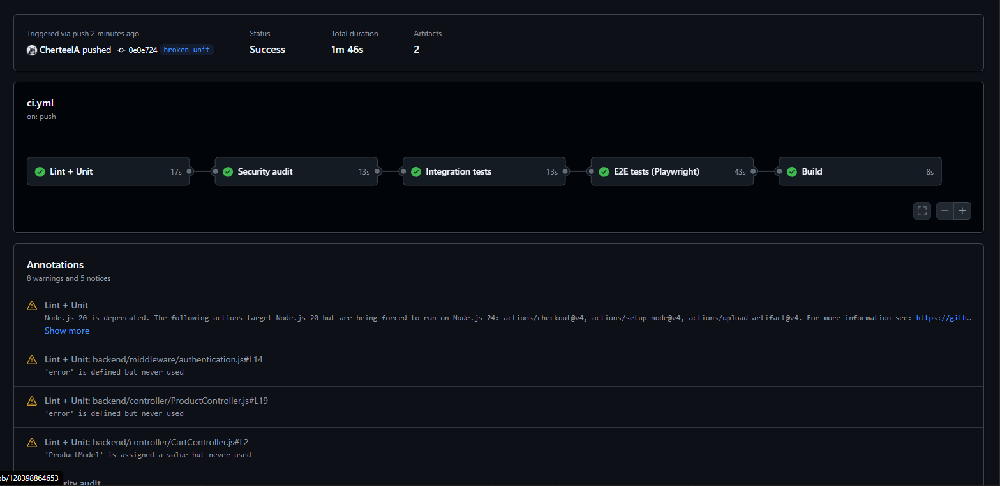
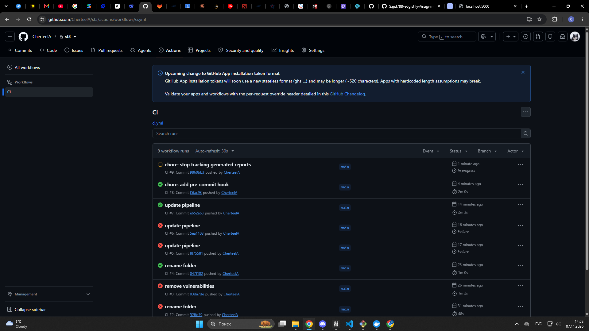
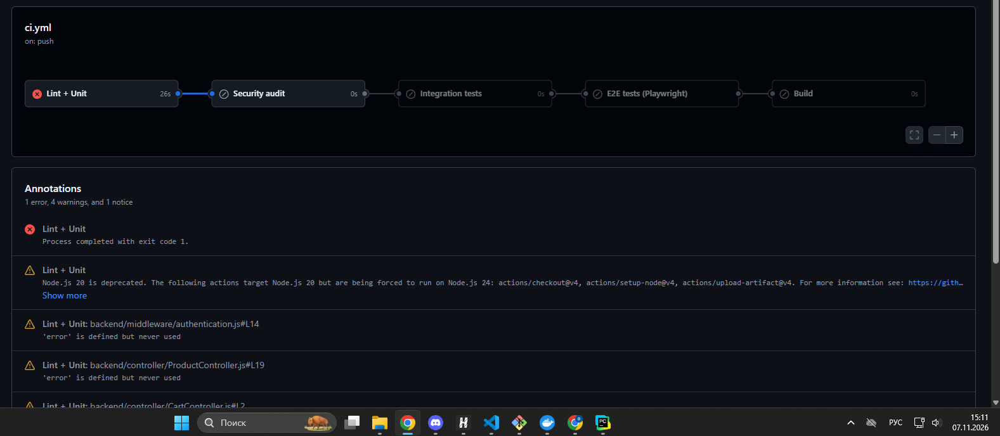
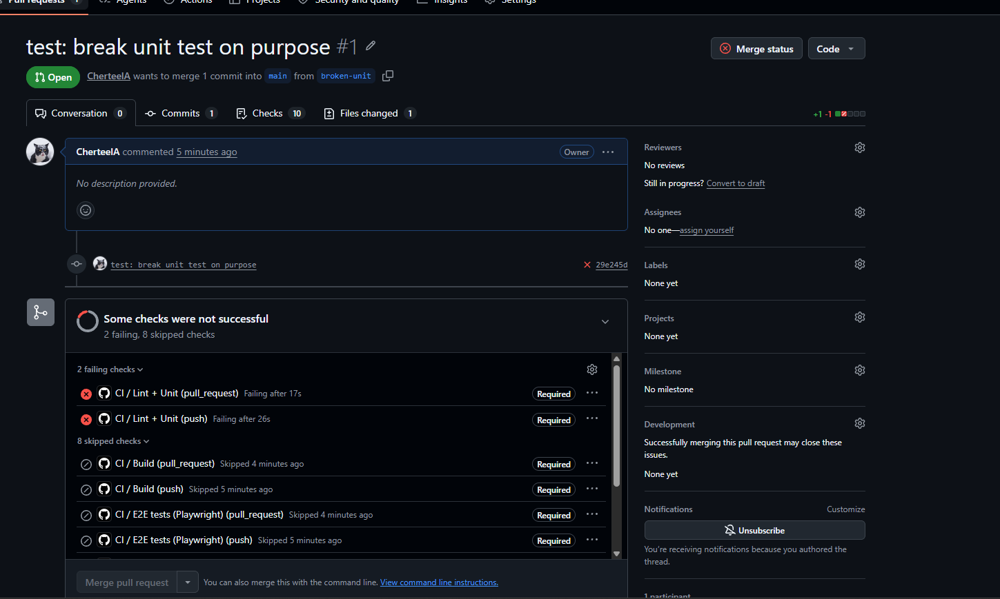
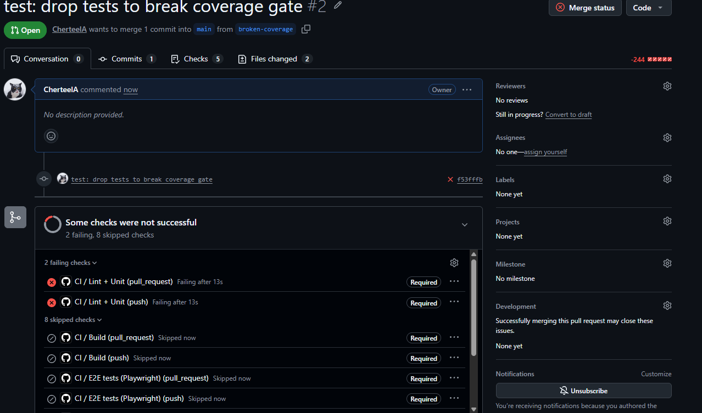
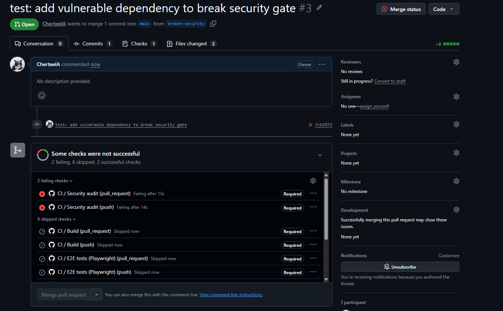
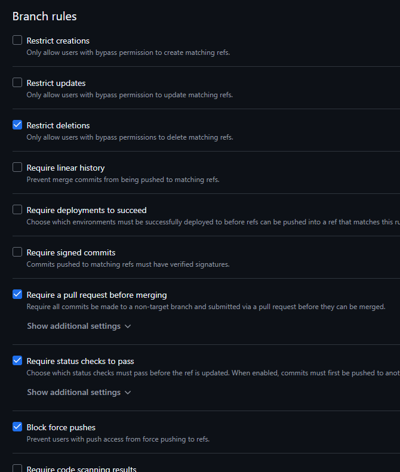
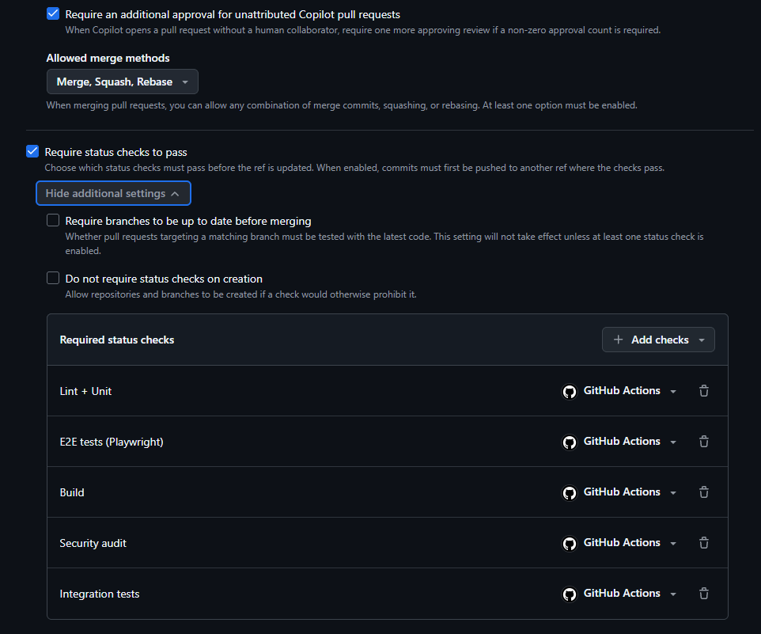

# Лабораторная работа № 3

## Автоматизация UI-тестов и построение CI/CD-пайплайна с блокирующими quality gates

## Ситников Алексей, группа ПВ 233

**Репозиторий:** https://github.com/CherteelA/st3

**Объект тестирования:** интернет-магазин [edgistify-Assignment](https://github.com/Sajid788/edgistify-Assignment), выбрана backend-часть (Node.js, Express, MongoDB).

---

## 1. Код UI-тестов с Page Object


Сценарии: регистрация, вход, список товаров, добавление в корзину, оформление заказа, выход (после выхода доступ к корзине закрыт, код 401).

### `e2e/pages/ShopApi.js` (Page Object)

```javascript
class ShopApi {
  constructor(request) {
    this.request = request;
    this.token = "";
    this.userId = "";
  }
  headers() {
    return this.token ? { Authorization: `Bearer ${this.token}` } : {};
  }
  register(user) {
    return this.request.post("/api/users/register", { data: user });
  }
  async login(email, password) {
    const res = await this.request.post("/api/users/login", { data: { email, password } });
    if (res.ok()) {
      const body = await res.json();
      this.token = body.token;
      this.userId = body.userId;
    }
    return res;
  }
  products() {
    return this.request.get("/api/products");
  }
  addToCart(item) {
    return this.request.post("/api/cart/add", { data: item, headers: this.headers() });
  }
  cart() {
    return this.request.get("/api/cart/", { headers: this.headers() });
  }
  createOrder(order) {
    return this.request.post("/api/orders/create", { data: order, headers: this.headers() });
  }
  orders() {
    return this.request.get("/api/orders/get", { headers: this.headers() });
  }
  logout() {
    this.token = "";
  }
}
module.exports = { ShopApi };
```

### `e2e/tests/shop.spec.js` (тесты)

```javascript
const { test, expect } = require("@playwright/test");
const { ShopApi } = require("../pages/ShopApi");

const email = `e2e_${Date.now()}@test.com`;
const password = "password123";
const productId = "64b7f0c2a1b2c3d4e5f60718";

test.describe.serial("shop API flow", () => {
  let shop;
  test.beforeAll(({ playwright }) => {});
  test.beforeEach(async ({ request }) => {
    shop = shop || new ShopApi(request);
    shop.request = request;
  });

  test("1. регистрация", async () => {
    const res = await shop.register({ fullName: "E2E User", email, password });
    expect(res.status()).toBe(200);
  });

  test("2. вход", async () => {
    const res = await shop.login(email, password);
    expect(res.status()).toBe(200);
    expect(shop.token).toBeTruthy();
  });

  test("3. список товаров", async () => {
    const res = await shop.products();
    expect(res.status()).toBe(200);
    expect(Array.isArray(await res.json())).toBe(true);
  });

  test("4. добавление в корзину", async () => {
    const add = await shop.addToCart({
      userId: shop.userId, images: ["a.png"], title: "Shirt",
      price: 50, quantity: 2, size: "M", productId,
    });
    expect(add.status()).toBe(201);
    const cart = await (await shop.cart()).json();
    expect(cart.length).toBeGreaterThan(0);
  });

  test("5. оформление заказа", async () => {
    const res = await shop.createOrder({
      products: [{ images: ["a.png"], title: "Shirt", productId, quantity: 2, price: 50 }],
      totalPrice: 100,
      shippingAddress: "Frankfurt",
    });
    expect(res.status()).toBe(201);
    const orders = await (await shop.orders()).json();
    expect(orders.length).toBeGreaterThan(0);
  });

  test("6. выход: без токена доступ закрыт", async () => {
    shop.logout();
    const res = await shop.cart();
    expect(res.status()).toBe(401);
  });
});
```

### Успешный прогон E2E (локально)

```
Running 6 tests using 1 worker

  ok 1 tests\shop.spec.js:16:3 › shop API flow › 1. регистрация (66ms)
  ok 2 tests\shop.spec.js:21:3 › shop API flow › 2. вход (16ms)
  ok 3 tests\shop.spec.js:27:3 › shop API flow › 3. список товаров (14ms)
  ok 4 tests\shop.spec.js:33:3 › shop API flow › 4. добавление в корзину (18ms)
  ok 5 tests\shop.spec.js:43:3 › shop API flow › 5. оформление заказа (21ms)
  ok 6 ….spec.js:54:3 › shop API flow › 6. выход: без токена доступ закрыт (6ms)

  6 passed (1.8s)
```

Помимо E2E, в проекте написаны unit-тесты (34 теста, покрытие `controller` и `middleware` 100%) и integration-тесты (13 тестов, `supertest` + `mongodb-memory-server`).

---

## 2. CI-конфигурация и успешные прогоны

CI реализован на GitHub Actions: файл `.github/workflows/ci.yml`. Триггеры: `push` и `pull_request`. Стадии идут строго друг за другом через `needs`, поэтому падение любой стадии блокирует все следующие (они получают статус *skipped*):

```
Lint + Unit  →  Security audit  →  Integration tests  →  E2E tests (Playwright)  →  Build
```

Репозиторий содержит также pre-commit-хук (`.githooks/pre-commit`), который перед коммитом запускает линтер и unit-тесты локально.


### `.github/workflows/ci.yml`

```yaml
name: CI

on:
  push:
  pull_request:

jobs:
  lint-unit:
    name: Lint + Unit
    runs-on: ubuntu-latest
    defaults:
      run:
        working-directory: backend
    steps:
      - uses: actions/checkout@v4
      - uses: actions/setup-node@v4
        with:
          node-version: 22
          cache: npm
          cache-dependency-path: backend/package-lock.json
      - run: npm ci
      - run: npm run lint
      - name: Unit tests + coverage gate (>= 80%)
        run: npm run test:unit
      - name: Upload coverage report
        if: always()
        uses: actions/upload-artifact@v4
        with:
          name: coverage-report
          path: backend/coverage

  security:
    name: Security audit
    needs: lint-unit
    runs-on: ubuntu-latest
    defaults:
      run:
        working-directory: backend
    steps:
      - uses: actions/checkout@v4
      - uses: actions/setup-node@v4
        with:
          node-version: 22
          cache: npm
          cache-dependency-path: backend/package-lock.json
      - run: npm ci
      - name: npm audit (fail on critical)
        run: npm audit --audit-level=critical

  integration:
    name: Integration tests
    needs: security
    runs-on: ubuntu-latest
    defaults:
      run:
        working-directory: backend
    env:
      JWT_SECRET: ci-test-secret
    steps:
      - uses: actions/checkout@v4
      - uses: actions/setup-node@v4
        with:
          node-version: 22
          cache: npm
          cache-dependency-path: backend/package-lock.json
      - run: npm ci
      - run: npm run test:integration

  e2e:
    name: E2E tests (Playwright)
    needs: integration
    runs-on: ubuntu-latest
    services:
      mongo:
        image: mongo:7
        ports:
          - 27017:27017
        options: >-
          --health-cmd "mongosh --quiet --eval 'db.runCommand({ping:1})'"
          --health-interval 5s
          --health-timeout 5s
          --health-retries 10
    env:
      CI: true
      PORT: 5000
      MONGO_URL: mongodb://localhost:27017/shop_e2e
      JWT_SECRET: ci-e2e-secret
    steps:
      - uses: actions/checkout@v4
      - uses: actions/setup-node@v4
        with:
          node-version: 22
      - name: Install backend deps
        run: npm ci
        working-directory: backend
      - name: Install e2e deps
        run: npm ci
        working-directory: e2e
      - name: Run Playwright tests
        run: npx playwright test
        working-directory: e2e
      - name: Upload Playwright report
        if: always()
        uses: actions/upload-artifact@v4
        with:
          name: playwright-report
          path: |
            e2e/playwright-report
            e2e/test-results

  build:
    name: Build
    needs: e2e
    runs-on: ubuntu-latest
    defaults:
      run:
        working-directory: backend
    steps:
      - uses: actions/checkout@v4
      - uses: actions/setup-node@v4
        with:
          node-version: 22
      - name: Install production dependencies
        run: npm ci --omit=dev
      - name: Smoke check that the app loads
        run: node -e "require('./app'); console.log('build ok')"
```

### Порог покрытия (`backend/jest.config.js`)

```javascript
module.exports = {
  testEnvironment: "node",
  collectCoverageFrom: ["controller/**/*.js", "middleware/**/*.js"],
  coverageDirectory: "coverage",
  coverageReporters: ["text", "lcov", "html"],
  coverageThreshold: {
    global: { statements: 80, branches: 80, functions: 80, lines: 80 },
  },
};
```

### Отчёты и артефакты

Пайплайн публикует артефакты: `coverage-report` (HTML и lcov-отчёт покрытия) и `playwright-report` (HTML-отчёт Playwright и `test-results`).

### Успешные прогоны

Все пять стадий пайплайна пройдены:



История запусков CI (зелёные прогоны на `main`):



---

## 3. Подтверждение работы quality gates и блокировки сборки

Для каждого gate создана отдельная ветка с намеренной поломкой и pull request в `main`. Во всех трёх случаях пайплайн падает, а следующие стадии, включая `Build`, пропускаются.

### 3.1. Упал unit-тест → job `Build` имеет статус *skipped*

Ветка `broken-unit`: в `OrderController.test.js` ожидаемый код ответа изменён с `400` на `401`. Job `Lint + Unit` красный, все остальные стадии (`Security audit`, `Integration tests`, `E2E tests`, `Build`) имеют статус *skipped*.



Pull request #1: проверки не пройдены, кнопка **Merge pull request** недоступна, у всех проверок метка *Required*.



### 3.2. Coverage < 80% валит пайплайн

Ветка `broken-coverage`: удалены тесты `CartController.test.js` и `OrderController.test.js`, оставшиеся тесты проходят, но покрытие падает ниже порога. Вывод `npm run test:unit` (та же команда выполняется в CI на шаге `Unit tests + coverage gate`):

```
 PASS  test/unit/authentication.test.js
 PASS  test/unit/UserController.test.js
 PASS  test/unit/ProductController.test.js
-----------------------|---------|----------|---------|---------|-------------------
File                   | % Stmts | % Branch | % Funcs | % Lines | Uncovered Line #s
-----------------------|---------|----------|---------|---------|-------------------
All files              |   53.92 |    63.63 |   53.84 |   53.92 |
 controller            |   48.35 |       60 |      50 |   48.35 |
  CartController.js    |       0 |        0 |       0 |       0 | 1-70
  OrderController.js   |       0 |        0 |       0 |       0 | 1-38
  ProductController.js |     100 |      100 |     100 |     100 |
  UserController.js    |     100 |      100 |     100 |     100 |
 middleware            |     100 |      100 |     100 |     100 |
  authentication.js    |     100 |      100 |     100 |     100 |
-----------------------|---------|----------|---------|---------|-------------------
Jest: Coverage for statements (53.92%) does not meet "global" threshold (80%)
Jest: Coverage for branches (63.63%) does not meet "global" threshold (80%)
Jest: Coverage for lines (53.92%) does not meet "global" threshold (80%)
Jest: Coverage for functions (53.84%) does not meet "global" threshold (80%)

Test Suites: 3 passed, 3 total
Tests:       18 passed, 18 total
```

Все оставшиеся тесты зелёные, но покрытие 53.92% ниже порога 80%, поэтому jest завершается с ненулевым кодом. В CI это роняет job `Lint + Unit`, остальные стадии пропускаются, merge в `main` заблокирован (pull request #2):



### 3.3. Critical vulnerability валит пайплайн

Ветка `broken-security`: в зависимости добавлен `minimist@1.2.5` с известной критической уязвимостью. Выдержка из вывода `npm audit --audit-level=critical`:

```
minimist  1.0.0 - 1.2.5
Severity: critical
Prototype Pollution in minimist - https://github.com/advisories/GHSA-xvch-5gv4-984h
fix available via `npm audit fix --force`
Will install minimist@1.2.8, which is outside the stated dependency range
node_modules/minimist

23 vulnerabilities (3 low, 19 moderate, 1 critical)
```

В этом сценарии `Lint + Unit` проходит, а падает именно стадия `Security audit`. Стадии `Integration tests`, `E2E tests` и `Build` пропущены, merge заблокирован (pull request #3):



Ранее, в обычном прогоне до исправления зависимостей, `npm audit` также останавливал пайплайн из-за двух критических уязвимостей (`proxy-addr` и `tar`, последняя приходила через неиспользуемый пакет `bcrypt`). Проблема была устранена удалением `bcrypt` и командой `npm audit fix`.

### 3.4. Branch protection

Для ветки `main` настроен ruleset: обязателен pull request и обязательны зелёные проверки CI (`Lint + Unit`, `Security audit`, `Integration tests`, `E2E tests (Playwright)`, `Build`). Также запрещены удаление ветки и force push.





---

## 4. Badge в README.md

В начало `README.md` добавлен badge статуса пайплайна:

```markdown
[](https://github.com/CherteelA/st3/actions/workflows/ci.yml)
```


---

## 5. Выводы о роли автоматизации в CI/CD

Автоматизация тестирования превращает проверку качества из ручного и необязательного этапа в обязательную часть доставки кода. В ходе работы это хорошо видно на трёх примерах: сломанный тест, просевшее покрытие и уязвимая зависимость останавливают пайплайн сами, без участия человека, а branch protection не даёт такому коду попасть в `main`.

---

## 6. Ответы на контрольные вопросы

### 1. Что такое пирамида тестирования и почему она важна?

Пирамида тестирования — модель распределения автоматических тестов по уровням. В основании лежат многочисленные быстрые **unit-тесты**, выше — **integration-тесты** (проверяют взаимодействие модулей, API и базы), на вершине — немногочисленные **E2E-тесты** (проверяют пользовательские сценарии целиком). Чем выше уровень, тем тест медленнее, дороже в поддержке и хрупче, но ближе к реальному поведению системы.


### 2. Какие паттерны автоматизации UI вы знаете?

- **Page Object** — каждая страница (или набор API-эндпоинтов) описывается классом с методами действий; тесты не знают о селекторах и URL. В работе использован класс `ShopApi`.
- **Page Factory** — вариант Page Object, где элементы страницы инициализируются автоматически (в Selenium через `@FindBy`).
- **Screenplay** — тесты описываются через актёров, их способности (abilities), задачи (tasks) и вопросы (questions); хорошо масштабируется на большие проекты.
- **Component Object / Widget Object** — Page Object для повторно используемых компонентов (меню, таблица, модальное окно).
- **Fluent interface (цепочка вызовов)** — методы страниц возвращают объекты следующих страниц, что делает сценарий читаемым.
- **Data-Driven Testing** — один сценарий выполняется на наборе входных данных.
- **Keyword-Driven / BDD (Gherkin, Cucumber)** — сценарии описываются на языке, близком к естественному.
- **Fixtures** (в Playwright) — подготовка и очистка окружения вынесены из самих тестов.

### 3. Что такое quality gates и зачем они нужны?

Quality gate (контрольные ворота качества) — автоматическое условие в пайплайне, при невыполнении которого сборка останавливается, а код не может перейти на следующий этап или попасть в основную ветку. Примеры из этой работы: все тесты зелёные, покрытие не ниже 80%, нет критических уязвимостей (`npm audit`), линтер без ошибок.

Нужны, чтобы требования к качеству соблюдались автоматически, а не «по договорённости»: они не зависят от внимательности ревьюера, исключают попадание заведомо плохого кода в `main`, делают качество измеримым и не дают ему деградировать со временем. В связке с branch protection они превращаются из рекомендации в обязательное правило.

### 4. Почему unit-тесты запускаются на каждый коммит, integration — после сборки, а E2E — перед релизом?

Порядок определяется **скоростью, стоимостью и областью проверки**:

- **Unit-тесты** выполняются за секунды, не требуют инфраструктуры и дают мгновенную обратную связь, поэтому их запускают на каждый коммит: ошибку находят сразу, пока контекст свежий, а исправление стоит дёшево.
- **Integration-тесты** медленнее и требуют собранного приложения и окружения (БД, сервисы). Их имеет смысл запускать только когда быстрые проверки и сборка уже прошли, чтобы не тратить ресурсы на заведомо неработающий код.
- **E2E-тесты** самые медленные и хрупкие, им нужно полностью развёрнутое приложение со всеми зависимостями. Их запускают на последнем этапе, перед релизом, когда остальные проверки уже пройдены и нужно убедиться, что ключевые пользовательские сценарии работают.

Так пайплайн реализует принцип «fail fast»: самые дешёвые проверки идут первыми, а дорогие выполняются только для кода, который уже прошёл предыдущие проверки.
