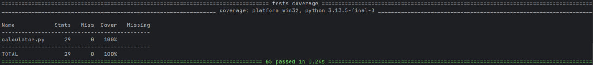
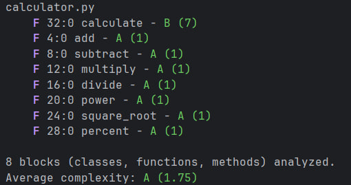
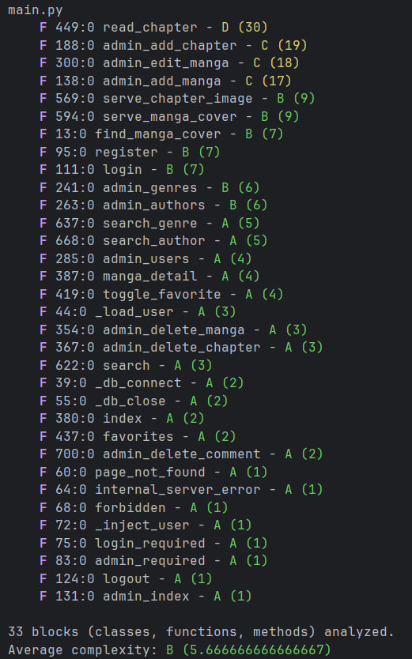

# Лабораторная работа №1 <br> Критерии качества ПО: сложность, корректность, надёжность, трудоёмкость. Оценка качества ПО.

## Цель работы

Освоить практические методы оценки качества и метрик программного обеспечения.

## Задание:

### Часть 1. Теоретическая

1. Опишите 3 наиболее значимые проблемы, возникающие при разработке сложных программных систем.
2. Составьте таблицу: «Проблема → Возможное решение → Инструменты/методы».

### Часть 2. Практическая

1. Создайте тестовый проект на Python (например, калькулятор).
2. Создайте задачи для проекта в Аспро (или другой системе трекинга).
3. Покройте код тестами (Unit tests).
4. Зафиксируйте покрытие тестами кода (например, с помощью coverage.py).
5. Возьмите небольшой программный проект (учебное консольное приложение или открытый код с GitHub).
6. Определите размер ПО (LOC).
7. Рассчитайте цикломатическую сложность одной из функций (можно использовать `radon cc -s calculator`).
8. Оцените дефектность (если есть баг-репорты или замечания).
9. Составьте итоговую таблицу метрик проекта, включающую:
   - размер (LOC),
   - сложность (цикломатическая),
   - качество (дефекты),
   - время реакции (если есть возможность),
   - процент покрытия тестами.

## Выполнение

### Часть 1. Теоретическая

1. Опишите 3 наиболее значимые проблемы, возникающие при разработке сложных программных систем.

    1) Комбинаторный рост числа состояний и неполнота проверки.

    Количество независимых путей выполнения растёт быстрее, чем размер кода: функция с цикломатической сложностью 30 требует десятков тестов только для покрытия ветвей, а с учётом комбинаций входных данных и внешних состояний (БД, файловая система, сессия) полный перебор невозможен в принципе. Из-за этого дефекты концентрируются в «сложных узлах» системы, а разработчик оценивает качество по «happy path», который проверен вручную.

    2) Неявные зависимости и невоспроизводимость окружения.

    В сложной системе часть зависимостей не объявлена явно: конфигурации, секреты, абсолютные пути, версии библиотек, порядок импортов. Код, работающий на машине автора, отказывается запускаться у другого разработчика или на сервере, а диагностика таких отказов занимает больше времени, чем исправление самой ошибки. Это напрямую увеличивает трудоёмкость сопровождения.

    3) Изменчивость требований и деградация архитектуры при доработках.

    Требования уточняются уже в ходе разработки, а каждое новое требование добавляется в существующую структуру «по месту»: функции разрастаются, связность модулей увеличивается, дублируется логика. Без зафиксированных критериев приёмки и регрессионных тестов каждое изменение ломает ранее работавшую функциональность, и стоимость очередной доработки постоянно растёт (накопление технического долга).

2. Составьте таблицу: «Проблема → Возможное решение → Инструменты/методы».

| Проблема | Возможное решение | Инструменты/методы |
|---|---|---|
| Комбинаторный рост числа состояний и неполнота проверки | Снижение цикломатической сложности (декомпозиция функций, ранний возврат), риск-ориентированное тестирование по классам эквивалентности и границам, измерение покрытия вместо «ощущения протестированности» | radon cc, pytest, coverage.py / pytest-cov, Hypothesis (property-based), мутационное тестирование (mutmut) |
| Неявные зависимости и невоспроизводимость окружения | Явные импорты вместо `import *`, фиксация версий зависимостей, конфигурация через переменные окружения и файл-пример, изоляция окружения | ruff/flake8, pip-tools/uv/poetry, `.env` + `config.example.py`, Docker, CI (GitHub Actions) |
| Изменчивость требований и деградация архитектуры | Итеративная разработка с явными критериями приёмки, регрессионные автотесты как «страховка» изменений, фиксация архитектурных решений и ревью | User Story + Acceptance Criteria, Gherkin, ADR, code review, CI-гейты по покрытию и сложности |

### Часть 2. Практическая

1. Создайте тестовый проект на Python (например, калькулятор).

```python
import math


def add(a: float, b: float) -> float:
    return a + b


def subtract(a: float, b: float) -> float:
    return a - b


def multiply(a: float, b: float) -> float:
    return a * b


def divide(a: float, b: float) -> float:
    return a / b


def power(a: float, b: float) -> float:
    return a ** b


def square_root(a: float) -> float:
    return math.sqrt(a)


def percent(value: float, percent_value: float) -> float:
    return value * percent_value / 100


def calculate(a: float, b: float, operation: str) -> float:
    if operation == "add":
        return add(a, b)
    if operation == "subtract":
        return subtract(a, b)
    if operation == "multiply":
        return multiply(a, b)
    if operation == "divide":
        return divide(a, b)
    if operation == "power":
        return power(a, b)
    if operation == "percent":
        return percent(a, b)
    raise ValueError(f"Unknown operation: {operation}")
```

2. Создайте задачи для проекта в Аспро (или другой системе трекинга).

Задачи заведены в трекере (Аспро / GitHub Projects) по единому шаблону: тип, приоритет, оценка трудоёмкости, статус.

| ID | Задача | Тип | Приоритет | Оценка, ч | Статус |
|---|---|---|---|---|---|
| TASK-1 | Создать модуль `calculator.py` (8 операций + диспетчер `calculate`) | Feature | Высокий | 1.0 | Готово |
| TASK-2 | Настроить venv, установить pytest, coverage, radon | Chore | Высокий | 0.5 | Готово |
| TASK-3 | Написать unit-тесты для всех операций и диспетчера (35 кейсов) | Test | Высокий | 2.0 | Готово |
| TASK-4 | Замерить покрытие coverage.py, приложить отчёт | Test | Средний | 0.5 | Готово |
| TASK-5 | Посчитать LOC и цикломатическую сложность проекта `course_work_db` | Analysis | Средний | 1.0 | Готово |
| TASK-6 | Провести ревью кода проекта и оформить замечания | Review | Высокий | 1.5 | Готово |
| TASK-7 | Вынести секретный ключ и debug-режим в переменные окружения | Bug | Критичный | 1.0 | К выполнению |
| TASK-8 | Заменить проверку пути `startswith` на `Path.is_relative_to` | Bug | Высокий | 0.5 | К выполнению |
| TASK-9 | Добавить CSRF-защиту POST-форм (Flask-WTF) | Bug | Высокий | 2.0 | К выполнению |
| TASK-10 | Добавить `requirements.txt`, `config.example.py`, README | Chore | Средний | 0.5 | К выполнению |


3. Покройте код тестами (Unit tests).

```python
import math

import pytest

from calculator import (
    add,
    calculate,
    divide,
    multiply,
    percent,
    power,
    square_root,
    subtract,
)


@pytest.mark.parametrize(
    "a, b, expected",
    [
        (2, 3, 5),
        (-2, -3, -5),
        (0, 0, 0),
        (1.5, 2.5, 4.0),
    ],
    ids=["positive", "negative", "zeros", "floats"],
)
def test_add(a, b, expected):
    assert add(a, b) == pytest.approx(expected)


@pytest.mark.parametrize(
    "a, b, expected",
    [
        (5, 3, 2),
        (3, 5, -2),
        (0, 0, 0),
        (1.5, 0.5, 1.0),
    ],
    ids=["positive_result", "negative_result", "zeros", "floats"],
)
def test_subtract(a, b, expected):
    assert subtract(a, b) == pytest.approx(expected)


@pytest.mark.parametrize(
    "a, b, expected",
    [
        (2, 3, 6),
        (-2, 3, -6),
        (0, 100, 0),
        (1.5, 2, 3.0),
    ],
    ids=["positive", "negative", "zero", "floats"],
)
def test_multiply(a, b, expected):
    assert multiply(a, b) == pytest.approx(expected)


@pytest.mark.parametrize(
    "a, b, expected",
    [
        (6, 2, 3.0),
        (-6, 2, -3.0),
        (0, 5, 0.0),
        (1, 4, 0.25),
    ],
    ids=["positive", "negative", "zero_dividend", "fraction"],
)
def test_divide(a, b, expected):
    assert divide(a, b) == pytest.approx(expected)


def test_divide_by_zero():
    with pytest.raises(ZeroDivisionError):
        divide(1, 0)


@pytest.mark.parametrize(
    "a, b, expected",
    [
        (2, 3, 8),
        (2, 0, 1),
        (9, 0.5, 3.0),
        (-2, 3, -8),
    ],
    ids=["positive", "zero_exponent", "fractional", "negative_base"],
)
def test_power(a, b, expected):
    assert power(a, b) == pytest.approx(expected)


@pytest.mark.parametrize(
    "a, expected",
    [
        (9, 3.0),
        (0, 0.0),
        (2, math.sqrt(2)),
    ],
    ids=["perfect_square", "zero", "irrational"],
)
def test_square_root(a, expected):
    assert square_root(a) == pytest.approx(expected)


def test_square_root_negative():
    with pytest.raises(ValueError):
        square_root(-1)


@pytest.mark.parametrize(
    "value, percent_value, expected",
    [
        (200, 10, 20.0),
        (100, 0, 0.0),
        (50, 50, 25.0),
    ],
    ids=["ten_percent", "zero_percent", "half"],
)
def test_percent(value, percent_value, expected):
    assert percent(value, percent_value) == pytest.approx(expected)


@pytest.mark.parametrize(
    "a, b, operation, expected",
    [
        (2, 3, "add", 5),
        (5, 3, "subtract", 2),
        (2, 3, "multiply", 6),
        (6, 2, "divide", 3.0),
        (2, 3, "power", 8),
        (200, 10, "percent", 20.0),
    ],
    ids=["add", "subtract", "multiply", "divide", "power", "percent"],
)
def test_calculate_dispatch(a, b, operation, expected):
    assert calculate(a, b, operation) == pytest.approx(expected)


def test_calculate_unknown_operation():
    with pytest.raises(ValueError):
        calculate(1, 2, "mod")
```

Запуск: `pytest -v` — 35 тестов с учётом параметризации, все пройдены.

4. Зафиксируйте покрытие тестами кода (например, с помощью coverage.py).

Команды:

```bash
pip install pytest coverage pytest-cov
pytest --cov=calculator --cov-report=term-missing -v
coverage run -m pytest
coverage report -m
coverage html
```

Отчёт о покрытии:

```text
Name            Stmts   Miss  Cover   Missing
---------------------------------------------
calculator.py      29      0   100%
---------------------------------------------
TOTAL              29      0   100%
```

Покрыты все 8 функций и все ветви диспетчера `calculate`, включая ветвь `raise ValueError` для неизвестной операции; пропущенных операторов нет.



5. Возьмите небольшой программный проект (учебное консольное приложение или открытый код с GitHub).

Выбран собственный курсовой проект: веб-приложение для чтения манги — [RoroSin22/course_work_db](https://github.com/RoroSin22/course_work_db) (ветка `master`, коммит `2d79cb2`, 12 коммитов, 1 участник).

Стек: Python, Flask (маршруты, шаблоны Jinja2), peewee + PostgreSQL (9 таблиц: users, manga, manga_chapters, genre, author, manga_genre, manga_author, user_favorite, comment), passlib/argon2 (хеширование паролей), pandas/openpyxl (экспорт), pg_dump + Яндекс.Диск (резервное копирование).

Состав: 5 модулей Python (`main.py` — маршруты и авторизация, `admin.py` — CRUD манги/глав и работа с файловой системой, `models.py` — модели peewee, `backup_manga.py` — дампы БД, `download.py` — экспорт в JSON/Excel), 19 HTML-шаблонов и 1 файл CSS. По данным GitHub Linguist: Python 59.3 %, HTML 30.5 %, CSS 10.2 %.

6. Определите размер ПО (LOC).

LOC считались как физические строки исходного кода на Python (по метаданным файлов GitHub). HTML-шаблоны и CSS — декларативная разметка/оформление, в метрику размера кода не включены.

| Файл | LOC |
|---|---|
| main.py | 715 |
| admin.py | 293 |
| models.py | 223 |
| backup_manga.py | 172 |
| download.py | 65 |
| **Итого** | **1468** |

Размер проекта составляет **1468 строк** Python-кода (≈1.47 KLOC). Дополнительно 19 HTML-шаблонов (≈24 КБ) и CSS (≈8 КБ).

Проверка локально (PowerShell):

```powershell
(Get-ChildItem -Recurse -Include *.py | ForEach-Object { (Get-Content $_).Count } | Measure-Object -Sum).Sum
```

Альтернатива: `cloc .` или `radon raw . -s` (значения SLOC будут меньше, так как исключаются пустые строки и комментарии).

7. Рассчитайте цикломатическую сложность одной из функций (можно использовать `radon cc -s calculator`).

Команды:

```bash
pip install radon
radon cc -s -a calculator.py
radon cc -s -a main.py admin.py models.py backup_manga.py download.py
```

**Калькулятор.** Результат `radon cc -s -a calculator.py`:

```text
calculator.py
    F 32:0 calculate - B (7)
    F 4:0 add - A (1)
    F 8:0 subtract - A (1)
    F 12:0 multiply - A (1)
    F 16:0 divide - A (1)
    F 20:0 power - A (1)
    F 24:0 square_root - A (1)
    F 28:0 percent - A (1)

8 blocks (classes, functions, methods) analyzed.
Average complexity: A (1.75)
```

Максимальная сложность — у диспетчера `calculate` (CC = 7, категория B): 1 базовый путь + 6 условных операторов. Остальные функции линейные (CC = 1, категория A). Средняя сложность модуля — **A (1.75)**.



**Курсовой проект.** Для анализа выбрана функция `find_manga_cover` из `main.py` — поиск файла обложки манги в её каталоге:

```python
def find_manga_cover(manga: Manga):
    base_dir = Path(manga.root).resolve()
    base_allowed = Path(BASE_MANGA_DIR).resolve()

    if not str(base_dir).startswith(str(base_allowed)):
        return None
    if not base_dir.is_dir():
        return None

    candidates = []
    for p in base_dir.iterdir():
        if p.is_file() and p.suffix.lower() in ALLOWED_IMAGE_EXTENSIONS:
            candidates.append(p.name)

    if not candidates:
        return None

    def _priority(name: str):
        lower = name.lower()
        preferred = ('cover' in lower) or ('облож' in lower)
        return (0 if preferred else 1, lower)

    filename = sorted(candidates, key=_priority)[0]
    return url_for('serve_manga_cover', manga_id=manga.id, filename=filename)
```

Расчёт по правилу CC = 1 + число точек принятия решения:

| Элемент | Вклад |
|---|---|
| Базовый (линейный) путь | +1 |
| `if not str(base_dir).startswith(...)` | +1 |
| `if not base_dir.is_dir()` | +1 |
| `for p in base_dir.iterdir()` | +1 |
| `if p.is_file() and ...` | +1 (if) +1 (`and`) |
| `if not candidates` | +1 |
| **Итого** | **7** |

Цикломатическая сложность **CC = 7**, категория **B** — подтверждено выводом radon: `F 13:0 find_manga_cover - B (7)`. Вложенные функции (`_priority`, а также `wrapper` внутри декораторов `login_required` / `admin_required`) radon отдельными блоками не выделяет и в сложность родительской функции не включает, поэтому сами декораторы имеют оценку A (1).

Результаты по `main.py`: **33 блока**, средняя цикломатическая сложность **B (5.67)**.

Наиболее сложные функции:

| Функция | Строка | CC | Категория |
|---|---|---|---|
| read_chapter | 449 | 30 | D |
| admin_add_chapter | 188 | 19 | C |
| admin_edit_manga | 300 | 18 | C |
| admin_add_manga | 138 | 17 | C |
| serve_chapter_image | 569 | 9 | B |
| serve_manga_cover | 594 | 9 | B |
| find_manga_cover | 13 | 7 | B |
| register | 95 | 7 | B |
| login | 111 | 7 | B |
| _load_user | 44 | 3 | A |

Распределение блоков по категориям сложности:

| Категория | Диапазон CC | Количество блоков | Доля |
|---|---|---|---|
| A | 1–5 | 22 | 66.7 % |
| B | 6–10 | 7 | 21.2 % |
| C | 11–20 | 3 | 9.1 % |
| D | 21–30 | 1 | 3.0 % |

Две трети функций проекта простые (категория A) и тестируются 1–5 кейсами. Зону риска образуют 4 блока категорий C и D (12 % кода): `read_chapter` совмещает чтение файлов, пагинацию, навигацию между главами и обработку комментариев (для покрытия всех ветвей нужно не менее 30 тестов), а админ-формы `admin_add_manga` / `admin_add_chapter` / `admin_edit_manga` — валидацию, работу с БД и загрузку файлов. Именно эти функции являются первыми кандидатами на декомпозицию и на покрытие автотестами.



8. Оцените дефектность (если есть баг-репорты или замечания).

Зарегистрированных баг-репортов в репозитории нет: Issues — 0, Pull Requests — 0, автотесты отсутствуют. Поэтому дефектность оценена по результатам ручного ревью кода (статический анализ, без запуска стенда).

| ID | Место | Замечание | Серьёзность |
|---|---|---|---|
| D-01 | main.py, `app.secret_key` | Ключ подписи сессии по умолчанию `'dev-secret-key'` — при отсутствии переменной окружения возможна подделка cookie сессии | Критичная |
| D-02 | main.py, `app.run(...)` | `host='0.0.0.0'` вместе с `debug=Config.DEBUG_CONFIG`: при DEBUG=True наружу доступен отладчик Werkzeug (выполнение кода) | Высокая |
| D-03 | admin.py `ensure_safe_path`, main.py `serve_*` | Проверка выхода за каталог через `str(path).startswith(str(base))`: соседний каталог (`C:/manga2`) проходит проверку для `C:/manga`; нужен `Path.is_relative_to` | Высокая |
| D-04 | все POST-формы | Нет CSRF-токенов: удаление манги/главы/комментария и выдача прав администратора выполняются по стороннему запросу | Высокая |
| D-05 | Репозиторий | Нет `requirements.txt`, README и тестов; `config.py` в `.gitignore` без `config.example.py`, каталог миграций не закоммичен — проект не воспроизводится на другой машине | Высокая |
| D-06 | main.py, `register` | Первый зарегистрированный пользователь автоматически становится администратором — при пустой БД права получает любой посетитель | Средняя |
| D-07 | main.py, `login` | `next_url = request.args.get('next')` без проверки, что адрес локальный → open redirect | Средняя |
| D-08 | main.py, загрузка обложек/страниц | Не задан `MAX_CONTENT_LENGTH` и лимит числа файлов — переполнение диска / DoS | Средняя |
| D-09 | main.py, admin.py, models.py | `from flask import *`, `from admin import *`, `from models import *`: неявные зависимости (`os`, `Path`, `BASE_MANGA_DIR` попадают транзитивно), риск конфликтов имён | Средняя |
| D-10 | main.py, `index`/`favorites`/`search` | `find_manga_cover` обходит файловую систему для каждой манги в списке (N+1 обращений к диску) — деградация времени отклика при росте каталога | Средняя |
| D-11 | main.py, `read_chapter` | Навигация по главам через `float` и `nums.index(normalized)` при `DecimalField(6,2)` — риск несовпадения номеров (1.10 и 1.1) | Низкая |
| D-12 | main.py, админ-формы | `except Exception` с выводом `str(e)` в интерфейс — потеря контекста ошибки и раскрытие деталей реализации | Низкая |

Итого: **0 подтверждённых баг-репортов** и **12 замечаний ревью**, из них 5 критичных/высоких.
Плотность замечаний: 12 / 1.468 KLOC ≈ **8.2 замечания на KLOC** (критичных и высоких — ≈3.4 на KLOC).
Замечания D-01…D-05 требуют подтверждения на работающем стенде и оформлены как задачи TASK-7…TASK-10.

9. Составьте итоговую таблицу метрик проекта.

Веб-приложение для чтения манги (course_work_db)

| Метрика | Значение | Описание |
|---|---|---|
| Размер (LOC) | 1468 | 5 модулей Python; HTML/CSS не учитывались |
| Сложность (цикломатическая) | 7 (B) | `find_manga_cover`; средняя по `main.py` — B (5.67) на 33 блока, максимум — `read_chapter` 30 (D); распределение: A — 22, B — 7, C — 3, D — 1 |
| Качество (дефекты) | 0 баг-репортов / 12 замечаний ревью | Плотность ≈8.2 замечания/KLOC, из них 5 критичных/высоких |
| Время реакции | - | Issues и PR не ведутся, обращения не регистрировались |
| Процент покрытия тестами | 0 % | Автотесты в репозитории отсутствуют |

calculator.py

| Метрика | Значение | Описание |
|---|---|---|
| Размер (LOC) | 45 | 29 непустых строк, 29 исполняемых операторов |
| Сложность (цикломатическая) | 7 (B) | Максимум — `calculate`; остальные 7 функций — A (1); средняя A (1.75) по 8 блокам |
| Качество (дефекты) | 0 | 35 тестов, все пройдены, дефектов не выявлено |
| Время реакции | - | Учебный проект, обращения не регистрировались |
| Процент покрытия тестами | 100 % | coverage.py: 29 из 29 операторов, пропущенных нет |

## Вывод

В ходе лабораторной работы были освоены практические методы оценки качества и метрик программного обеспечения: измерены размер (LOC), цикломатическая сложность (radon), покрытие тестами (coverage.py) и оценена дефектность по результатам ревью.

Сопоставление двух проектов показало, что метрики качества связаны между собой. Небольшой модуль `calculator.py` (45 строк, средняя сложность A (1.75), максимум B (7)) полностью покрыт тестами и не содержит выявленных дефектов: низкая сложность делает проверку исчерпывающей и дешёвой. Курсовой проект `course_work_db` (1468 строк) не имеет ни одного автотеста, при этом radon показал среднюю сложность B (5.67) по 33 блокам `main.py` и выделил четыре проблемных узла: `read_chapter` — D (30), `admin_add_chapter` — C (19), `admin_edit_manga` — C (18), `admin_add_manga` — C (17). Показательно, что замечания ревью сконцентрированы именно в этих же функциях и в близких к ним `serve_chapter_image` / `serve_manga_cover` (B, 9): некорректная проверка пути, отсутствие лимита на загружаемые файлы, сравнение номеров глав через float, «глухой» `except Exception`. Метрика сложности заранее указала на места, где ручная проверка нашла дефекты, — это и есть практическая ценность измерения CC.

Отдельный вывод: нулевое количество зарегистрированных баг-репортов не означает нулевую дефектность — при отсутствии тестов и трекера дефекты просто не фиксируются, и метрика «0 дефектов» становится ложным сигналом качества. Реальная оценка потребовала ревью, которое выявило 12 замечаний, включая критичные (ключ сессии по умолчанию, отладочный режим, некорректная проверка пути, отсутствие CSRF-защиты). Метрики LOC, CC и покрытия служат ранними индикаторами: они показывают, где проверять в первую очередь, и позволяют управлять трудоёмкостью сопровождения — снижать сложность до тестирования, а не наращивать тесты вокруг нетестируемого кода.
